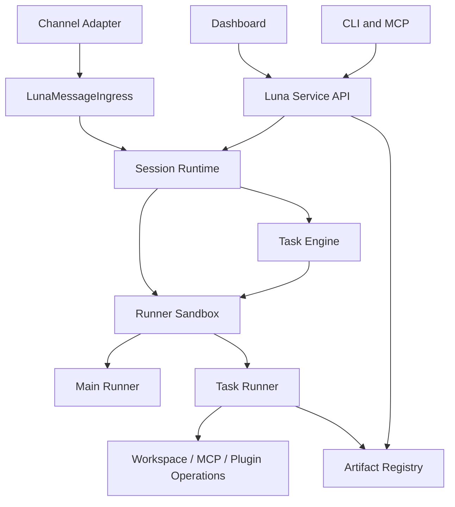

# Architecture Principles

## Design Goals

Luna is an agent system, not only a user-owned web application. It brings multi-channel messages, session context, durable tasks, runner execution, knowledge workspace, plugin operation dispatch, authorization, and Dashboard into one runtime.

Core goals:

- Users can naturally start work from direct messages, group chats, and Dashboard.
- Main Runner understands session context and chooses whether to reply, clarify, create a task, attach a task, or report task status.
- Task Runner executes long-running, deliverable, and evidence-heavy work.
- Runtime owns deterministic actions: database writes, channel sends, status card updates, runner scheduling, authorization checks, idempotency, and audit.
- Dashboard shows the full factual chain; external channels show only the summary, follow-up question, status, and result that users need.

## Layer Boundaries

Boundary rules:

- The channel layer owns provider integration, message normalization, reactions, message sending, and card rendering.
- The session layer owns session/thread resolution, timeline, context packs, Main Runner input, and session command execution.
- The task layer owns tasks, task runs, status cards, result delivery, retries, and task timeline.
- The runner sandbox layer owns container lifecycle, runner root mounts, IPC, provider-worker execution, and protocol parsing.
- The service layer owns HTTP APIs, CLI/MCP access, Dashboard, authorization, artifacts, knowledge workspace, plugin operation dispatch, and runtime state.
- Provider-specific payloads stay inside adapters or extensions; they do not enter Session, Task, or Dashboard core logic.

## Data And Resource Principles

Luna produces runtime data, then authorizes related users or signed-link holders to access it. Resource facts are managed by Luna, not by a local path or a runner process.

Resource rules:

- `artifact:<id>` is the durable internal reference.
- Signed `/artifacts/:id/preview` is the user-openable preview page.
- Signed `/api/artifacts/:id/content` is raw content access.
- The service owns artifact registration, storage, signing, preview metadata, and authorization.
- Durable resources visible to runners should cross process and sandbox boundaries as artifacts, not host-local paths.

## Runner Principles

Main Runner and Task Runner are Runtime-scheduled execution units. They do not directly own database writes, channel sends, or resource authorization.

Runner rules:

- Agent `type` selects the container-side provider adapter and `model` is passed to that runner. The retained `execution` field accepts only `container`; direct host execution is not a supported runtime mode.
- Runtime injects service URL, short-lived token, session/task/run id, artifact allowlist, and runner root as job-scoped runner environment.
- Container-start environment is limited to low-sensitivity sandbox facts. Dynamic secrets and model provider env are injected per job when the container worker spawns the real runner CLI.
- Runners access internal resources through Luna CLI, MCP, or Service APIs.
- When a runner generates a user-visible file, it must call `luna artifacts register <path>` before referencing the file in final output.
- Server-side local path fallback is not the long-term architecture.
- Prompt contracts, CLI commands, Service APIs, and web routes must be documented as separate interfaces.

## Channel Principles

Core business logic consumes provider-neutral abstractions. Adding a channel should add an adapter/factory and renderer, not provider-specific branches in Session, Task, or Dashboard.

Channel rules:

- Inbound messages are normalized before they enter runtime logic.
- Text, images, files, mentions, links, and card semantics are converted into shared content blocks.
- Outbound rendering decides how a given channel presents text, links, images, files, and status cards.
- Dashboard and external channels display the same Service/runtime facts through different presentation surfaces.

## Permission Principles

Authorization is based on canonical users, groups, operation grants, runner token scope, artifact related users, and signed links.

Key rules:

- Channel identity is not the authorization subject.
- Service bearer token should not be described as a user-facing model that can read arbitrary user resources.
- Main Runner token can operate only within its session scope.
- Task Runner token can operate only within its task scope.
- Artifact signed links are short-lived; after expiry, only an authenticated user allowed for the artifact can continue to access it.

## Documentation Principles

Architecture docs describe the current long-term design. They are not commit logs, and they do not preserve compatibility narratives for old data.

Each topic document should explain:

- What problem the subsystem solves.
- Which abstractions and persisted facts it owns.
- What it depends on and what depends on it.
- Key data flows and failure modes.
- What the non-goals are.
- Where the primary code paths are.

## Primary Code Paths

- `src/kernel/kernel.ts`
- `src/runtime.ts`
- `src/server/server.ts`
- `src/server/routes/index.ts`
- `src/channels/types.ts`
- `src/main-runner/main-runner.ts`
- `src/tasks/task-run-supervisor.ts`
- `src/runners/container-agent-runner.ts`
- `src/sandbox/container-lifecycle.ts`
- `src/sandbox/container-runner.ts`
- `src/artifacts/artifact-registry.ts`
