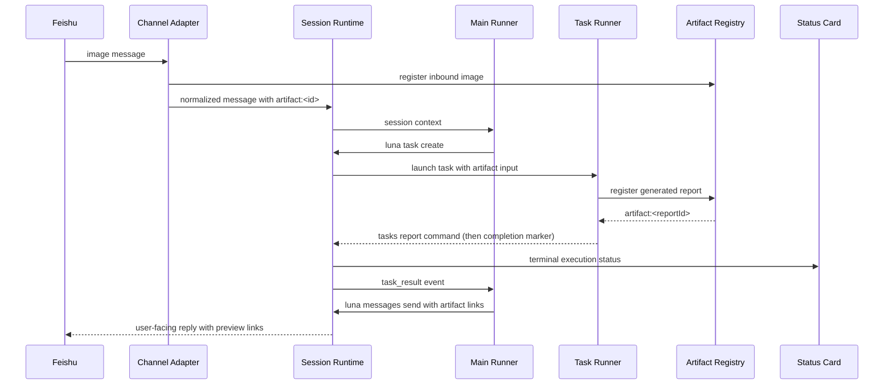
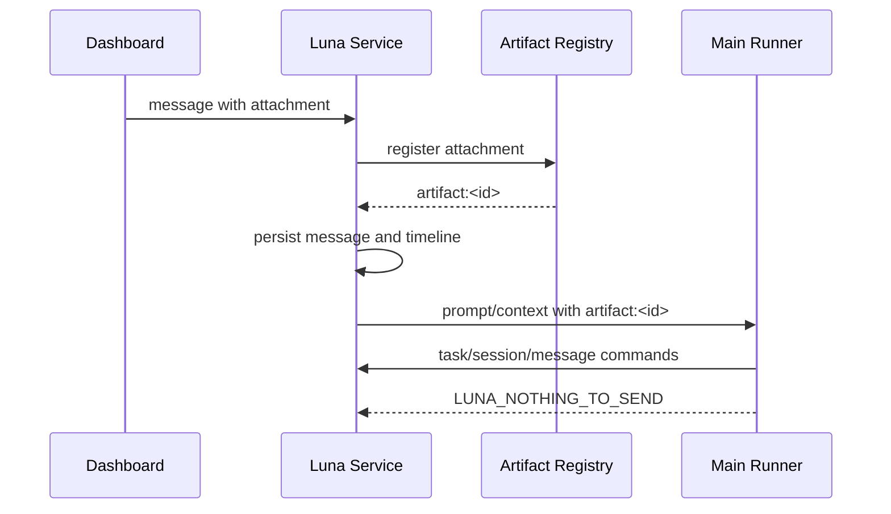
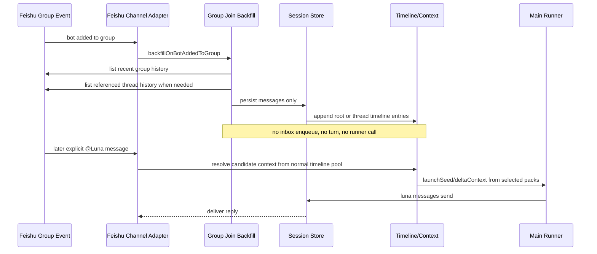
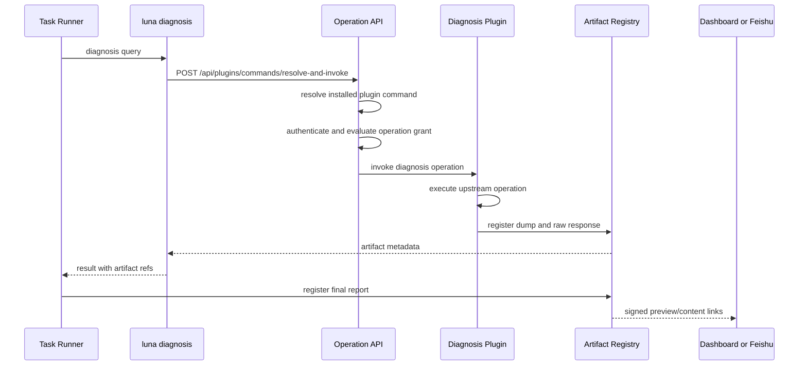
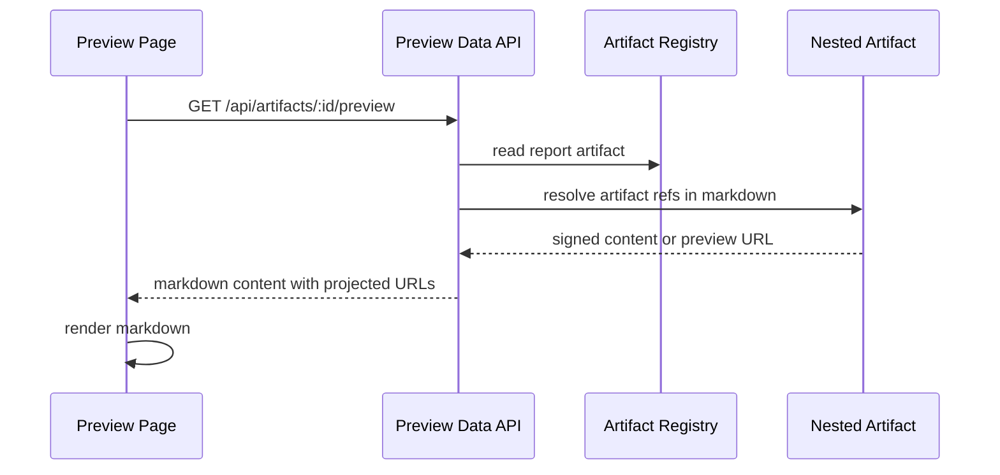
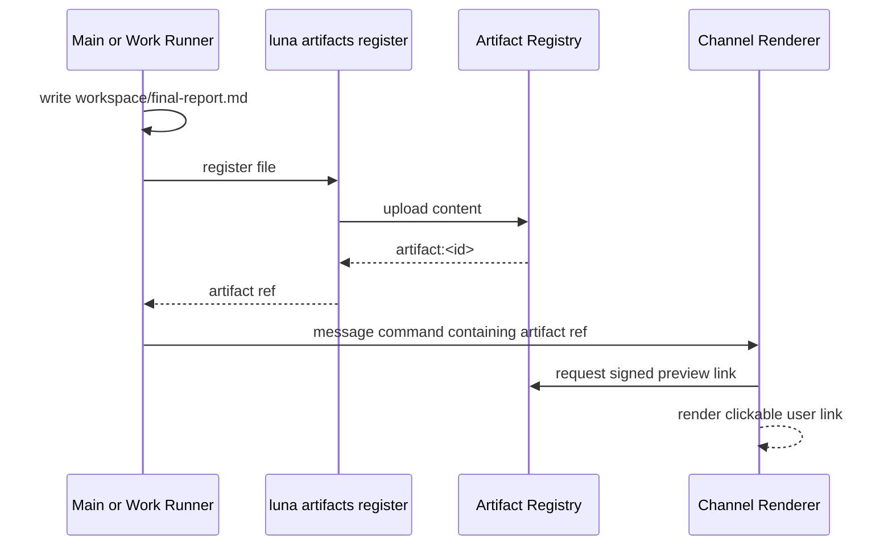

# End-To-End Flows

## Feishu Image To Report Artifact

## Dashboard Attachment To Runner Prompt

## Group Join Backfill To First Activation

## Plugin Diagnosis Dump To Share Link

## Markdown Report With Embedded Artifact

## Runner Local File To User Link

