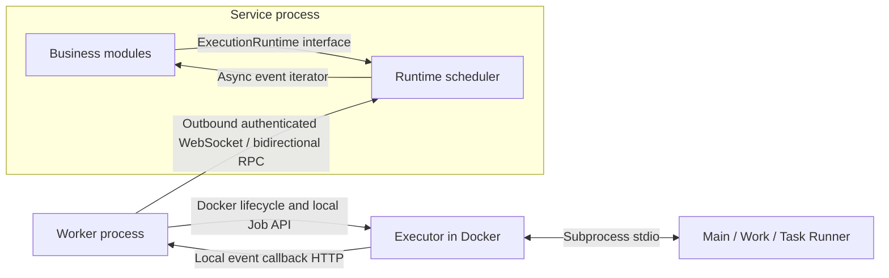

# Luna Execution Runtime

Shared execution modules are Bun workspace packages. Consumers declare
`workspace:*` dependencies and import `@luna/runner-protocol`,
`@luna/execution-store`, or `@luna/execution-transport` through their package
exports, rather than referencing package source directories. Protocol helpers
use explicit subpath exports such as `@luna/runner-protocol/reply` and
`@luna/runner-protocol/runner-assets`. The container builder installs the same
package manifests in a minimal workspace before bundling Executor entry points.

Luna Service owns an embedded Runtime scheduler. Business code calls the typed
`ExecutionRuntime` interface implemented by `Runtime`; Job submission,
credentials, file operations, cancellation, queries and event iteration use no
Service-to-Runtime HTTP or SSE connection. Runtime retains its own `runtime.sqlite`
and private credential files, separate from Service business tables.

Deployable applications live under `apps/`; shared libraries live under
`packages/`. Service, its embedded Runtime and the Service CLI remain in root
`src/` (`src/cli/server-main.ts`). `apps/cli` owns the user-facing `luna` HTTP
client and commands; `apps/executor` owns Executor and its container-side Runner.
Neither application imports Service internals or another application. CLI
utilities and HTTP helpers live in `@luna/cli-support`; shared API schemas,
artifact helpers and schedule calculations live in `@luna/service-client`.
Stream framing and provider failure types live in `@luna/runner-protocol`.

Each application declares its workspace dependencies and has independent
`build` and `typecheck` scripts. `apps/cli/dist/luna-client.js` is copied to root
`dist/` by the root build for existing deployment and npm packaging. Executor
builds `executor.js`, `job-main.js` and `job-process.js` under its own `dist/`.
The Worker build embeds these bundles and the CLI client in `luna-worker.js`. At
start Worker installs them under `<Worker home>/runner-runtime/<version>`, moves
the `current` link there, and every container mounts that root read-only at
`/opt/luna-runtime` and runs `current/executor.js`. Bun resolves the link at
start, so an Executor and the Jobs it spawns stay on one version. After a Worker
update, an idle container with an older Executor is stopped and started again at
its next admission, keeping its system layer; a busy one keeps its Executor until
then. The image still carries copies at `/app/agent-runner/dist` for Workers
without the mount. `container/` holds image definitions, wrapper scripts and
environment setup, not application source, so Luna code changes need no new image.
Worker lives in `apps/worker` as `@luna/worker`, with its own CLI,
manifest, typecheck and build. Service remains in `src/` and does not import
Worker implementation code; Runtime communicates with it through the execution
HTTP protocol. `luna worker bind|init|start|status` owns Worker administration;
`luna service` owns Service lifecycle and Runtime administration. The client CLI
forwards these namespaces to standalone component processes, preserving stdin,
stdout, stderr, exit status and SIGINT/SIGTERM. It resolves sibling bundles first,
then installed `luna-worker` / `luna-service` executables on PATH; source checkouts
also support their source entrypoints. The old executables remain compatible.
The client bundle does not import Service or Worker implementations; installations
with only the client report a missing component for local deployment commands.
Shared host
configuration, workspace path validation and managed Git helpers live in
`@luna/host-runtime`, which depends on neither Service nor Worker. Worker depends
only on this neutral package, execution protocol/store/transport and Zod.

Run `bun run --cwd apps/worker build` to produce
`apps/worker/dist/luna-worker.js`. The root build also copies this standalone
bundle to `dist/luna-worker.js` for existing deployment scripts. The Worker
bundle can run on a separate host with Bun, Docker and its private configuration,
without Service sources or Service dependencies.

Service loads `$LUNA_HOME/runtime/runtime.json`, overridable with `sandbox.runtimeConfigFile`. The same file defines the Runtime identity and any shared project metadata.

Service also owns the configured Runtime callback/admin listener (default 8091).
It accepts Executor events and authenticated deployment commands; Service-facing
Job/file HTTP routes do not exist. `runtime start` is retired; start Service
instead. The standalone `luna-runtime` executable and build entry are removed;
use `luna service runtime` for initialization and administration. Before upgrading, stop the old standalone Runtime and disable its service
unit. Keep existing IDs, configuration, database and credentials. Port conflicts
fail startup with a migration instruction rather than silently attaching remotely.
The obsolete Service HTTP client, Job/file HTTP routes, SSE transport and standalone
Runtime test host have been deleted. Kernel injects the same `Runtime` object that
it starts and closes; there is no alternate production Runtime implementation.

Startup opens Runtime before business recovery and API admission. Shutdown detaches
Service observers, stops scheduling and waits for in-flight local calls and scheduler
work before closing Runtime storage. It does not cancel durable Jobs or stop their
containers. While Service is down, Runtime scheduling/event collection also stops;
Executor processes may continue, subject to available credentials and Service API
dependencies. On restart, persisted assignments and cursors reconnect to the same
execution and reconcile its current/terminal snapshot. Live output emitted during
the outage is not replayed by Executor.

## Placement and execution

Runtime persists scheduling state and assigns Jobs to a ready registered Worker, local or remote. Worker prepares the environment. Registered Workers maintain an outbound authenticated WebSocket to Service; Runtime sends Executor control operations through that connection and Worker forwards them to its local Executor. Legacy direct registration remains for existing protocol tests and administration compatibility. Executor manages Runner process trees, credentials, retries, and terminal state. On missed terminal events, Runtime queries the assigned Executor and closes the Job using its snapshot. Executor keeps only accepted Jobs and process attempts in SQLite until Runtime confirms their terminal state and releases them. Service persists invocation authority and settles the business result it receives.

Platform Runtime uses `shared` within each Shadow. One persistent container serves that Shadow’s contexts. `runtime mode drain` pauses new admission while existing Jobs settle, and `runtime mode resume` reopens admission. Runtime startup, the mode API, and the CLI reject `isolated`. The offline converter writes `shared` into the replacement Runtime configuration.

Container names use `luna-exec-shared-<16 hex characters>`. The suffix hashes the Worker ID and the Shadow environment ID so names remain stable across restarts.

## Project and context storage

Worker gives Runner subprocesses its host UID and GID. Both modes bind-mount Worker-local persistent HOME and Runner directories. Service supplies logical context/runner identifiers, role and dynamic context JSON. Worker resolves its own paths and renders instructions from synchronized templates. Service records the returned instruction fingerprint before submitting a Job; a changed fingerprint invalidates the old provider session. Executor sets `cwd` to the Worker-resolved directory. Service and Worker host paths need not match. When resolving a session or task context without a Runtime origin, Service atomically clears the old provider session ID and last run ID and records the current Runtime origin. The next invocation starts a fresh CLI session, just as after an incompatible model change. Context identity, conversation records and working files remain in place; old provider history is not resumed or migrated. This reset happens once, before preparing the invocation. Contexts already owned by another Runtime remain rejected. The Service validates the resulting Runtime origin before provisioning a Job.

Worker mounts public commands, Memory, Skills and projects below HOME. User-level software and provider configuration are persisted in each Shadow’s host HOME at `agents/<agentId>/shadows/<shadowId>/`. Session and task working files are stored in the Shadow’s `runners/` directory. See [Runner layout and mount configuration](runner-sandbox.md#files-and-tools).

Worker `projects: [{ projectId, hostPath }]` retains host-side project configuration and project IDs for routing and context affinity. The Executor mounts the Shadow HOME and selected resources. Runner working files live under the context’s `workspace/`. Existing host project files stay in place.

Executor's control credentials and SQLite ledger are root-only. Each Job's Service token is scoped and checked against its durable invocation. Executor injects the token and Service URL into that Runner's environment, which the existing CLI reads directly. A running process keeps its launch-time token. New attempts use the latest supplied credentials.

## Transport and recovery

Control endpoints use HTTP and role-specific bearer credentials. Worker and its published Executor control ports listen on loopback. The Service listener accepts Worker binding, resource downloads and authenticated WebSocket connections at `/api/worker/*`; remote bindings require HTTPS (normally terminated by a reverse proxy supporting WebSocket upgrades). Worker registration credentials are independent of Dashboard sessions and Job credentials. Service and the Runtime callback port must be reachable from the local Docker environment. Executor reports events to Worker using local HTTP POST; Worker relays them over its authenticated Service connection. Runtime provides a cursor-based async event iterator to Service. A Service restart also restarts its embedded scheduler and reattaches to the same durable Job. A container restart records unfinished Jobs as interrupted. Executor snapshots replace provisional streamed text with the provider-confirmed final answer on success, persisting it in `finalText` and `result`. Codex requires `turn.completed`; Claude uses its successful `result` event. Service reads the confirmed `finalText` after completion or reattachment, including an explicitly empty result. A succeeded snapshot without this field is a protocol failure; aggregated logs and streamed commentary are never fallback replies. Main and Work accept valid final replies into the existing message command queue before settling their invocation.

Job cancellation signals the Job's subreaper. It terminates only that process tree, including detached descendants, so concurrent Jobs can share the Worker UID. Rate-limit retry uses the same Job and an Executor-managed retry budget.

For local setup and pairing, see the [README](../../README.md#start-service).

## Execution storage and cleanup

Executor has exactly two durable tables: `executor_jobs` (request, binding, snapshot and retry state) and `executor_attempts` (attempt times, process identity and exit facts). Runtime owns the historical terminal result. After Runtime persists that result, Worker verifies the terminal state, releases the reservation and removes the Executor Job and attempts. Retrying release also retries cleanup. Runtime removes the Job credential file and marks the record outside the indexed pending queue only after release succeeds.

Executor credentials, context registrations, event batches and callback configuration live in memory. Worker supplies control credentials and instance identity in deployment configuration; it re-registers the working directory when preparing an environment. Runtime supplies invocation credentials and callback credentials. Container restart marks accepted unfinished Jobs interrupted; it never resumes their Runner processes or reuses saved credentials. A terminal snapshot remains queryable until release, including when its live event was lost. Live events use a bounded per-Job memory queue and are never replayed.

Runtime and Executor query indexed pending/active records during scheduling, rather than parsing historical Jobs on every tick. Removing a drained Shadow container releases its published port and deployment credentials; a later environment can reuse that port.

File operations use a Service → Runtime interface call followed by Runtime → Worker → Executor HTTP calls. Worker holds the environment lock through a synchronous Executor file request and a completion barrier before releasing occupancy. A lost response is not background-replayed. The barrier revokes an in-memory file lease, so a delayed request cannot execute after occupancy is released. On Worker restart, lease revocation (or a confirmed stopped container) lets Worker release abandoned file occupancy. File writes remain atomic replacements; file requests and results have no durable operation ledger.

Deleting a session or task removes its Service invocation/job payloads, resource pins and context origin in the deletion transaction. The existing deletion manifest retains only Runtime/Job identifiers until Runtime cleanup succeeds, including after Service restart or Runtime downtime. Runtime deletes event, request and result bodies, retaining only the released Job ID to reject stale resubmission. Runtime can finish releasing a persisted preparation after the settled Service invocation is deleted. The Worker still checks its reservations before releasing it. Task-owned executions retain their task ownership and original session ID when only the associated session is deleted. These are explicit deletion/release rules, not timed retention or settlement-ACK protocols.

## Local and remote Worker registration

Local pairing is explicit: `luna worker bind --local --service http://127.0.0.1:8090` reads the Service Runtime admin configuration once, registers over its authenticated local API, and persists the binding in Worker home. Service startup never scans Worker files; Worker startup never reads Service files. Deployments may run Service without a local Worker. When deployed, the configured home Worker is protected from unbinding; Dashboard pause or resume changes admission for that Agent only. Jobs already assigned to a Worker can finish. Runtime maintenance can drain the entire Worker. A local Worker still needs an explicit Agent assignment using that Agent’s binding code. Remote `luna worker bind --service https://…` consumes a ten-minute, single-use code issued from the target Agent’s Workers page and persists a distinct Worker credential in `$LUNA_WORKER_HOME/binding.json`. Worker starts its outbound connection and sends health every ten seconds. Dashboard shows connection state, readiness, desired/applied resources, capacity, projects and pause/resume controls. Disconnected or unready Workers do not receive new placements. Existing contexts normally retain affinity; idle contexts and unreserved jobs can rebuild after the bounded failure checks below.

Service publishes immutable scoped resource snapshots. Worker downloads only the snapshot authorized for its Shadow placement; the former global resource download and in-place synchronization are removed. Invocation preparation references remain until trusted Service settlement and reservation release, without a timeout-based expiry. Job selection must match the prepared snapshot and mounted environment. Executor images must still be provisioned on each host with the configured digest; resource downloads do not distribute images.

Project names are scoped by the selected Worker for reverse-connected Workers; two Workers advertising `shared` do not imply shared files. The scheduler chooses an eligible node for a new context and normally preserves that choice; recovery can explicitly replace it before execution reservation. The first release uses capacity/project readiness selection; explicit per-task Worker selection is not exposed in Dashboard.

Resource payloads use bounded JSON/base64 downloads (128 MiB decoded). Worker stores immutable scoped snapshots and applies a new version only after the previous preparation references and reservations are released. Intermediate events can be lost during disconnection; durable terminal snapshots reconcile results.

On Linux, Executor event callbacks use a separate authenticated callback-only listener, default Worker port + 100 (8192), configurable with `callbackHost` / `callbackPort`. It must be reachable from the local Docker network, not from the public Internet. It accepts only Executor event POSTs and rejects control operations. Worker and Executor control listeners remain loopback-only. Docker Desktop uses the existing host-gateway callback path.

### Capacity admission and queued jobs

Service Runtime persists waiting jobs in `scheduled_jobs` and retries them on
scheduler ticks. Context routing and preparation establish stable Worker
ownership without reserving execution capacity, so a full but ready Worker can
prepare a new context before its job enters the queue. Routing prefers Workers
with free capacity when possible.

Before reserving **every** unassigned job (including jobs in existing contexts),
the scheduler checks the global `maxConcurrentJobs` limit and the selected
Worker's readiness, heartbeat, drain state and `capacity`. Checks and the durable
reservation share one SQLite transaction. Worker occupancy is conservatively
counted as the maximum of reported active reservations and nonterminal jobs
already reserved by Service, covering dispatch before the next heartbeat.
A capacity shortage leaves the job `queued`, with no Worker reservation, for a
later tick; an unavailable affinity Worker is replaced only through the explicit pre-execution recovery flow below. Failed admission
does not consume global capacity or prevent other eligible queued jobs from
being considered. Already reserved jobs continue reconciliation and cancellation
without re-admission. Queued cancellation needs no free slot. Terminal jobs
release Service capacity; stale Worker occupancy may delay admission until the
next heartbeat. These rules apply to both local and remote Workers.

### Bounded delivery and context rebuilding

Runtime stores the last observed heartbeat separately from WebSocket connectivity:
a closed connection prevents admission immediately, but does not erase a recent
heartbeat. Context preparation makes at most two calls to the original Worker
(total, not two additional retries). Explicit client/authorization rejections are
not retried. Two transient failures with a heartbeat in the last 30 seconds fail
preparation with `worker_delivery_failed`. If the heartbeat has expired, Runtime
persists the new context owner before preparing a ready replacement advertising
the same project. Preparation retries and restart use that persisted owner.
Recovery of the old Worker does not move the context back. No old project files
or provider session data are copied.

The existing `runtime_prepared_contexts` table also stores the preparation input.
It supports rebuilding a job still in the Service queue, before it has a Worker
reservation. Preparing a context with an outstanding reserved job never changes
its owner. The replacement contributes its paths, environment and resource
revision. A Worker-qualified instruction fingerprint invalidates the previous
provider session through the existing Service context rebuild path. For queued
jobs, Runtime removes the old provider session ID and prefixes the supplied
prompt with an environment-reset notice; it does not invent missing history or
assume old filesystem changes exist. Original submission hashes are retained for
caller idempotency while effective dispatch hashes describe the rebuilt input.

Placement before an Executor assignment is also bounded. When an unassigned
job keeps failing (for example `docker_operation_failed`, `prepare_conflict`,
`no_worker_available`) for `preparationFailureTimeoutMs` (default three
minutes) since its first failure, Runtime records `failureReason`, requests
cancellation through the normal preparation-cancel path, and settles the job as
`failed` with that reason once the Worker confirms. Expected waits
(`capacity_exhausted`, `context_busy`, pending cancellation) do not count.
Nothing has executed at this point, so no external effect is abandoned. Service
raises the reason as the error code, and the session reports it to the user as
a normal error reply instead of leaving the turn running.

Worker records whether a reservation was sent to an Executor (`executorBound`,
persisted before the first Executor call). A reservation never sent can be
cancelled without starting a container; one that was sent, or an older record
without the flag, still requires Executor-fenced cancellation.

Executor delivery reuses the same job/assignment IDs and durably counts at most
two submission attempts, including across Service restart. A failed response is
followed by a query; a reservation with sequence zero is not an accepted job.
Confirmed acceptance resumes tracking without resubmission. After two failed
sends, an unreachable or unqueryable attempt remains `reconnecting` with
`execution_state_unknown`, retaining its reservation and owner. Further recovery
is query-only (five-second backoff), not a third POST or a fresh job elsewhere.
A negative query is fenced by confirmed cancellation before reporting delivery
failure, so a late POST cannot start the abandoned attempt. This initial version
only automatically switches before execution reservation; dispatched attempts
are reconciled or failed on their original Worker. There is no execution lease
or automatic replay of uncertain external effects.

## Shadow placement and context routing

Runtime persists Shadow placement in `shadow_placements` and context routing in
`shadow_context_routes`. New contexts select an authorized, connected, ready
Worker with matching protocol and project capability. Available Workers already
serving the Shadow are preferred. Full Workers use the normal waiting and
reservation flow; existing contexts retain their selected Worker.

Each Worker reuses a persistent HOME and container for a Shadow. Service owns
Agent memory and business facts; local tools, working files and provider session
state remain on the selected Worker.

### Bounded offline recovery

Context preparation uses `/v2/context-prepare` and retries eligible requests at
most twice. An unreserved context can move after the original Worker becomes
unavailable and has had no heartbeat for 30 seconds. Draining, capacity waits,
resource waits and explicit rejection use their own handling. Reserved Jobs,
unknown outcomes and active file operations retain their original Worker.

A switch invalidates preparation caches and schedules release of the old
preparation. The target recreates context files and mounts the invocation's fixed
snapshot. Queued work keeps its original request hash for Service idempotency,
while its accepted execution request is updated before reservation. Old provider
session IDs are cleared and the next launch explains the rebuilt environment.
Files remain on the original Worker; this is not filesystem migration.

### Scope and resource checks

Version 2 Job requests require `scope: { agentId, shadowId, placementGeneration }`,
`resources: ResourceSelection` and a matching resource revision. Service creates
Jobs from the invocation's persistent resource reference and prepared context.
Missing preparation, foreign scope or a different snapshot fails. Runtime,
Worker and Executor compare the complete scope, selection, request hash and
assignment; a correct digest alone does not authorize another Shadow.

Assignments and both Job and maintenance reservations carry `ExecutionScope`.
Environment handles must match accepted ownership. Version 2 environments use
shared mode and keys derived from the environment namespace and full scope.
Concurrent generations cannot run against the same HOME while an older
container or reservation remains active. The Executor control volume is fixed
to its deployed scope and resource selection.

Context registration and Job acceptance validate the deployed environment.
File operations route by `contextId` to the registered directory in that
container; existing assignment authorization and synchronous file-lease
revocation remain the control boundary. Health reports scope, selection,
instance ID and `shadow-scope-v2` capability, all checked before readiness.

### Preparation settlement

Context preparation and Job reservations carry `invocationId`. Runtime persists
preparation intents before requesting Worker so a lost reply does not lose
release responsibility. It releases preparation only after trusted Service
settlement and after that invocation has no unfinished Runtime Jobs. Failed
release requests persist and retry after scheduling ticks or restart.

Worker preparation records bind invocation, context, generation and resources.
Released records retain tombstones that reject late preparation. Downloads and
writes recheck the reference before modifying HOME. An old release cannot
release a newer invocation. A Job with an active preparing, ready or cancelling
reservation blocks preparation release.

### Container resource changes

Worker checks the image, resource selection and container limits
(Runtime `resources`: memory, CPUs, pids) before reusing an environment.
A new snapshot or limit waits for old preparation references and reservations to
drain, then switches the snapshot link or runs `docker container update` in place.
Only a new image replaces the container (resetting its writable system layer)
while preserving writable Shadow HOME. Other
Shadows retain their environments. Snapshot cleanup and physical process
shutdown are separate from invocation settlement.

Runtime `resources` are Service-wide requests. Each Worker caps the CPU quota
at the CPU count its Docker daemon reports, so a default larger than a small
host still starts; memory and pids limits are passed through unchanged. Docker
failures keep the daemon's stderr in the Worker log and error details.

## Worker-owned images

Service Runtime initialization neither accesses Docker nor chooses a Runner
image. `worker init` resolves an image digest and writes local `worker.json`;
`worker bind` writes Service origin and credentials to `binding.json`;
`worker start` validates both and checks the local image and readiness.

Worker reports its image and capabilities. Jobs use the selected Worker's image,
so Workers can have different toolchains. Agent authorization, routing and
context affinity determine placement. Updating a Worker's image requires
stopping or draining execution and updating its local configuration; rebinding
does not replace an image. See [Runner images](runner-image-variants.md),
[Worker storage](worker-storage-layout.md) and the
[deployment guide](../runbooks/deploy-luna.md).
