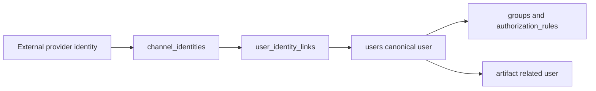

# Identity And Users

## Concept Boundaries

Luna handles external channel identities, internal users, authorization subjects, and artifact access relationships. These concepts must stay separate:

- **Canonical User**: Luna's stable internal user and the subject for authorization and audit.
- **Channel Identity**: an external identity snapshot visible in a channel, used for display, mentions, and provider debugging.
- **Related User**: the human user associated with a Luna-produced resource and authorized to access the artifact produced by that interaction.
- **Group/Channel Surface**: the place where a message happened; it is not the owner of a resource.

Luna is the agent that produces runtime data. Human users are not the sole producers of all Luna data, but Luna can authorize the relevant human user to access resources produced by their interaction.

## Canonical User

`users` is Luna's canonical user table. `kind` can be `human`, `bot`, `service`, or `system`, representing the subject types understood by the runtime.

Canonical users:

- Act as the authorization subject for Dashboard, CLI, MCP, and Service APIs.
- Participate in group membership and operation grant evaluation.
- Provide a stable identity for audit, resource access, and visibility decisions.
- Can connect multiple channel identities or login identities.

Authorization must not be granted directly to channel identities. External channel ids, open ids, union ids, local ids, or SSO claims should first resolve to a canonical user.

## Channel Identity

`channel_identities` stores external channel identities and profile snapshots such as Feishu open_id, union_id, avatar, and display name. It is a provider-neutral external actor record, not an authorization subject.

Channel identities:

- Display message senders, mention targets, and profile data.
- Preserve provider raw profile snapshots for debugging.
- Resolve canonical ownership through `channel_user_bindings`; claim evidence is recorded separately in `identity_observations`.
- Support channel rendering and provider fallback behavior.

`user_identity_links` connects canonical users to abstract identity claims such as `lark/open_id`, `wechat/open_id`, `sso/user_id`, or `local/local_id`. One canonical user can be linked to multiple channel identities.

## Profile Trust And Refresh

Channel identity profile fields are not all equally trustworthy.

Current rules:

- Strong sender or directory snapshots may update canonical channel-profile fields such as display name and avatar.
- Low-confidence mention-only snapshots are allowed for mention resolution, but they do not overwrite canonical profile fields.
- When a field is unknown, Luna prefers leaving it empty over filling it with a guessed fallback string.
- Later stronger channel signals can then fill missing display or avatar data without first undoing a synthetic placeholder.

This is important for imported history and mention enrichment, where the first seen profile may be incomplete.

## Bot And Human Classification

Canonical user kind should come from explicit provider signals, not display-name heuristics.

Current rules:

- `identity.kind === "bot"` maps to canonical `bot`.
- provider mention metadata such as `mentioned_type: "bot"` also maps to canonical `bot`.
- explicit `system` signals map to canonical `system`.
- plain user identities map to canonical `human`.

Luna should not special-case its own bot identity by matching display names such as `"Luna"` or other label keywords.

## Related User

Related user is the artifact access concept. It replaces the older `created_for_user_id` mental model: the resource is produced by Luna, but a relevant human user from the interaction should be authorized to access it.

This is more precise than "owner":

- The resource fact is managed by Luna Service.
- The actual producer may be a runner, diagnosis tool, or channel adapter.
- The human user is the person authorized to access the interaction output.
- After a signed link expires, the related user can still access their related artifact through authenticated authorization.

Related users affect Dashboard visibility, artifact access policy, Feishu reply link usability, and audit explanation.

## Group Chat Association

Group chat messages have two dimensions:

- The message occurred in a group/channel surface.
- The interaction may still be associated with the sender or another explicitly identified related user.

Images, files, or reports from a group chat can be related to the sender or relevant user. This does not change the group context for the message, and it does not make the group itself the user subject for the artifact. Channel-level context is still represented by session, surface, and timeline facts.

## Permission Impact

Authorization should be read in this order:

1. Resolve the request, login session, or runner token into a canonical user or runner scope.
2. Evaluate operations through user, group, and operation grants.
3. For artifacts, additionally check signed link validity, related user, runner scope, or internal service authority.
4. Dashboard, Feishu, and CLI should present the same authorization facts in surface-appropriate ways.

Service bearer token is a service operation. It should not be described as a user model that can read other users' resources arbitrarily.

## Data Flow

When an inbound message reaches Luna, the adapter first converts provider identity into `ChannelIdentity`. The identity directory then materializes or resolves a canonical user from the channel identity and identity claims. Authorization, audit, and artifact access are based on the canonical user or runner scope.

## Primary Code Paths

- `src/data/schema/users.ts`
- `src/data/schema/channel-identities.ts`
- `src/channels/identity-profile-trust.ts`
- `src/identity/identity-directory.ts`
- `src/server/policy/authorization-subject.ts`
- `src/permissions/permission-engine.ts`

## Display-name fallback

User display names are resolved when identity/message data is written, and persisted in
`users.display_name`. `profile_source=mention` distinguishes a message mention fallback
from official channel data and manual profiles. Valid mentions update missing or
mention-sourced names through an existing scoped identity link. Manual and official
names take precedence; empty names and ID placeholders never overwrite valid names.
Official profile refresh promotes a mention name to channel source, even when the text
is identical. Avatars update independently; absent avatars render name initials.

Dashboard
reads use the user table directly and never aggregate mention history for display names.
Name provenance affects profile updates only, never identity matching or authorization.

Feishu user and mention profile caches expire after one hour on success and five minutes
on failure. The next event retries an expired lookup; there is no polling task.

### Dashboard user deletion

Administrators logically delete users with `DELETE /api/users/:id`. The current
user and system reply identities are protected; active bot session references,
unfinished messages or tasks block deletion with 409. The transaction marks the
user deleted, removes identity observations, channel bindings, links, memberships
and permissions, revokes tokens and login grants, and disables schedules.
Historical authors and audit references remain.

Deleted users cannot authenticate. Lists hide them, while historical references
show a deleted-user label. Associated Agent owners can inspect read-only history;
management and writes remain disabled. A later external message creates a fresh
normalized identity without inheriting old grants.

### System reply identities

Each Shadow has its own `kind=system` reply user. Verified provider bots link to
that user through the active binding. Rebinding does not merge Shadows or rewrite
historical authors. Deletion protection follows `kind`, not identity spelling or
profile provenance. An ordinary bot cannot be deleted while an active session
still references it.

### Message authors and directory presentation

MessageStore requires a canonical user or a normalizable channel sender.
Normal replies and work-status cards validate the Shadow reply user, active scope
and original binding through `SessionStore.requireReplyUserId`. Authors are not
inferred from delivery receipts. The raw assistant-write entrypoint still needs
stronger author-consistency checks; internal events have separate authors.

Dashboard sessions use the selected Shadow's reply user. External bots are linked
through `recordShadowBotIdentity`; provider claims are displayed from observed
identities. Authenticated Dashboard sender identity is associated with the same
canonical user used for persistence.

Runners use `luna users search --query <name>` and `luna users get <ID>`, optionally
filtering `--kind user` or `--kind bot`. The directory checks local associations
first and delegates group lookup and identity normalization to the channel
adapter. Bot association requires a unique verified name and confirmed group
membership. Feishu mentions use the sending application's `open_id`; different
application observations may link to the same canonical user.

## Channel identity persistence

The database stores `channel_user_bindings` (one canonical user per channel identity) and `identity_observations` (many channel observations per canonical claim). `user_identity_links` now owns only the canonical claim; its old `channel_identity_id` column is removed. Message persistence, recipient lookup, runner directory and Dashboard projections read channel ownership from the binding table. They no longer let the last bot observation overwrite another bot's link.

Materialization is transactional, including directory profile updates. Conflicting canonical claims or a conflict between an existing channel binding and a claim fail without automatically merging users. A human identity cannot silently change into a bot. Verified self-bot binding uses the current Shadow reply user. Once the previous Bot user has no remaining channel bindings or identity links, Luna records the Shadow reply user as its canonical identity. Historical message authors keep their stored IDs. The global luna-bot module and its historical-author rewriting path have been removed.

`feishu-identity-scopes.ts` builds provider claims using the authenticated application scope: `open_id` uses `app:<appId>`, `user_id` requires `tenant:<tenantKey>`, and `union_id` requires a trusted `developer:<developerId>`. Feishu and Lark namespaces are separate. Inbound normalization, history backfill and post-enrichment identity rebuilding use the shared builder. Ordinary external-ID observations use a channel scope. Empty or wrongly scoped Feishu/Lark claims are rejected. Trusted developer metadata still needs to be wired into channel configuration before union-based cross-application association is available; an unscoped union ID is not used as a substitute.

