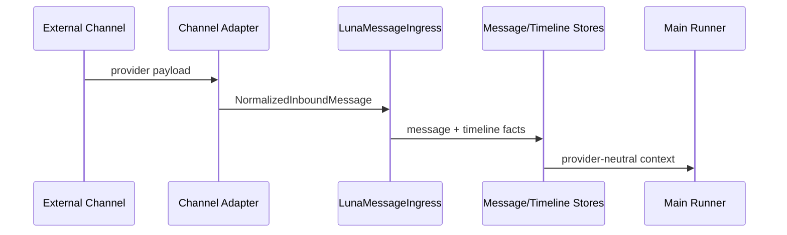

# Messages And Channels

## Core Abstractions

The channel layer converts external provider payloads into Luna's internal abstractions. Core business logic handles provider-neutral messages, identities, surfaces, mentions, and content blocks.

Main objects:

- `NormalizedInboundMessage`: the inbound message emitted by adapters into Luna runtime.
- `ChannelIdentity`: a sender or related actor visible in a channel.
- `ChannelSurface`: the place where a message occurred, such as p2p, group, thread, or webhook.
- `ChannelMention`: a structured mention with a target identity.
- `MessageContentBlock`: a content block for text, images, files, links, cards, and related content.

Provider raw payloads are for audit, debugging, and fallback only. They should not become the long-term input contract for Main Runner or Task Runner.

## Message

`messages` is the provider-neutral durable message fact. A real external message is stored once with one explicit `owner_session_id`; other sessions may reference that same fact through timeline entries. Only session merging moves ownership. Deleting the owning session scrubs the message into an immutable content-free tombstone (`deleted_at`); references remain visible as “Message deleted”. Deleting a referencing session removes only its timeline entries. See `sessions-main-runner.md` for deletion and file cleanup semantics.

Message facts usually include:

- Channel identity: `channel_type`, `channel_id`, `external_message_id`.
- Sender: `sender_identity_id`.
- Content: `role`, `content_kind`, `presentation_kind`, `content_json`.
- Audit: `raw_payload_json`.

`session_timeline_entries` is the message-list view for a session. It can point to a real message or project a message from another surface as a reference into the current session context. Dashboard session detail, Main Runner context builder, and Task source context all use timeline entry as the smallest discussable unit.

Imported history uses the same message model:

- Group-join backfill normalizes provider history through the same provider-neutral message abstractions used for live inbound traffic.
- Imported history becomes ordinary `messages` plus timeline entries with ingest metadata, not a special temporary cache.
- Imported history may later participate in activation or thread context selection, but import itself never triggers runner execution.

## Attachment

Attachments can start from three places:

- External channel attachments, such as Feishu images or files.
- Local files cached by a runner workspace or channel adapter.
- Existing `artifact:<id>` references.

User-facing durable references should become artifacts. Runner prompts may use locally materialized files as runtime input, but final output, Dashboard links, and Feishu replies should not depend on local workspace paths.

## Channel Adapter

Channel Adapter owns the provider lifecycle and conversion boundary:

- Receive provider events or poll messages.
- Normalize provider payloads into `NormalizedInboundMessage`.
- Resolve sender, surface, thread, mentions, content blocks, and addressing.
- Send outbound text, images, files, links, and interactive cards.
- Isolate provider-specific SDKs, raw payloads, and rendering details.

For Feishu, the adapter also owns bounded history backfill and message enrichment:

- group history listing when Luna is newly added to a chat
- thread history listing for thread ids referenced by imported group messages
- sender, surface, and mention-target profile enrichment
- interactive-card markdown extraction for imported card history
- sender-type normalization so imported bot/app outputs are persisted as assistant-role messages rather than human user messages

Adding a channel should add an adapter/factory and renderer. It should not add provider-specific branches to Session, Task, or Dashboard core logic.

## Multi-Channel Interface

The multi-channel interface must allow the same business facts to run across different presentation surfaces:

- receive: accept channel messages.
- normalize: convert them into provider-neutral messages.
- persist: write messages, identities, surfaces, and timeline entries.
- attach: register or convert channel attachments into artifacts when needed.
- render: present text, links, images, files, and status cards according to channel operations.

Dashboard, Feishu, CLI/local, and future channels share the same Service/runtime facts. Differences should stay in adapters and renderers.

## Inbound Data Flow

The key invariant is that runners see Luna-selected context, not provider raw payload.

The `#steer` command checks the persisted sender and Agent are active before interrupting an active turn.

The same invariant applies to history backfill: provider history is normalized first, persisted as Luna facts, and only later selected into runner input through normal context-pack logic. Group-join backfill rechecks the original bot binding after provider reads and enrichment before it resolves a thread or writes a message. A binding retired during the fetch cannot supply history to a replacement Shadow.

Processing markers follow the shared Session turn lifecycle:

- The channel adapter begins processing for every accepted inbound message.
- Session batching may assign one message as the trigger and additional messages as
  coalesced inputs, but all remain independently marked in the provider.
- `SessionTurnProcessor` completes processing for every inbound in the batch from a
  shared `finally` path, regardless of success, failure, or cancellation.
- Provider sends may clear the current message marker as an idempotent fast path,
  but they do not replace the turn-level batch cleanup.

## Outbound Rendering

Outbound rendering chooses a presentation based on surface operations:

- Dashboard can show full timelines, artifact lists, previews, and debug information.
- Feishu and similar channels show summaries, status cards, clickable links, images, or files.
- CLI/local surfaces show text, JSON, or local materialized file paths.

The same artifact can appear as a Dashboard preview, a signed Feishu link, and an internal runner `artifact:<id>` or materialized path.

Work-session status-card updates keep the provider-neutral message fact authoritative:

- When updating an existing status card, Luna persists the new card body and terminal
  state before attempting the provider update. A provider outage must not leave
  Dashboard showing the earlier empty in-progress card.
- Provider adapters own bounded retries for transient transport failures. Feishu image
  uploads retry socket resets and timeouts, but do not retry explicit provider
  validation or authorization failures.
- A failed provider update is logged as a delivery degradation after the durable
  result is stored; it does not erase or roll back the completed runner result.

## Boundaries And Non-Goals

Boundaries:

- Channel adapters own provider-specific parsing and rendering.
- Session/Task core consumes provider-neutral abstractions only.
- Artifacts own durable resource identity and access.

Non-goals:

- Do not treat provider raw payload as the core business model.
- Do not use channel identity as a substitute for canonical user authorization.
- Do not use local paths as cross-channel durable links.

## Primary Code Paths

- `src/channels/types.ts`
- `src/channels/registry.ts`
- `src/channels/normalized-inbound.ts`
- `src/shared/messaging/types/message.ts`
- `src/shared/messaging/types/contents.ts`
- `src/sessions/message-store.ts`
- `src/sessions/session-timeline-store.ts`
- `src/sessions/inbound/group-join-backfill.ts`
- `src/sessions/inbound/group-join-backfill-persistence.ts`
- `extensions/channels/feishu/messaging/feishu-normalizer.ts`
- `extensions/channels/feishu/messaging/interactive-card-content.ts`
- `extensions/channels/feishu/messaging/message-channel.ts`
- `extensions/channels/feishu/messaging/message-renderer.ts`

Downloaded Feishu images can carry optional display width and height in their stored image content block. The dashboard uses these dimensions to reserve space before the image loads. Messages without dimensions use a default frame.

## Session commands and trigger runtime

The current shared dispatcher, durable trigger ledger, asynchronous message
commands, target authorities, handoffs and schedules are documented in
[Session command runtime](session-command-runtime.md). Runner side effects remain
Service-owned; the runner submits commands and does not call provider SDKs.

## Dashboard direct session access

Dashboard is a management UI and direct session interaction entry point, not a
session delivery destination. The existing `DashboardChannel` name and
`dashboard/luna-dashboard` message provenance identify its HTTP ingress adapter;
they do not imply a `session_channel_bindings` row. Authenticated submissions
carry a trusted `targetSessionId`. The shared resolver loads that active session
directly, without adding a surface alias or outbound binding. Dashboard inputs
enter the session queue directly. Provider inputs resolve by their external surface
and use the active bot binding for surface-level reply matching. No Feishu identity is fabricated
for a dashboard user.

Creating a conversation in Dashboard inserts a local session with no external
surface or delivery bindings. Legacy non-null `sessions.channel_*` fields retain
Dashboard origin metadata for compatibility; delivery destinations come only
from external bindings. Migration removes earlier Dashboard bindings and retires
pending virtual deliveries while retaining historical receipts. Reading any
session in Dashboard never creates a binding.

The shared ingress handles control commands, normalized message persistence,
coalescing, `#steer`, and turn creation exactly as for other channels. Dashboard
message IDs are stable for a user/session/request key. Request retries reuse the
persisted message; different text under the same key is rejected. Runner replies
are persisted by the message command service with a bot identity and timeline entry.
The delivery receipt updates the message delivery status.
The UI reads those same timeline facts, including messages received from Feishu.

### Parallel outbound channels

`session_channel_bindings` is the structured delivery routing table. Each session
has at most one current surface/thread binding per channel instance. The existing
`session_surface_aliases` table remains the inbound lookup index, including old
provider aliases. `sessions.channel_*` describes the original surface for legacy
consumers; it is no longer the complete set of reply destinations. Migration
backfills original bindings and previously attached channel aliases.

`SessionReplyDispatcher` sends a logical reply to every bound adapter, regardless
of which channel supplied the input. Main message commands,
task notifications, and session message commands use this shared boundary.
Dashboard does not receive an outbound delivery: clients read the shared timeline.
A session with zero external bindings still completes its logical reply and
persists it through the message command service. Dashboard-originated input to a
Feishu-bound session uses that existing Feishu binding, without special forwarding. Transport-scoped control messages without a session (including private
login-token responses) remain on their originating adapter and are not broadcast.

The dispatcher freezes the destination list and normalized operations in
`session_reply_dispatches` / `session_channel_deliveries` before sending. Each
channel gets its own stable idempotency key, status, receipt, and error. The Feishu
adapter deterministically hashes oversized keys into a 43-character base64url
SHA-256 value to satisfy the provider UUID limit; shorter existing keys remain
unchanged. A failure
does not prevent attempts to the other channels. The logical send fails until all
required deliveries succeed; retry/restart skips successful deliveries. In-flight
calls share one promise within the service; interrupted sends have a 60-second
lease before retry with the same provider idempotency key. Exactly-once delivery
across a process crash still depends on the provider honoring that key.

The message command service persists one logical reply at acceptance, with one
canonical bot user and a timeline entry. Delivery updates its status and receipt.
A partial delivery remains inspectable in delivery records and is not treated as
a successfully delivered reply. The
logical message ID maps to each channel's physical message ID, so status-card
updates never reuse another provider's ID. New thread receipts bind the channels'
respective threads to one output session. Adapters may expose `getSessionSurface(sessionId)` to attach a child
session; Dashboard needs no such attachment. A peer without a thread receipt or a local session surface still receives
the reply in its bound parent surface; it cannot address the new child thread.
Local user mentions are rendered without treating canonical local IDs as external
provider mentions. Targets and anchors are resolved from each binding separately.

Service delivers quotes (`replyTo`), interactive action rows (`{"type":"actions","requestId":"...","options":[...]}`),
and inline mentions (`{"type":"mention","userId":"..."}`) solely as authored by the Runner
in its `luna.reply` document; Service neither auto-injects quotes or `@`-mentions on final
group answers nor blocks `replyTo` or inline user mentions on direct (`p2p`) Feishu chats.
Turn inputs (`<capabilities>` and `<events>`) include the resolved `surface` (`p2p`, `group`, or `thread`)
along with message/source IDs and requester canonical user IDs so the Agent can
apply conversation etiquette from its prompt instructions. On Feishu, interactive
card button clicks arrive through `card.action.trigger` on the WebSocket `EventDispatcher`,
where `CorrelatedRequestService.handleCardAction` deterministically resolves the pending
`ask` in `correlated_requests`, updates the card to its settled state, returns a toast, and
queues a `request_result` wake-up to the originating session without running an intermediate LLM turn. `channel_surfaces`
preserves provider chat mode metadata (`chat_mode: "p2p"`) so profile-less
internal notifications cannot reclassify a direct chat as a group. In a topic
thread, replies already post in place on the thread root, so `replyTo` is
ignored there while inline mentions still resolve as written.

### Luna identity and channel configuration

Each Shadow has a canonical system user for its replies. Dashboard conversations
can start on the Agent's default Shadow or an ordinary Shadow without a Feishu
connection. Feishu entry points resolve the Shadow from the active bot binding.
A verified application self identity is linked to the bound Shadow's reply
user. External bot names remain in the channel configuration.

YAML configuration loading parses and validates the file without querying SQLite.
The initial schema has no `channel_config_state` import marker, and configuration
loading does not consult historical migration metadata.

`channel_configs` stores the owning Agent, Feishu App ID, encrypted App Secret,
optional default chat, enabled state and verified bot identity.
`/agent/<agentId>/settings/channels` lists the Agent's Feishu bots. Adding a bot
verifies its credentials and creates its Shadow and binding in the same database
transaction. Editing keeps the bound Shadow and App ID fixed. Rebinding reuses
the previous Shadow when it is active and available. The form and query cache
are keyed by Agent.

Save verifies the application's bot before persisting. An empty secret keeps the
existing value, and disabling an existing configuration with its saved secret
works offline. Responses expose whether a secret exists. Adapter reload runs
after persistence. A reload failure is reported as saved with a runtime error.

App secrets reuse AES-256-GCM with channel-specific authenticated binding. The
service uses its configured Agent master key when present, otherwise creates an
owner-only `data/channel-config.key`; backups must retain that key with the database.
The key is not stored in the database or served to the browser.

Runtime adapters load enabled configurations for active Agents and Shadows with
active bindings. Existing channel configurations enter this model through the
offline migration. Dashboard starts with an empty channel list.
### Bot mentions in group conversations

Bot-authored messages can start a turn when the channel adapter reports an explicit mention of the receiving bot in a group. Self messages, ordinary replies, aliases and activation follow-ups do not start a bot-authored turn.

A Runner can use a JSON `mention` block with the recipient’s Luna user ID in `luna say --json` for its current group, including for a bot-triggered handoff. The command resolves the recipient's address in the sending channel and passes it to the adapter as structured mention metadata. Runner instructions reserve mentions for explicit next steps and direct ordinary replies, acknowledgments, and result reporting to the group without a bot mention. Feishu escapes raw mention markup in message text.

For inline placement, `luna say --json --stdin` accepts an ordered array of `{"text":"…"}` and `{"mention":"Luna-user-id"}` entries. The CLI expands it into `luna.reply` with `message` presentation and derives a deterministic idempotency key per invocation (`--repeat` opts into an intentional duplicate). On acceptance, the service validates mention targets in the current group's sending channel, fills missing mention display labels from canonical user / channel identity records, persists `message_mentions` rows on the outbound message for Dashboard rendering, and resolves channel addresses again on delivery. Feishu renders these blocks as Markdown with native mentions at the specified positions.

## Retired delivery records

The old `outbound_delivery_records` Store and table are removed. Session deletion
checks active `session_commands` and `session_channel_deliveries`; durable
`session_reply_dispatches` continue to group per-channel delivery attempts.
Legacy decisions and handoffs are no longer returned by session/task APIs.
