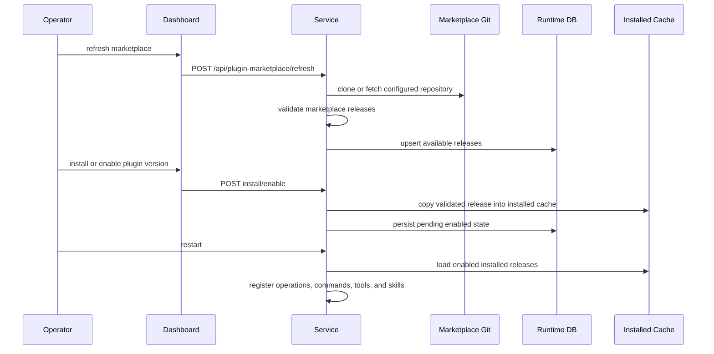

# Plugins And Marketplace

## Purpose

Plugins keep Luna Core generic while allowing trusted extensions to contribute domain-specific operations, CLI commands, runner tools, and skills. Luna Core owns installation, authorization, runtime dispatch, artifact attribution, and Dashboard management. Plugin source code and release packages live outside the core repository.

The first supported distribution channel is a trusted Git marketplace. This is intentionally simpler than a public marketplace: Luna is configured with a Git URL, an operator refreshes it manually, and installed or enabled plugin changes take effect after the Luna Service restarts.

## Repository Model

The marketplace repository is a sibling repository, for example `luna-plugins`:

```text
luna-plugins/
  marketplace.json
  plugins/
    example-plugin/
      manifest.json
      src/
      skills/
      release/
        0.1.1/
          example-plugin-0.1.1.tgz
```

`marketplace.json` is the index Luna reads during refresh. Each plugin release points at an immutable `.tgz` package. The package is the installable artifact, similar to an npm package tarball: it extracts to a release root containing the compiled runtime entrypoint, the release manifest, checksums, package metadata, and runtime assets such as skills.

Luna Core must not import marketplace plugin source files. Core code only reads marketplace indexes and installed release packages through the plugin contracts.

## Configuration

Marketplace configuration belongs to Luna Service:

```yaml
plugins:
  marketplace:
    gitUrl: "https://git.example.com/luna-plugins.git"
    branch: "main"
```

The service keeps a cloned marketplace cache under `LUNA_HOME` and records marketplace releases, installations, enabled state, and pending operations in the runtime database. Marketplace refresh is manual from Dashboard or API. There is no background sync in the current architecture.

## Release Validation

Refresh validates the marketplace index and release packages before they are exposed:

- plugin ids and versions must match manifest metadata.
- release package paths must stay inside the marketplace checkout and point at `.tgz` archives.
- package checksums must match the archive bytes before extraction.
- `plugin.js`, `manifest.json`, and declared skill files must exist.
- checksums must match the release contents.
- manifests must use supported Luna plugin contract fields.

Invalid releases are rejected during refresh. They are not installable and should be fixed in the marketplace repository.

## Install And Enable Flow



Install and enable operations are recorded immediately. Runtime registration is restart-based in this phase. This avoids hot-unload edge cases for operation handlers, command parsers, skill discovery, and long-running runner processes.

## Runtime Contract

Installed plugin releases export a plugin definition from `plugin.js`. Luna accepts a default export, a `plugin` export, or a named export whose shape matches the plugin definition contract.

At service startup, the installed plugin loader imports enabled releases and passes a `PluginRuntimeContext` to each plugin:

- `plugin`: installed plugin id, version, source, and marketplace metadata.
- `config`: plugin-scoped runtime configuration from Luna config.
- `logger`: plugin-scoped logging adapter.
- `workspace`: temporary file helpers for service-side plugin work.
- artifact and operation host APIs exposed by the plugin contracts.

Plugin handlers should use host APIs for artifacts, logging, and operation results. They should not depend on Luna Core private modules.

## Authorization

Plugins declare operations in their manifest. Luna Core owns all authorization:

- operations are registered with provider type `plugin` and source plugin metadata.
- Dashboard can show which plugin contributes each operation.
- users or groups receive grants through Luna's operation policy model.
- a request without a grant is rejected before plugin code runs.
- invocation audit is generic for all operations and retained for seven days.

Plugins do not implement user-level authorization themselves. They can validate input and enforce upstream-specific constraints, but Luna decides whether the caller may invoke the operation.

## CLI Commands

Plugins may contribute CLI command namespaces. Luna CLI does not import plugin code. For service-backed plugin commands, the CLI forwards the raw command path and argv to Luna Service. The service resolves the installed plugin command parser and dispatches the resulting operation invocation after authorization.

This keeps service-side credentials and configuration in the service process. Plugin command arguments must not carry secrets such as upstream app ids or app secrets.

For a command invoked with a verified Runner token, Service resolves the
invocation's context. A local Worker supplies the physical working directory
it prepared for that context. Remote Worker calls and human calls use the
Service plugin workspace. Files on a remote Worker remain accessible through
the existing Worker file and artifact upload paths. Failed host commands
preserve their exit code, stdout, and stderr in the operation response.

## Skills

Plugins may include skills in their release package. The installed plugin loader contributes those skills to Luna's skill discovery surface with plugin attribution. Skills are versioned with the plugin release and are not stored under Luna Core.

At Service startup, Luna materializes runner-visible skills into `LUNA_HOME/.runner-skills`. That directory merges bundled skills, filesystem skills, and enabled plugin skills. Containers mount the merged tree read-only at `<runnerRootPath>/.agents/skills` and `<runnerRootPath>/.claude/skills`; those locations are ordinary container mount points rather than host-target symlinks. Release-local plugin skill paths are copied into the generated tree so containerized runners can read them without mounting plugin source or installed package paths directly.

## Primary Code Paths

- `packages/plugin-contracts/src/index.ts`
- `src/plugins/installed-loader.ts`
- `src/plugins/runner-skills.ts`
- `src/plugins/marketplace-service.ts`
- `src/plugins/marketplace-store.ts`
- `src/plugins/git-marketplace.ts`
- `src/plugins/release-validator.ts`
- `src/server/routes/plugin-marketplace.ts`
- `src/server/routes/plugins.ts`
- `apps/cli/src/commands/plugin-command.ts`
- `apps/dashboard/src/app/plugins/`

## Manifest default permission rules

`PluginManifest.defaultPermissionRules` optionally declares `{ pattern, effect }` rules.
Patterns are exact operation IDs or trailing `prefix.*` patterns in a top-level namespace declared by the plugin's
operation IDs. A trailing `.*` includes the prefix itself and all
dot-delimited descendants. Bare `*`, interior wildcards, foreign namespaces, and
effects other than `allow`/`deny` are rejected during registry/release validation.
Rules may cover future operations, but never register executable operations.

For an operation, resolve explicit `operation.defaultDecision` first, then any
matching default deny, any matching default allow, and finally deny. Rules use
static operation roots or explicitly declared dynamic namespaces. Defaults are
resolved in memory, including dynamically constructed operation descriptors.
User/group deny and allow rules take precedence over plugin defaults.

Example (operation definitions omit `defaultDecision` to inherit these rules):

```json
"defaultPermissionRules": [
  { "pattern": "examplecli.*", "effect": "allow" },
  { "pattern": "examplecli.settings.*", "effect": "deny" }
]
```

## Packaged CLI commands

Plugins can contribute commands backed by a host executable or a packaged
runtime. Dynamic operation namespaces allow a plugin to resolve command paths
without registering every possible operation in advance. Namespace ownership
is exclusive; `workspace` and `system` remain reserved for Luna Core.

A command may declare a package-relative `runtimeDirectory` alongside its
launcher. Luna validates the directory inside the installed release and stages
it under `$HOME/.luna-resources/commands/.runtime/<binary>` in the read-only
resource snapshot. Commands without a runtime directory contribute only a
launcher. Launcher names must be unique across enabled plugins.

Host commands remain subject to operation authorization and the selected
Agent/Shadow scope. Keep executable mappings, upstream authentication and
provider-specific skill bundles in the external plugin repository.

## Platformization: Agent configuration and scoped execution

The installation registry remains platform-owned, but an installed plugin is not automatically enabled for any Agent. AgentPluginStore owns `(agent_id, plugin_id)` activation, configuration and a compare-and-swap revision. The owner API is `/api/agents/:agentId/plugins/:pluginId`; public responses contain configured secret key names only. AES-GCM associated data binds each secret to Agent/plugin/key and its encryption revision. Unchanged credentials retain their encrypted envelope, allowing disable/configuration edits without a decryption key. There is no fallback to registry installation configuration or Service environment secrets during dispatch.

A plugin must explicitly declare `agentScopeVersion: 2` after its code is audited for scoped configuration, credentials and host access. Legacy manifests remain installed/catalogued but cannot be enabled or dispatched for an Agent. Plugins that do not declare this contract cannot be enabled for an Agent.

The Dashboard Plugins page lists loaded plugins for a selected Agent owned by the
signed-in user. `GET /api/agents/:agentId/plugins` returns the loaded version,
compatibility and Agent enablement. The editor saves ordinary configuration and
write-only secret changes against the revision it loaded. Agent and plugin
selection determine the cache and draft lifetime. A stale revision requires an
explicit reload. It lists installed plugins only. Installation and version changes
live on the platform 插件管理 page outside any Agent, shown to and enforced for
platform administrators. Personal CLI tokens select scope
with `LUNA_AGENT_ID` and `LUNA_SHADOW_ID`. Runner tokens derive scope from
their active invocation.

HTTP operation and command requests resolve an authorized Agent and Shadow. Runner requests derive their scope and context from an active invocation and Job. The dispatcher checks resource ownership, enablement, and grants, then records the Agent and Shadow on the audit. Before host, workspace, artifact, or secret operations and before returning success, it rechecks the invocation, actor and scope status, current configuration, grants, and working directory. Context capabilities expire when dispatch returns.

Plugin temporary HOME and working files are under the selected Service Agent/Shadow. Host exec starts with a minimal PATH/HOME/LANG environment rather than the Service environment, and only explicitly allowed environment keys can be added. Service credential variables and HOME overrides are rejected. Artifact registration/materialization checks real owner scope and human resource access; Runner helpers restrict artifacts to their execution owner, and local-file registration must resolve inside the invocation workspace or validated Runner root.

These are trusted-plugin host boundaries, not an OS sandbox: audited plugin JavaScript executes in Service and can call Node APIs itself. Upstream side effects and provider-specific credential handling require independent plugin review; declaring scope support does not establish OS-level isolation.
