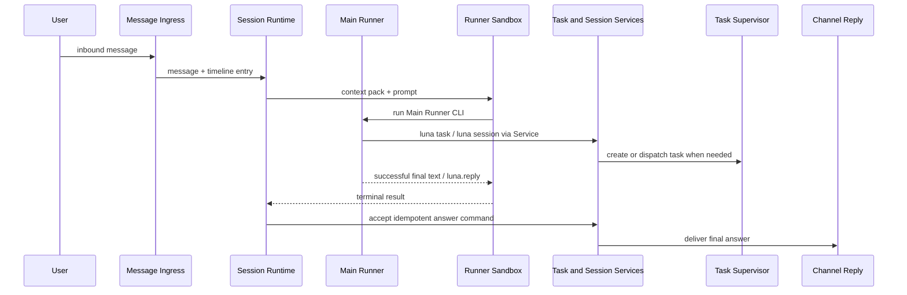

# Sessions And Main Runner

## Responsibility Boundary

A session is the user interaction work view. Main Runner is the session-level decision maker: it understands messages, context, attached tasks, and activation reasons, executes task/state commands while running, then returns its final reply for Service delivery. `luna messages send` remains available for progress, notifications and early answers.

Main Runner does not directly:

- write database facts.
- send channel messages.
- create or schedule Task Runs.
- bypass Service to register artifacts.

Those deterministic actions are handled by task/session services, `TaskRunSupervisor`, and the message delivery layer.

Main Runner execution goes through the configured runner adapter. Runtime always uses `ContainerAgentRunner` to run supported agent CLIs inside the runner sandbox. Main Runner owns reasoning, message content and send timing, and task/state command submission; Service owns authorization, persistence, delivery and task side effects.

Main classifies work before using execution tools: ordinary conversation and
Task status reads stay in Main; project/file operations, external research,
diagnosis, tests and artifact production are dispatched through Task commands,
even when a single command would be quick. Main can read its memory and Luna
context and perform orchestration commands. Shared filesystem/tool availability
does not change this role boundary; Work sessions still execute directly.

For private user-message turns (including Dashboard), Main must provide an answer,
including for unclear or batched short input. Service accepts successful terminal
text or a `luna.reply` document into `session_commands` before settling the turn.
An already accepted answer for the same session and origin owns delivery; pending,
running, sent and unknown answers suppress a duplicate terminal reply. Progress
and notifications do not suppress it. A bare sentinel without an answer fails a
private turn; unrelated group activations may complete silently. Failed executions,
empty terminal output and streamed tool commentary never become final replies.

## Session Lifecycle

A session is created or resolved from a channel message, Dashboard message, or thread handoff. A session may bind external conversation surfaces or have no external channel; true messages are stored independently as provider-neutral facts.

Typical lifecycle:

1. An inbound message reaches `LunaMessageIngress`.
2. Runtime resolves or creates the session.
3. The message is persisted into `messages`.
4. `session_timeline_entries` records the message or reference visible in that session.
5. The context builder materializes visible context for Main Runner.
6. Main Runner executes task/state commands and returns a final reply as plain text or a `luna.reply` document. Service accepts the reply into the existing message queue before settling the turn.
7. Runtime applies commands immediately. Final output only describes a reply; it never executes or replays business actions. `LUNA_NOTHING_TO_SEND` skips a new message when an answer already owns delivery or silence is allowed.

After an `answer` command is confirmed delivered to its source session, the
command service clears processing reactions for the inbox inputs claimed by
that command's originating turn. Context references, later pending messages,
progress updates, notifications and cross-session sends do not clear those
markers. Marker cleanup failures leave the delivery marked `sent`; turn
finalization still performs cleanup as a fallback. This visual acknowledgment
does not finish the turn or release the session execution lane: pending input
still waits for the current Runner to complete.

## Timeline And Context Pack

`session_timeline_entries` is the smallest discussable unit shared by Dashboard, Main Runner context builder, and Task source context.

Entry meanings:

- `message`: the message truly occurred in the current session surface.
- `reference`: the message occurred in another surface but is explicitly referenced for the current session's context or display.
- `event`: an internal session fact such as conversation-control state. Events are visible in timeline and APIs but are not conversational content.

`context_packs` / `context_pack_items` are the durable source of truth for runner-visible context. They are not prompt text. They record which context was selected for launch, activation, turn delta, or thread launch. A prompt is a materialized rendering of context packs.

Timeline and context-pack boundaries are strict:

- Timeline stores the candidate pool a session can see, including silent messages, imported history, references, and internal control events.
- Context packs record only the subset selected for runner input.
- Internal events never become context-pack items.

## Group Join History Backfill

When Luna is added to a Feishu group after a conversation already started, Runtime imports a bounded history window into the same message and timeline model instead of creating a separate "group summary" store.

Current behavior:

- Group-join backfill imports recent group history into the root group session timeline.
- If the imported group history references thread ids, Runtime also fetches bounded thread history and resolves the corresponding thread sessions.
- Imported history is persisted as normal `messages` plus `session_timeline_entries`.
- Imported history is marked through ingest metadata such as `history_backfill` / `group_join_backfill`.
- Backfill never enters `session_inbox`, never creates turns, and never invokes Main Runner by itself.

The result is that imported history becomes part of the normal candidate pool for later explicit activation or thread launch, but it does not bypass the normal context-selection boundary.

## Main Runner Input

Runtime constructs Main Runner input with:

- session id.
- requester user id or requested identity.
- ordered messages.
- activation context messages.
- current assistant identity.
- latest message addressing.
- launch seed, delta context, and bound task information.

Input should be provider-neutral Luna facts. Provider raw payload is not part of the long-term Main Runner contract.

For explicit group activation, activation context selection is still deterministic Runtime logic:

- Runtime first takes recent user messages inside the configured time window.
- It also considers recent skipped user messages that have not yet been sent to the runner.
- If the explicit activation would otherwise have too little context, Runtime can widen to the latest unsent user messages until the configured minimum recent count is satisfied.

This preserves the old "recent local context" meaning while giving first activation after silent buildup or imported history a minimum usable window.

## Main Runner Output

Main Runner calls task and session-state commands, then returns plain text or a
`luna.reply` presentation document. It may return `LUNA_NOTHING_TO_SEND` after an
early CLI answer or when silence is allowed. There is no public action JSON protocol. Task creation,
supplements and restarts run through `TaskCommandService` and `TaskRunSupervisor`;
clarification and focus release use session commands. Multiple tasks use separate
request IDs and optional current-turn source-message selections.

The old action contracts, parser, executor and decision-replay adapters have been
removed. Main returns a `MainRunnerCompletion` to its caller, never an action.
The retired `runner_decisions`, `session_handoffs` and `outbound_delivery_records`
tables and their Dashboard projections have been removed. Invocation/Job/operation
records and durable session commands remain the sources for execution and delivery.
Recovery uses `runner_operations`, session commands and Task Supervisor records.
A failed Main invocation remains a failed turn. SessionTurnProcessor accepts a
service-authored diagnostic through SessionCommandService so the failure is
visible as an assistant message in the timeline and delivered to bound channels.
Known Worker admission, availability and model configuration failures have
actionable messages; other failures use a generic diagnostic without exposing
raw exception details. This does not retry execution or change Worker admission.
An already accepted answer (including pending or ambiguous delivery) suppresses
the diagnostic. Cancellation, Runtime detachment and Work Runner's separate
failure/status-card path do not create this reply. The turn ID and fixed command
key deduplicate diagnostics across replay; raw errors remain in the failed turn.

Provider-call recovery is below this module's interface. Main Runner submits one
logical invocation to `ContainerAgentRunner`; it does not parse Claude or Codex
error strings and does not resubmit prompts itself. The runner sandbox
normalizes provider failures and owns bounded transient retry before returning
either a completed execution stream or a terminal failure.

Main Runner and Work Runner share `invokeSessionAgent` for the mechanics of a
session-scoped provider call: message construction, stream collection,
provider resume-id persistence, and invalidation. They intentionally differ
above that seam. Both accept successful final replies through the same message
command service. Work also updates its operational status card; reply validation
failures mark its attempt failed and the status card blocked.

## Runner Context And Attempts

Each session has a runner context rooted at
`<runnerRootBase>/<session-id>`, which defaults to
`$LUNA_WORKER_HOME/agents/<agentId>/shadows/<shadowId>/runners/<session-id>`. Main Runner cwd is the runner home, not
`workspace/`. The runner home contains materialized instructions, CLI state,
and `workspace/` for files that belong to the current session. `projects/`
is the mounted shared development workspace containing projects and
repositories.
Shared skills are mounted directly into agent-native paths inside the
container; the host runner home does not create skills links.

Runtime passes the runner context ID in `AgentRunOptions.runnerContextId`. Each session context has its own working directory in the Shadow container.

Main registers the invocation and pins its resources before asking the Worker to prepare that directory. The prepared instruction fingerprint determines whether Main can resume a provider session. Recovery attaches to an existing Job using its saved request and skips file preparation.

It also carries provider and model fingerprints from the active Dashboard
Profile. Runtime compares them immediately before execution. Provider identity
changes always clear the provider resume id; model-only changes follow the
active revision's resume policy. Agent type changes resolve a separate runner
context. Activation itself does not mutate existing contexts.

If the stored fingerprint does not match:

- Runtime clears the persisted `runner_session_id`.
- the current turn is treated as a fresh runner session.
- Runtime creates a new immutable `session_launch` pack from the latest eligible session timeline messages.
- the rebuilt pack is materialized as `launchSeed` for the replacement provider session.

Provider stale-resume errors use the same rebuild path. After the provider adapter invalidates the missing provider session id, Runtime selects a new `session_launch` pack before replaying the current turn as a fresh launch. Selection includes prior user and assistant messages, applies the configured message and character budgets, and excludes the current turn plus queued or claimed entries so `user_messages` is not duplicated inside `launchSeed`.

Each rebuild keeps older launch packs for audit but gives the newly created `session_launch` pack precedence when Main Runner context is materialized. `createdForInvocationId` ties the pack to the rebuilding turn and makes same-turn replay idempotent. A brand-new runner context is not a rebuild and does not synthesize historical relaunch context.

This keeps provider sessions aligned with the current Main Runner contract, preserves information added after an earlier launch, and avoids stale runner sessions surviving prompt or instruction upgrades.

Main Runner attempts are persisted in `session_runner_attempts`. Each attempt records the prompt and raw output. Successful terminal text is accepted as reply content; an existing answer command suppresses redundant output. Empty or mixed marker output without an existing answer is a protocol failure. Task/state changes already accepted through commands remain persisted independently of terminal success. Historical action records are never replayed.

## Container Execution Notes

Main Runner Jobs use `session:<runner-context-id>` as their execution scope. Work Jobs use the same execution path with the `work` runner kind. Provider credentials and the Service token are supplied per Job.

Service submits a Job to Runtime. Worker prepares the Docker environment, and Runtime calls the container Executor directly. Executor uses stdio for the Runner subprocess and posts events to Runtime. Service consumes the embedded Runtime's async event iterator. The shared HOME and session working directory persist on the host across container reaping. See [Execution Runtime](execution-runtime-foundation.md).

## Thread Handoff

Root sessions and thread sessions are different conversation views. True messages are not moved. A thread session references the root anchor, parent message, and selected context through reference entries.

When Runtime creates a thread work session:

- the root session keeps the original user message.
- the thread session receives a `thread_launch` context pack.
- root, parent, and nearby context are projected into the thread session as reference entries.
- tasks, status cards, clarification replies, and later task results belong to the thread session.

Thread sessions are not limited to Luna-created threads. Any incoming or imported thread message can resolve or create a thread session for that thread id.

`thread_launch` remains a selection record, not a copied thread cache:

- Runtime first selects recent thread-visible messages.
- If the thread-local history is too small, Runtime supplements from root-session context, including the root anchor and nearby relevant history.
- The final selected subset is written to `thread_launch`; root history is not bulk-copied into every thread session.
- A root message selected for `thread_launch` has a timeline entry in the thread and retains the original root entry as provenance. Both entries must resolve to the same message within the same Agent and Shadow.

Business logic does not branch by P2P/group. Differences are limited to activation, context enrichment, and presentation.

## Follow-up Interruption Events

Group `activation_followup` is tracked as a session fact, not only as an addressing reason on the current message.

When all of the following are true:

- the inbound message was admitted as `activation_followup`
- Main Runner calls `luna session release` when focus-shift bookkeeping is needed, then returns its final reply or an allowed sentinel
- the invocation has an applied `session.release` operation, reflected by `followupReleased` in its completion

Runtime appends a timeline `event` describing a conversation-control interruption for the current follow-up chain.

This event:

- is visible in Dashboard and session APIs as a system-style timeline item.
- is excluded from runner context selection.
- closes the current follow-up chain until the next explicit Luna activation.

## Artifact Relationship

Session-level user-visible files must be registered as artifacts before users
see them. A runner creates private outputs in `workspace/`; final replies should
use `artifact:<id>` or Service-generated signed links.

This rule ensures:

- Dashboard, Feishu, and CLI can access the same resource fact.
- Main Runner does not depend on host paths when it runs in a sandboxed container.
- After signed-link expiry, access can still be evaluated through related-user authorization.

## Failure And Idempotency

Command execution relies on the operation ledger, session command queue and Task Supervisor source deduplication. Recovery resumes accepted command work and pending result notifications; it never interprets historical runner decisions.

Status card updates should not require the model to run again. Task Run state transitions are deterministic database writes that trigger notifications.

## Primary Code Paths

- `src/sessions/session-resolver.ts`
- `src/sessions/message-store.ts`
- `src/sessions/session-timeline-store.ts`
- `src/context/context-pack-store.ts`
- `src/main-runner/main-runner.ts`
- `src/runners/operation-service.ts`
- `src/tasks/task-command-service.ts`
- `src/main-runner/activation-context.ts`
- `src/main-runner/context-builder.ts`
- `src/main-runner/thread-handoff.ts`
- `src/main-runner/workspace-instructions.ts`
- `src/sessions/session-runner-attempt-store.ts`
- `src/sessions/session-timeline-event-store.ts`
- `src/work/group-join-backfill.ts`
- `src/runners/container-agent-runner.ts`
- `src/runners/session-agent-invocation.ts`
- `src/prompts/main-runner/instructions.md`

## Session commands and trigger runtime

The current shared dispatcher, durable trigger ledger, asynchronous message
commands, target authorities, handoffs and schedules are documented in
[Session command runtime](session-command-runtime.md). Runner side effects remain
Service-owned; the runner submits commands and does not call provider SDKs.

### Dashboard input

Dashboard submits normalized messages with a trusted target session ID to the same
`LunaMessageIngress`, inbox, coalescing and turn processing used by Feishu. It does
not bind a Dashboard surface or add an outbound delivery destination. Local
sessions may have zero external bindings; replies still persist to the shared
timeline. Replies to externally bound sessions are dispatched through
`session_channel_bindings`. Dashboard input does not use the `session.invoke`
trigger path.
See `messages-and-channels.md` for the binding and reply transport boundary.

### Dashboard session deletion

Agent owners permanently delete idle sessions with `DELETE /api/sessions/:id`
after confirmation. Pending inbox, turns, triggers, commands, outbound delivery,
unfinished primary tasks or active processing in a referencing session blocks
deletion with 409. A synchronous SQLite transaction checks idleness, revokes
tokens, releases routing and removes the session and its execution records.
Insert guards reject late writes to the deleted session.

`messages.owner_session_id` establishes one primary owner. Other sessions hold
references; only explicit session merging transfers ownership. Deleting a
referencing session does not remove the shared message. Deleting the owner
scrubs the message into an immutable content-free tombstone retaining only its
ID, deletion time and fixed placeholders. References remain visible without an
author link. Affected provider sessions are invalidated so subsequent launches
do not resume context containing removed content. Independent tasks keep their
history and lose the deleted-session association.

Session-owned schedules, subscriptions, commands, turns, inbox, decisions,
context packs, Runner contexts and channel bindings are removed; cross-session
schedules are disabled. A transactional deletion manifest records exclusive
managed attachments and Runner directories for cleanup. Shared files are kept
and artifacts still used by other resources retain valid ownership.
`session_deletions` retains ID, Agent, time and pending cleanup; paths are cleared
after cleanup. Failures return an error and retry on repeated DELETE or restart.
Unknown IDs or unowned historical deletion records return 404. Managed cleanup
stays inside artifact/Runner roots and does not follow escaping symlinks.
Backups and external provider chats are outside this deletion operation.

Later messages from the same external chat create a new session and context.
User deletion remains logical. Old deleted-session rows can be permanently
removed through the same explicit endpoint; startup does not purge them in bulk.

## Command reply lifecycle

Main and Work receive invocation-scoped message capabilities. The Service checks
runner kind, session, runner context and a live invocation registry on every
request; cancelled or completed invocations cannot send. Task tokens cannot use
this API. Main/Work also share the session directory, scheduling and handoff
capabilities guarded by that actor check.

Main executes task and clarification commands before sending acknowledgments or
questions. Command execution persists clarification and dispatches tasks, without
sending user messages. Unrelated group follow-ups may end with the sentinel without sending
a message; private user-message turns require an accepted answer or a successful final reply. Main terminal JSON is reply content or a luna.reply presentation document; it never executes business actions. User answers enter Main, which selects
whether to forward supplemental context to a Task.

Work may send an early answer during execution, or return a final reply. It
registers generated files explicitly before including artifact references in either
path. Runtime status cards remain operational progress, not a second final answer.

Command-mode root decisions keep clarification state and new task ownership in
the conversation that received the command reply. They do not silently create a
thread handoff after delivery; subsequent user messages must reach the same Main
context. The old automatic thread-handoff and action-replay implementations are removed.

## Task and state command boundary

The public endpoints are `POST /api/runner/tasks/create|update|restart|status-card`,
`POST /api/runner/session/clarify|release`, and `GET /api/runner/operations/:id`.
Payloads contain domain fields only; old action and reply metadata is rejected.
Task and session mutations use only these domain endpoints.
Only a live Main invocation may mutate state; Task-result invocations send messages
only. Task source message selection is restricted to the current invocation. The explicit
`POST /api/runner/session/create-thread` command can select an anchor and history
from the current session timeline and returns `targetSessionId`; it creates
references and a thread launch pack without copying or sending history.
Source Main hands the full request to the topic Main using `messages handoff`.
The receiving Main sends the opening reply first, then creates the Task in its
own session; the source does neither. See `tasks-task-runner.md` for ordering
and failure handling.

`RunnerOperationService` handles authentication, invocation scope, serialization,
idempotency and receipts. `TaskCommandService` owns task facts, participants,
subscriptions and provenance, and calls the existing `TaskRunSupervisor` for run
creation and replacement. Session clarification uses `SessionStateStore` directly.
The final completion adapter reads focus release from the operation ledger.

`runner_operations` persists request, trusted invocation context, phase and result.
Preparation is one SQLite transaction: domain mutations and the prepared receipt
commit together. Dispatch then uses a distinct internal source message per operation
and the supervisor's source-based deduplication. A crash after dispatch but before
receipt completion can therefore redispatch without starting a second run. Startup
recovers accepted/prepared operations before session queue recovery. Failed
operations expose their error and can be retried with the same request ID.

Keys are scoped to session and logical turn. Identical retries return the existing
receipt; changed payloads conflict. Multiple commands from one inbound message can
create distinct tasks without conflating their source identity. Original messages
remain task provenance, while the internal operation source identifies dispatch.
A separate operation lane avoids deadlocking against the running Main's session
lane. Accepted operations remain durable after Main exits.

Receipts contain command ID, task IDs and run ID; applied means dispatched, not
completed. Session/task deletion rejects pending operations, and operation rows
cascade when an idle session is deleted. Historical runner decisions are retained
only for audit display; no compatibility executor or replay path remains.

Status-card commands use the same durable operation ledger, pin the current Task
Run and await delivery without executing a new run. Startup awaits recovery of
prepared operations, including asynchronous card delivery.

## Final reply and CLI presentation protocol

Main (user input, task result and session trigger) and Work share
`finalizeRunnerReply`. On successful execution, a final reply is accepted with
the stable key `service-final-answer` before business settlement. Existing
answer commands in pending/running/sent/unknown retain delivery ownership;
progress and messages to another session do not suppress the final reply.
Empty or mixed marker output is rejected. Ordinary JSON is content, never an action.

`luna.reply` version 1 supports text/message/card presentation and ordered text,
image and file-link blocks. Image/file blocks use active Artifact references;
image references must have an image MIME type. Unknown presentation/template
falls back to a normal message while retaining all valid blocks. The CLI accepts
the same document through `messages send --json --stdin` for every purpose.
The command payload stores the normalized reply and a Markdown projection;
no new tables are used. Feishu renders single images, rich posts or interactive
cards. Dashboard uses signed Artifact URLs and existing rich Markdown cards.

Provider success contains the confirmed final answer only. Intermediate tool
output and commentary remain progress and are not fallback final replies.
This removes the ordinary final-message CLI round trip. Pending turns remain
serialized and wait for execution and business settlement, not for a new model
request confirming a send receipt. Delivery remains asynchronous.

### Creation-time launch context for groups and topics

Both creation paths select the triggering message and up to four preceding
visible messages; Main may supplement older messages by ID. Topic creation uses
its anchor; group creation derives the trigger from the active invocation and
freezes the selection at command acceptance. Group success binds a `group_launch`
pack and target timeline references, matching `thread_launch` behavior. Source
messages are not copied, moved, or sent externally. The receiving Main gets the
launch context before opening/Task decisions; Task source packs retain the same
references. Handoff only requests execution, not context transfer. Relaunch can
still select recent target history, which includes these durable references.
