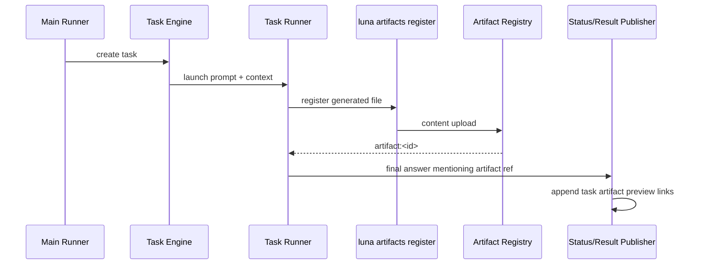

# Tasks And Task Runner

## Responsibility Boundary

A task is Luna's durable work unit. It is not limited to diagnosis. Work should become a task when it is long-running, deliverable, evidence-heavy, multi-step, tool-heavy, or needs asynchronous status updates.

Task Runner executes the work but does not own the final resource and notification model:

- Task Engine creates and updates tasks.
- Task Run Supervisor manages run lifecycle.
- Task Runner executes inside a runner root.
- Artifact Registry manages output files.
- The notification layer updates status cards and result cards.

## Task And Run Model

A Task is a durable subagent thread. It owns task identity, title, summary, context, participants, source links, subscriptions, and one or more Task Runs. It is not a one-shot ticket.

A Task Run is one execution turn for the Task subagent. It owns:

- run index and reason.
- input snapshot.
- context pack ids.
- materialized prompt.
- runner context id.
- source message id.
- terminal status and error/cancel reason.
- final report artifact id when the run completes with a report.

`tasks.status` mirrors the latest effective Task Run status. The current status vocabulary is:

- `new`
- `running`
- `completed`
- `failed`
- `cancelled`

Workflow statuses such as `INVESTIGATING`, `RESOLVED`, and `ESCALATED` are not part of the current model. Dashboard, status cards, and task context should project the latest run status instead of preserving a separate ticket state.

## Task Lifecycle

Typical lifecycle:

1. Main Runner requests task creation or update through `luna task create|update|restart` , while the Main process is still running.
2. Runtime persists the task, source context pack, and dispatch marker.
3. Task Run Supervisor creates an initial or restart run.
4. Task Runner materializes the prompt and begins execution.
5. The runner calls tools, queries knowledge, invokes plugin operation commands, or writes workspace files.
6. User-visible files are registered through `luna artifacts register <path>`.
7. When the Task Run completes, Runtime updates task status, timeline, enabled status cards, and result delivery.

Each Task Run stores source context packs, materialized prompt, runner context, timeline events, final report/artifacts, and terminal status.

## Supplemental Input

Task supplemental messages are selected by Main Runner task commands, not by keyword detection. If the Main Runner calls `luna task update`, Runtime treats the message as valuable context appended to the Task subagent and starts a new Task Run.

Current behavior:

- If there is no active run, supplemental input creates a new restart run immediately.
- `TaskRunSupervisor.restartTaskRun()` validates the source and records the update context together with its timeline event. If preparation succeeds, it cancels the active run and starts the replacement.
- A manual restart with no source message stores the supplied text as a fact in the task's update context pack.
- The old run must not overwrite the new run's terminal status or final report.
- `luna task list` takes the Agent scope from `LUNA_AGENT_ID` or `--agent-id`.
  Service applies the caller's existing permissions to task reads.
- For status/progress questions, Main reads `luna task get --task-id TASK_ID` and replies with `luna messages send`, without starting another run.
- `luna task update` supplements or corrects task context and starts a new run; `luna task restart` retries with existing information unchanged. Both cancel any active run.

## Launch Prompt

The launch prompt is the Task Runner input snapshot. It is not the only source of truth. Task source context packs are the durable facts explaining why the task was launched and which context it received.

Launch prompts should include:

- task type, title, summary, and dispatch reason.
- pending user input.
- source context and update context.
- known facts and assumptions.
- input image or file references as `artifact:<id>`.

`task_launch` context is injected only when the runner context has no provider
session id and a new provider session is being created. A restart that resumes
an existing provider session receives the restart/update context without
replaying the launch context. If the provider session is invalidated and a
fresh session is explicitly rebuilt, the launch context is eligible again.

When an input attachment is already an artifact, the prompt should prefer `artifact:<id>`. The runner may materialize it into a local file for processing, but it must not use the materialized path as the final user link.

## Workspace

Runner cwd is the session or task runner root. `projects/` is the mounted
shared development workspace containing projects and repositories.
`workspace/` holds runner-private attachments, reports, logs, and runtime
intermediate outputs.

Workspace-local paths are runtime facts:

- They help a runner read and write files for the current task.
- They are not guaranteed to be reachable from a remote service, Dashboard, Feishu, or another sandboxed runner process.
- They should not appear directly in user-visible replies.

## Container Execution

Task Runner uses the same fixed container execution model as Main Runner and runs through `ContainerAgentRunner`.

The supervisor resolves the active Dashboard Agent Profile when a run begins,
not when a task was originally queued. Provider/model resume compatibility is
then checked lazily against the selected task runner context.

Task Jobs use the scope `task:<task-id>:<runner-type>` and carry the task and Task Run IDs in their Job credentials. In isolated mode, Worker provides a container for the scope. In shared mode, Task uses the common Executor. Both modes use the public HOME and a task-specific working directory. Runtime and Executor serialize executions for the same context. Worker retains context data after container reaping.

## Artifact Output Contract

When Task Runner generates a user-visible file, it must register an artifact first:

```bash
luna artifacts register workspace/final-report.md --json
```

After CLI returns `artifact:<id>`, the runner can reference that artifact in its report command. Do not rely on server-side fallback conversion from local paths to links.



## Status Card And Result Delivery

Status card body comes from runner/LLM output, while artifact links come from persisted task artifact outputs. These are separate responsibilities:

- Runner output explains the conclusion, process, and next steps.
- Task artifact list provides complete reports, images, files, and previewable resources.
- Status cards display operational progress and terminal status.
- Main reads the internal report and sends the user-facing answer through `luna messages send`, including for short answers such as weather results.

Do not require the LLM to manually assemble complete report links. When a task has artifact outputs, the notification layer can append links deterministically.

## Failure, Retry, And Idempotency

Task Run Supervisor owns initial runs, restart runs, obsolete-run cancellation, interrupted-run recovery, and terminal status. Idempotency depends on task run state, source message, context pack, timeline event, and notification trace.

On failure:

- Aborted or no-longer-active runs must not overwrite current state.
- Runtime recovery should mark interrupted runs failed instead of blindly rerunning them.
- Status cards and result notifications should be reconstructable from persisted task state.
- Live provider recovery may continue a Task Runner only after the runner
  protocol has emitted a completed-work checkpoint. Before the first
  checkpoint, a transient provider failure is terminal for that Task Run so
  side-effecting tools are not blindly replayed.

## Primary Code Paths

- `src/tasks/task-engine.ts`
- `src/tasks/task-run-supervisor.ts`
- `src/tasks/task-run-store.ts`
- `src/kernel/task-run-handler.ts`
- `src/tasks/task-status-projection.ts`
- `src/runners/container-agent-runner.ts`
- `src/sandbox/container-lifecycle.ts`
- `src/prompts/task-runner/instructions.md`
- `src/messaging/notifications/task-status-card-updater.ts`
- `src/messaging/notifications/feishu-task-updater.ts`


### Dashboard task deletion

An Agent owner can permanently delete an idle Task in that Agent with `DELETE /api/tasks/:id` from a Dashboard session. The detail page asks for confirmation. Running Tasks/Runs, active status-card notifications, pending task-result triggers, and running turns in related sessions return 409 without mutation. New idle tasks and terminal tasks can be deleted.

The transaction removes the task, runs, participants, subscriptions, task timeline, context packs, runner context and owned artifact metadata; task-scoped tokens are revoked and handoff links are detached. Session messages, external messages and other tasks remain. Managed artifacts referenced by surviving messages/tasks transfer ownership; local owned managed files use the durable file-cleanup mechanism. `task_deletions` records the ID, owning Agent, deletion time and pending cleanup. The owner can repeat DELETE to retry cleanup. Startup also retries cleanup. Unattributed historical tombstones and unknown IDs return 404. Storage guards reject late task-run/artifact writes after deletion.


Deleted Task references remain visible in the Dashboard. Before removing a task, deletion records only task/session/source-message IDs in `deleted_task_references` (no title, report or execution content). Session lists, session headers, message tags and status/result cards project these relationships as `status=deleted`, with the fixed label “Task deleted” and no task detail link. Historical message text is preserved. Task links in Markdown are replaced with the same non-clickable placeholder when they point to a deleted local task; external-site links remain unchanged. Historical cards and later links can also resolve deletion from `task_deletions`, so older deletions with surviving message references are recognized. Deleting a session removes its retained reference edges. Task detail APIs continue returning 404 after deletion; the placeholder is a reference projection, not a retained Task object.

## User communication boundary

Task Runner communicates findings, missing information and final reports to Main
through its internal task execution/report flow. It cannot use the runner message
API to address users. Main asks the user and receives their answer, then chooses
the task command that supplies further context to the Task.

A completed run with status cards enabled updates its operational status card with a neutral completion
notice. Main receives the task-result event and sends the user-facing explanation
with `luna messages send --purpose answer`; terminal Main output is not re-sent.
The result publisher correlates this command with its notification attempt and
avoids duplicate delivery during recovery.

If Main fails before submitting an answer, the result notification remains failed
for recovery; Runtime does not publish the Task report as a fallback user reply.

Main's task command returns after the Service persists the operation and dispatches
the run. Main can then acknowledge the task using its returned ID and finish with
`LUNA_NOTHING_TO_SEND`. Neither initial dispatch nor task restart waits for or
parses Main's terminal output. Task result reports still wake Main separately.

Task commands call `TaskCommandService` directly. New operations do not create
runner decisions or carry reply-format metadata. Creation uses a unique
operation-derived task ID; multiple commands in one turn may create multiple tasks.
Original messages are retained in task provenance/context packs; a separate internal
command source makes supervisor dispatch and restart idempotent. Clarification
state clears when a task is created. Updates require task ownership or an existing
subscription in the current conversation.

## Task report command and execution completion

Task calls `luna task report --request-id ID --stdin` with plain report text;
`--text REPORT` is also supported. `luna task report status COMMAND_ID`
reads its receipt. These use `POST /api/runner/task-reports` and
`GET /api/runner/task-reports/:id`. Only the current active Task invocation
may submit or inspect its report; Main and Work cannot use this capability.

A transaction persists the managed report artifact, task artifact, immutable
`task_report_commands` receipt, run report reference and per-subscription
task-result outbox entries. One report is accepted per run; identical request
ID and text retries return the same receipt, while changes conflict.
The publisher wakes Main immediately after commit, before Task process exit.
Task still cannot address users. Main sends the user-facing message.

Task ends with `LUNA_NOTHING_TO_SEND`. A sentinel without an accepted report
fails execution; terminal prose never becomes a report. The run stays running
until process settlement. Once accepted, the report survives later process
errors and startup recovery completes the run from its durable receipt.
Existing notification deduplication prevents a second delivery on settlement.
A superseded run cannot publish over the current run.

Missing information is included in this final command report. Main asks the
user, receives the answer and starts a new run with `tasks update`. Mid-run
question/suspend/resume is not implemented.


## Explicit topic binding and optional status cards

Runner chooses the conversation shape. `luna session create-thread` accepts
`anchorMessageId` (required Luna message ID), `contextMessageIds` (optional
supplementary historical Luna message IDs), and optional `title`. Creation
automatically selects the anchor plus up to four preceding messages, then adds
the explicit IDs without duplicates. All selected messages must
be visible, non-deleted entries in the invoking session. The anchor must be a
real Feishu message on that session's channel. Existing topics reuse their
canonical root; new topics bind beneath the anchor.

`ThreadCommandService` creates/resolves the session, adds message references,
and writes a `thread_launch` context pack inside the operation transaction.
The anchor is automatically included. Source messages keep their original
ownership and are not resent. The operation receipt includes `targetSessionId`.
This provision step sends no message. Source Main submits a `messages handoff`
(`session.invoke`) containing the complete request to the returned session. It
neither sends the topic opening nor creates the topic Task. The target Main is
invoked through the existing per-session dispatcher with the selected history.
It first sends its opening answer through CLI in its own session; once delivery
is confirmed it creates the Task there, omitting `sessionId`. The opening makes
the topic visible before its progress card. The opening describes intended work,
not successful creation; a later creation failure requires a visible notification.
On success the opening answer suppresses duplicate terminal delivery. Ambiguous
requests are clarified in the topic; the target does not hand back or create a
nested topic. Stable handoff/operation IDs retain existing replay semantics.

The general task command still accepts `sessionId` for explicit target binding;
this topic orchestration uses the receiving Main's current session. Without a
session ID the task stays in the current session;
task creation never creates a topic. `sendStatusCard` defaults to true.
The subscription stores `notification_level=none` for disabled cards and
`major_updates` for enabled cards. Existing subscription preferences remain
unchanged on update/restart. Existing historical subscriptions retain their
prior setting.

Runtime owns the lifecycle of enabled cards in the bound session. Root-session
cards are channel messages; topic cards reply to the real provider root, never
the synthetic command source ID. Card preference does not remove the task-result
subscription: reports still notify Main, which decides the user-facing reply.

Task launch copies the topic or group's selected history into durable task source packs.
The task's primary session and result subscription use the chosen target;
the invoking session retains original command provenance and can update/retry
the task it created. Command replay reuses the same session/task/run.

Status-card recovery isolates failures per notification. A historical provider or
idempotency error remains pending and logged; it cannot prevent service startup
or recovery of other cards.


## On-demand status cards

`luna task status-card --task-id TASK_ID --request-id ID [--resend]`
calls `POST /api/runner/tasks/status-card` with `{taskId,resend?}`.
A live Main invocation may operate a task belonging to the current conversation
or created from that conversation. Delivery always uses the existing task
subscription in its primary session; the command cannot select another channel.

Preparation pins the latest run and notification in `runner_operations`; no run
is created or restarted. Dispatch sends a missing card, refreshes the existing
card, or sends a replacement when `resend=true`. The snapshot includes current
status and run-scoped progress. Completed/failed/cancelled runs get terminal
cards. After delivery, the notification points at the returned card and the
subscription switches to `major_updates`, enabling future automatic updates.

Manual and automatic card delivery share a per-run execution lane. A replacement
therefore cannot race an older progress/terminal update. Automatic update keys
include the bound card identity. The manual command's outbound payload is
persisted before delivery, so retry uses the same content and provider key even
when progress changes. After replay it refreshes newer state if necessary.
Pointer replacement, local card persistence and delivery receipt commit together.
An older failed command cannot overwrite a subsequently replaced card.

The operation remains prepared on delivery failure and is recoverable on startup.
`luna task status COMMAND_ID` exposes its receipt. Applied receipts include
`taskSessionId`, `runId`, and `statusMessageId`. Replaying an applied command,
including a resend, returns that receipt without sending another card.

### Task progress presentation

Task creation accepts `sendStatusCard` (true by default) and
`statusCardStyle: "card" | "native"` (default native for new tasks; existing subscriptions retain their style). `tasks status-card` accepts
`--style card|native` / JSON `style`. Omitting style retains the current choice;
switching an existing message requires `--resend`. Subscriptions persist the
preference for subsequent runs; each run notification snapshots it. Replacement
closes an active native bubble before binding its successor. Task results and
Runner command/sentinel contracts are unchanged.

Both styles use the same notification lane, session delivery fanout, command
receipts and terminal transitions. The Feishu adapter translates native snapshots
into `message_cot` create/append/complete requests. A separate
`native_progress_deliveries` provider checkpoint stores channel/message/cot IDs,
acknowledged entry IDs and terminal state. This also supports recovery after a
service restart. Create/append requests with unknown network outcomes are not
blindly retried (the API has no documented idempotency facility); commands report
the ambiguity and a new request with `--resend` can replace the display. A known
bubble can still be closed after an ambiguous append. Delivery failures never
change Task execution outcomes. There is no silent style fallback.

Native entries contain only public assistant text and tool names with stable
call IDs. Thinking blocks, full tool argument objects and raw tool results are excluded.
Historical unmarked timeline entries are not exported to native bubbles. The
Feishu heading is provider-controlled; the task name is the first entry and the
closing explanation is a final entry before completion. Failed/cancelled runs
complete with `error`, successful runs with `done`. The dashboard retains its
common status-card projection and records the provider presentation style.

Tool progress is preserved structurally from the CLI provider through the
Executor/Runtime stream, `RunnerOutputState`, and Task timeline. Provider adapters
emit ordered public text, tool-start (call ID, name, display title), and tool-result
(call ID, outcome) events. Results also emit the existing retry checkpoint;
progress is never appended to the Runner's final answer. Claude mixed content
blocks and Codex command/file/MCP items retain their original call IDs. Full argument objects, outputs and thinking blocks are excluded from this public
stream. Tool titles include a subject extracted from structured input before
truncation: command/cmd, file path, search query/pattern, URL, or description.
Subjects collapse whitespace, redact common credential forms, and are bounded
to 80 characters. Codex MCP argument JSON is decoded before extraction. Missing
subjects retain the category label; no extra model generation is requested.

The Feishu renderer attaches tools to the most recent text node, selects a
category icon/title, and sends `TOOL_CALL_RESULT` for completion. Open tools and
the latest parent node are checkpointed across restarts. Terminal transitions
close unresolved tool nodes without claiming success. Successful runs send
`REASONING_END` then `RUN_FINISHED`; failed/cancelled runs use explicit error
completion (never `RUN_FINISHED`, which Feishu treats as success). Ambiguous
terminal appends retain the existing explicit completion recovery path. Native
headings and disclosure controls remain managed by the Feishu client.

Existing public assistant commentary may appear in progress bubbles; the Task
prompt does not require additional narration for progress display. Concrete tool
progress should be derived from structured tool events by the runtime.

Tool classification and Chinese labels are shared by the provider adapters and
Feishu renderer in `tool-display.ts`. Subject extraction uses an explicit field
priority, including full paths,
`Url`, `toolAction`, `toolSummary`, and `prompt`; display is capped at 80 characters.
Luna retains credential redaction before display and its existing result-status
protocol. Tool classification does not use assistant prose or generated labels.

### Work final replies

Work accepts successful final text or a luna.reply presentation document through
Service's shared final-reply handler. A CLI answer already accepted for the turn
suppresses duplicate terminal delivery. Progress cards report execution complete
and answer submitted, not provider-confirmed delivery. Task report commands and
Task internal terminal report semantics are unchanged.


### Explicit task cancellation

Main resolves the intended Task from the conversation for both `/stop` and
natural-language stop requests. If the target is ambiguous it asks the user;
there is no automatic whole-session cancellation or special `/stop` bypass.
Main calls `luna task cancel --request-id ID --json '{"taskId":"...","reason":"..."}'`.
The command uses the existing conversation scope checks and operation ledger.
Preparation freezes the active Run ID, so replay cannot cancel a later explicit
restart. A run already completed/failed is unchanged (`cancelled: false`).

Cancellation records Task/Run `cancelled`, revokes the invocation and its tokens,
then aborts the existing Runner through Runtime/Executor's normal Job cancellation.
No replacement Run or Task-result Main invocation is created. Late reports are
rejected and late process completion cannot change cancellation into completion.
The existing progress card closes with cancellation text, without the restart
phrase “New supplemental information received”. The command acknowledgment confirms cancellation requested;
physical process shutdown may finish shortly afterward. Startup cancellation and
notification recovery reuse the existing ledgers; no new persistence model is added.
