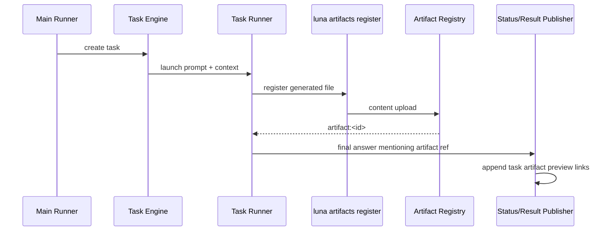

# Tasks And Task Runner

## Responsibility Boundary

A task is Luna's durable work unit. It is not limited to diagnosis. Work should become a task when it is long-running, deliverable, evidence-heavy, multi-step, tool-heavy, or needs asynchronous status updates.

Task Runner executes the work but does not own the final resource and notification model:

- Task Engine creates and updates tasks.
- Task Run Supervisor manages run lifecycle.
- Task Runner executes inside a runner root.
- Artifact Registry manages output files.
- The notification layer updates status cards and result cards.

## Task And Run Model

A Task is a durable subagent thread. It owns task identity, title, summary, context, participants, source links, subscriptions, and one or more Task Runs. It is not a one-shot ticket.

A Task Run is one execution turn for the Task subagent. It owns:

- run index and reason.
- input snapshot.
- context pack ids.
- materialized prompt.
- runner context id.
- source message id.
- terminal status and error/cancel reason.
- final report artifact id when the run completes with a report.

`tasks.status` mirrors the latest effective Task Run status. The current status vocabulary is:

- `new`
- `running`
- `waiting` (suspended cleanly while waiting on an open `Request` to Main or a scheduled `tasks pause --wake-in` timer; container released, `runner_session_id` preserved for `--resume`)
- `completed`
- `failed`
- `cancelled`

Workflow statuses such as `INVESTIGATING`, `RESOLVED`, and `ESCALATED` are not part of the current model. Dashboard, status cards, and task context should project the latest run status instead of preserving a separate ticket state.

## Task Lifecycle

Typical lifecycle:

1. Main Runner requests task creation or update through `luna tasks create|update|restart`, while the Main process is still running.
2. Runtime persists the task, source context pack, and dispatch marker.
3. Task Run Supervisor creates an initial, restart, or resume run.
4. Task Runner materializes the prompt (`<task>`, `<launch_context>` / `<update_context>`, `<task_events>`, `<user_input>`, `<completion>`) and begins execution.
5. During multi-stage work, Task Runner may send non-terminal milestone updates (`luna say --to main`), ask mid-run non-blocking or blocking questions (`luna ask --to main [--wait 60s]`), or suspend while waiting on external CI/jobs (`luna tasks pause [--wake-in <duration>] --reason "..."`).
6. User-visible files are registered through `luna artifacts register <path>`.
7. When the Task achieves its goal and calls `luna tasks report`, Runtime updates task status to `completed`, timeline, enabled status cards, and result delivery.

Each Task Run stores source context packs, materialized prompt, runner context, timeline events, pause reason / final report artifacts, and terminal or `waiting` status.

## Supplemental Input (`say --to task:<id>` vs. `tasks update`)

Supplemental input from Main uses two distinct channels depending on urgency:

- **Soft runtime inbox (`luna say --to task:<id>`)**: appends a `peer_message` event to `task_inbox_events` without aborting an active Task Run. Executor wires native `PostToolUse` (locally throttled to once per 15s via a file stamp, injecting `<task_events>` via `additionalContext` only when unread events exist) and `Stop` (blocking premature exit up to 2 times per run if unread events arrived or if the model forgot `tasks report` / `tasks pause` / open `Request`) hooks for both Claude Code and Codex in both `subprocess` and `pty` modes. `TaskReportService.submit` and `pause` also guard against unread inbox events (`409 unread_updates_pending`). If the Task is currently `waiting`, `say --to task:<id>` automatically resumes it.
- **Preemptive restart (`luna tasks update`)**: used when changed direction, conflicting facts, or new attachments (`sourceMessageIds`) make keeping the current run wasteful. `TaskRunSupervisor.restartTaskRun()` records a `task_update` context pack, cancels any active run, and starts a replacement run (`--resume` receives all unseen `task_update` packs recorded since the last delivered run on that `runnerContextId`).
- `luna tasks restart` retries a failed or cancelled task with existing information unchanged.
- `luna tasks cancel` cancels an active `running` run or transitions a suspended `waiting` task directly to `cancelled` (clearing `wake_at`, `wake_reason`, and `block_reason`).
- **Primary session vs. Watcher sessions (`luna tasks transfer | watch | unwatch`)**:
  - Every Task has **1 primary session** (`tasks.primary_session_id`) and **0..N subscribed sessions** (`task_subscriptions`). Task Runner mid-run communication (`luna say --to main`, `luna ask --to main`) routes exclusively to `primary_session_id`.
  - `luna tasks transfer --task-id <id> --to <address> [--origin-notify none|result_only|major_updates]` atomically switches `primary_session_id` and progress-card ownership to the target session without interrupting any active `TaskRun`, while retaining the previous primary session in `task_subscriptions` as a **silent watcher** (`notification_level = "none"`) by default, or `"result_only"` / `"major_updates"` when requested.
  - `luna tasks watch --task-id <id> [--to <address>] [--notify none|result_only|major_updates]` and `luna tasks unwatch` attach, adjust, or remove watcher sessions within the same Shadow.
  - Watcher notification levels: `none` (silent on-demand inspection via `tasks list/get/progress`, zero status cards and zero terminal `task_result` wakeups), `result_only` (no intermediate status cards, automatic terminal `task_result` delivery on completion/failure), and `major_updates` (both status cards and terminal `task_result`).
- For status/progress questions, Main reads `luna tasks get --task-id TASK_ID` and replies directly without starting another run.

## Launch Prompt

The launch prompt is the Task Runner input snapshot. It is not the only source of truth. Task source context packs are the durable facts explaining why the task was launched and which context it received.

Launch prompts should include:

- task type, title, summary, and dispatch reason.
- pending user input.
- source context and update context.
- known facts and assumptions.
- input image or file references as `artifact:<id>`.

`task_launch` context is injected only when the runner context has no provider
session id and a new provider session is being created. A restart that resumes
an existing provider session receives the restart/update context without
replaying the launch context. If the provider session is invalidated and a
fresh session is explicitly rebuilt, the launch context is eligible again.

When an input attachment is already an artifact, the prompt should prefer `artifact:<id>`. The runner may materialize it into a local file for processing, but it must not use the materialized path as the final user link.

## Workspace

Runner cwd is the session or task runner root. `projects/` is the mounted
shared development workspace containing projects and repositories.
`workspace/` holds runner-private attachments, reports, logs, and runtime
intermediate outputs.

Workspace-local paths are runtime facts:

- They help a runner read and write files for the current task.
- They are not guaranteed to be reachable from a remote service, Dashboard, Feishu, or another sandboxed runner process.
- They should not appear directly in user-visible replies.

## Container Execution

Task Runner uses the same fixed container execution model as Main Runner and runs through `ContainerAgentRunner`.

The supervisor resolves the active Dashboard Agent Profile when a run begins,
not when a task was originally queued. Provider/model resume compatibility is
then checked lazily against the selected task runner context.

One Task run may take as long as the platform allows: the platform setting
`execution.taskTimeoutMs` (1 to 10080 minutes, default 600 minutes / 10 hours; Dashboard `/platform/settings` → 运行与重试)
becomes the Job's `timeoutMs` when the run's Job is created
(`jobTimeoutMs` in `src/runners/runtime-agent-transport.ts`). Executor stops a
run that passes it with `execution_timeout`; the run fails, Main is told, and
the Task can be restarted. A changed setting applies to runs started afterwards.
Main and Work turns keep the platform-wide `execution.containerTimeoutMs` setting (`platform_settings`, managed on Dashboard `/platform/settings`).

Task Jobs use the scope `task:<task-id>:<runner-type>` and carry the task and Task Run IDs in their Job credentials. In isolated mode, Worker provides a container for the scope. In shared mode, Task uses the common Executor. Both modes use the public HOME and a task-specific working directory. Runtime and Executor serialize executions for the same context: `executeTaskRun` waits for any superseded (`revoked`) invocation of the Task to settle before resolving `runnerContext` and materializing the next run's prompt, and `ContextPreparationManager` returns retryable `503 context_busy` while a prior invocation's job on the same Worker is still draining. Worker retains context data after container reaping.

## Artifact Output Contract

When Task Runner generates a user-visible file, it must register an artifact first:

```bash
luna artifacts register workspace/final-report.md --json
```

After CLI returns `artifact:<id>`, the runner can reference that artifact in its report command. Do not rely on server-side fallback conversion from local paths to links.



## Status Card And Result Delivery

Status card body comes from runner/LLM output, while artifact links come from persisted task artifact outputs. These are separate responsibilities:

- Runner output explains the conclusion, process, and next steps.
- Task artifact list provides complete reports, images, files, and previewable resources.
- Status cards display operational progress and terminal status.
- Main reads the internal report and sends the user-facing answer as its final reply or through `luna say --purpose answer`, including for short answers such as weather results.
- Scheduled background inspections (`task.run` schedules) invoke `TaskRunSupervisor.restartTaskRun` directly with `quiet: true` so routine runs execute without waking Main first; when a quiet run finds something actionable, its report wakes Main or is picked up by the Shadow's heartbeat.

Do not require the LLM to manually assemble complete report links. When a task has artifact outputs, the notification layer can append links deterministically.

## Failure, Retry, And Idempotency

Task Run Supervisor owns initial runs, restart runs, obsolete-run cancellation, interrupted-run recovery, and terminal status. Idempotency depends on task run state, source message, context pack, timeline event, and notification trace.

On failure:

- Aborted or no-longer-active runs must not overwrite current state.
- Runtime recovery should mark interrupted runs failed instead of blindly rerunning them.
- Status cards and result notifications should be reconstructable from persisted task state.
- A Service restart reattaches a run whose Job is still executing. The run's
  invocation keeps the Agent configuration it started with, so a newer Service
  that describes that configuration differently still reattaches it.
- A submitted report finishes the run. When Service cannot follow the run's Job,
  it revokes the invocation, the recovery pump cancels and drains the Job to a
  terminal state, and the run then completes with the report; it is never
  cancelled or left running.
- Live provider recovery may continue a Task Runner only after the runner
  protocol has emitted a completed-work checkpoint. Before the first
  checkpoint, a transient provider failure is terminal for that Task Run so
  side-effecting tools are not blindly replayed.

## Primary Code Paths

- `src/tasks/task-engine.ts`
- `src/tasks/task-run-supervisor.ts`
- `src/tasks/task-run-store.ts`
- `src/kernel/task-run-handler.ts`
- `src/tasks/task-status-projection.ts`
- `src/runners/container-agent-runner.ts`
- `src/sandbox/container-lifecycle.ts`
- `src/prompts/task-runner/instructions.md`
- `src/messaging/notifications/task-status-card-updater.ts`
- `src/messaging/notifications/feishu-task-updater.ts`


### Dashboard task deletion

An Agent owner can permanently delete an idle Task in that Agent with `DELETE /api/tasks/:id` from a Dashboard session. The detail page asks for confirmation. Running Tasks/Runs, active status-card notifications, pending task-result triggers, and running turns in related sessions return 409 without mutation. New idle tasks and terminal tasks can be deleted.

The transaction removes the task, runs, participants, subscriptions, task timeline, context packs, runner context and owned artifact metadata; task-scoped tokens are revoked and handoff links are detached. Session messages, external messages and other tasks remain. Managed artifacts referenced by surviving messages/tasks transfer ownership; local owned managed files use the durable file-cleanup mechanism. `task_deletions` records the ID, owning Agent, deletion time and pending cleanup. The owner can repeat DELETE to retry cleanup. Startup also retries cleanup. Unattributed historical tombstones and unknown IDs return 404. Storage guards reject late task-run/artifact writes after deletion.


Deleted Task references remain visible in the Dashboard. Before removing a task, deletion records only task/session/source-message IDs in `deleted_task_references` (no title, report or execution content). Session lists, session headers, message tags and status/result cards project these relationships as `status=deleted`, with the fixed label “Task deleted” and no task detail link. Historical message text is preserved. Task links in Markdown are replaced with the same non-clickable placeholder when they point to a deleted local task; external-site links remain unchanged. Historical cards and later links can also resolve deletion from `task_deletions`, so older deletions with surviving message references are recognized. Deleting a session removes its retained reference edges. Task detail APIs continue returning 404 after deletion; the placeholder is a reference projection, not a retained Task object.

## User communication boundary & multi-stage interaction

Task Runner never addresses external chat surfaces directly; all communication
goes through Main (`--to main`):

- **Non-terminal milestone updates (`luna say --to main`)**: wakes subscribing
  Main (`peer_message`) with intermediate findings or registered artifacts while
  the Task container keeps running.
- **Mid-run questions & approvals (`luna ask --to main --text ... [--wait 60s]`)**:
  opens a correlated `Request` (`request_opened` on Main). When independent parallel
  work exists, omitting `--wait` lets the Task keep working and receive Main's
  `request_update` mid-run via `<task_events>` (`PostToolUse` / `Stop` hooks). When
  blocked, `--wait` returns immediately in the same container if Main settles in time
  (marking the `task_inbox_events` row delivered); otherwise the Task exits cleanly
  into `waiting` state (`block_reason = "waiting_user"`), releasing the container
  until Main settles via `luna ask reply <id> --done|--declined --text '...'`, which
  writes `request_update` to `task_inbox_events` and automatically `--resume`s the Task.
- **Timed external waits (`luna tasks pause [--wake-in <duration>] --reason "..."`)**:
  sets `tasks.wake_at` and `block_reason = "waiting_external"`, releasing the
  container cleanly (`status = "waiting"`). `TaskRunSupervisor.sweepDueWakeups`
  automatically resumes the Task when `wake_at` arrives.
- **Final report (`luna tasks report --stdin`)**: reserved exclusively for final
  Task completion (`--waiting` is removed).

A completed run with status cards enabled updates its operational status card with a neutral completion
notice (a suspended `waiting` run updates its status card with the pause reason). Main receives the `task_result` event in `<events>` and sends the user-facing explanation
as its final reply or with `luna say --purpose answer`; terminal Main output is suppressed when an early CLI answer already owns delivery.
The result publisher correlates this command with its notification attempt and
avoids duplicate delivery during recovery.

If Main fails before submitting an answer, the result notification remains failed
for recovery; Runtime does not publish the Task report as a fallback user reply.

Main's task command returns after the Service persists the operation and dispatches
the run. Main can then acknowledge the task using its returned ID and finish with
`LUNA_NOTHING_TO_SEND`. Neither initial dispatch nor task restart waits for or
parses Main's terminal output. Task result reports still wake Main separately.

Task commands call `TaskCommandService` directly. New operations do not create
runner decisions or carry reply-format metadata. Creation uses a unique
operation-derived task ID; multiple commands in one turn may create multiple tasks.
Original messages are retained in task provenance/context packs; a separate internal
command source makes supervisor dispatch and restart idempotent. Clarification
state clears when a task is created. Updates require task ownership or an existing
subscription in the current conversation.

## Task report, pause, and native CLI hooks

Task calls `luna tasks report --stdin` with plain report text (`--text REPORT`
is also supported; CLI derives `Idempotency-Key` automatically), or suspends via
`luna tasks pause [--wake-in <duration>] --reason "..."`. `luna commands status COMMAND_ID`
reads receipts (`POST /api/runner/task-reports`, `POST /api/runner/task-reports/pause`,
and `GET /api/runner/commands/:id`). Only the current active Task invocation may
submit a report or pause; Main and Work cannot use this capability.

Before accepting `submit` or `pause`, `TaskReportService` checks `task_inbox_events`
for unread updates (`409 unread_updates_pending`), ensuring the model sees any
late notes or settled `Request` answers before closing out.

A report transaction persists the managed report artifact, task artifact, immutable
`task_report_commands` receipt, run report reference and per-subscription
task-result outbox entries. One report is accepted per run; identical retries
return the same receipt, while changes conflict. The publisher wakes Main
immediately after commit, before Task process exit.

Task terminal output is ignored (`terminalOutputMode: "ignored_use_tasks_report"`—no
`LUNA_NOTHING_TO_SEND` sentinel is required). Completing a run without an
accepted `luna tasks report`, `luna tasks pause`, or an open `Request` from the
Task fails execution; terminal prose never becomes a report. Executor wires
native `PostToolUse` (15s local file-stamp throttle) and `Stop` (up to 2 blocks
per run) hooks (`apps/executor/src/task-hooks.ts` + `luna internal task-hook`)
for both Claude Code and Codex so unread inbox events are injected mid-run and
forgotten `tasks report` / `tasks pause` calls are caught before process exit.
Once accepted, a report survives later process errors and startup recovery
completes the run from its durable receipt. A superseded run cannot publish over
the current run.

### Quiet runs and results without a reply

`luna task update` and `luna task restart` accept `quiet: true` for a background
check nobody is waiting on. It is stored in the run's input snapshot and does
not affect the progress card, which `sendStatusCard` controls separately.

A task-result turn normally has to produce an answer message; a turn that ends
without one fails its delivery and is retried on recovery. Two cases settle
without a message (`TaskResultEventPublisher._mayEndSilently`): the run was
quiet, or during that turn Main applied a `task.update`, `task.restart` or
`task.cancel` for the same Task, so the work continues there. The notification
attempt is then marked `skipped`, a terminal state recovery does not retry.
Whether a quiet check found something worth saying is Main's judgment; the
instructions tell it to reply whenever it did.


## Explicit topic binding and optional status cards

Runner chooses the conversation shape. `luna session create-thread` accepts
`anchorMessageId` (required Luna message ID), `contextMessageIds` (optional
supplementary historical Luna message IDs), and optional `title`. Creation
automatically selects the anchor plus up to four preceding messages, then adds
the explicit IDs without duplicates. All selected messages must
be visible, non-deleted entries in the invoking session. The anchor must be a
real Feishu message on that session's channel. Existing topics reuse their
canonical root; new topics bind beneath the anchor.

`ThreadCommandService` creates/resolves the session, adds message references,
and writes a `thread_launch` context pack inside the operation transaction.
The anchor is automatically included. Source messages keep their original
ownership and are not resent. The operation receipt includes `targetSessionId`.
This provision step sends no message. Source Main submits a `messages handoff`
(`session.invoke`) containing the request and request-specific context (without
repeating standing `<soul>` / `<memory>` rules) to the returned session. It
neither sends the topic opening nor creates the topic Task; when the topic is
anchored to the current turn's group message and the handoff is accepted, source
Main finishes with `LUNA_NOTHING_TO_SEND` so the group does not receive a second
acceptance alongside the topic reply. The target Main is
invoked through the existing per-session dispatcher with the selected history.
It first sends its opening answer through CLI in its own session; once delivery
is confirmed it creates the Task there, omitting `sessionId`. The opening makes
the topic visible before its progress card. The opening describes intended work,
not successful creation; a later creation failure requires a visible notification.
On success the opening answer suppresses duplicate terminal delivery. Ambiguous
requests are clarified in the topic; the target does not hand back or create a
nested topic. Stable handoff/operation IDs retain existing replay semantics.

The general task command still accepts `sessionId` for explicit target binding;
this topic orchestration uses the receiving Main's current session. Without a
session ID the task stays in the current session;
task creation never creates a topic. `sendStatusCard` defaults to true.
The subscription stores `notification_level=none` for disabled cards and
`major_updates` for enabled cards. `luna task update` and `luna task restart` accept the same
`sendStatusCard`: when given, it sets the subscription's level from that run
on; when omitted, the existing preference is kept. Existing historical subscriptions retain their
prior setting.

Runtime owns the lifecycle of enabled cards in the bound session. Root-session
cards are channel messages; topic cards reply to the real provider root, never
the synthetic command source ID. Card preference does not remove the task-result
subscription: reports still notify Main, which decides the user-facing reply.

Task launch copies the topic or group's selected history into durable task source packs.
The task's primary session and result subscription use the chosen target;
the invoking session retains original command provenance and can update/retry
the task it created. Command replay reuses the same session/task/run.

Status-card recovery isolates failures per notification. A historical provider or
idempotency error remains pending and logged; it cannot prevent service startup
or recovery of other cards.


## On-demand status cards

`luna task status-card --task-id TASK_ID --request-id ID [--resend]`
calls `POST /api/runner/tasks/status-card` with `{taskId,resend?}`.
A live Main invocation may operate a task belonging to the current conversation
or created from that conversation. Delivery always uses the existing task
subscription in its primary session; the command cannot select another channel.

Preparation pins the latest run and notification in `runner_operations`; no run
is created or restarted. Dispatch sends a missing card, refreshes the existing
card, or sends a replacement when `resend=true`. The snapshot includes current
status and run-scoped progress. Completed/failed/cancelled runs get terminal
cards. After delivery, the notification points at the returned card and the
subscription switches to `major_updates`, enabling future automatic updates.

Manual and automatic card delivery share a per-run execution lane. A replacement
therefore cannot race an older progress/terminal update. Automatic update keys
include the bound card identity. The manual command's outbound payload is
persisted before delivery, so retry uses the same content and provider key even
when progress changes. After replay it refreshes newer state if necessary.
Pointer replacement, local card persistence and delivery receipt commit together.
An older failed command cannot overwrite a subsequently replaced card.

The operation remains prepared on delivery failure and is recoverable on startup.
`luna task status COMMAND_ID` exposes its receipt. Applied receipts include
`taskSessionId`, `runId`, and `statusMessageId`. Replaying an applied command,
including a resend, returns that receipt without sending another card.

### Task progress presentation

Current incremental updates, durable tool rows, adapter projections and Native
delivery budgets are defined in [Progress notifications](progress-notifications.md).
Tools and public text share the Task timeline; each tool updates one row.

Task creation accepts `sendStatusCard` (true by default) and
`statusCardStyle: "card" | "native"` (default native for new tasks; existing subscriptions retain their style). `tasks status-card` accepts
`--style card|native` / JSON `style`. Omitting style retains the current choice;
switching an existing message requires `--resend`. Subscriptions persist the
preference for subsequent runs; each run notification snapshots it. Replacement
closes an active native bubble before binding its successor. Task results and
Runner command/sentinel contracts are unchanged.

Both styles use the same notification lane, session delivery fanout, command
receipts and terminal transitions. The Feishu adapter translates native snapshots
into `message_cot` create/append/complete requests. A separate
`native_progress_deliveries` provider checkpoint stores channel/message/cot IDs,
acknowledged entry IDs and terminal state. This also supports recovery after a
service restart. Create/append requests with unknown network outcomes are not
blindly retried (the API has no documented idempotency facility); commands report
the ambiguity and a new request with `--resend` can replace the display. A known
bubble can still be closed after an ambiguous append. Delivery failures never
change Task execution outcomes. There is no silent style fallback.

Native entries contain only public assistant text and tool names with stable
call IDs. Thinking blocks, full tool argument objects and raw tool results are excluded.
Historical unmarked timeline entries are not exported to native bubbles. The
Feishu heading is provider-controlled; only real tool calls and public
assistant commentary are emitted during execution, and a closing explanation is
appended only for non-completed terminal states (failed, cancelled, waiting, or
blocked). Failed/cancelled runs complete with `error`, while completed and
waiting runs complete with `done`. The dashboard retains its
common status-card projection and records the provider presentation style.

Tool progress is preserved structurally from the CLI provider through the
Executor/Runtime stream, `RunnerOutputState`, and the transient progress sender.
Tool starts insert `runner.tool` rows and results update those rows; public
Assistant text remains separate `runner.step` rows. Provider adapters
emit ordered public text, tool-start (call ID, name, display title), and tool-result
(call ID, outcome) events. Results also emit the existing retry checkpoint;
progress is never appended to the Runner's final answer. Claude mixed content
blocks and Codex command/file/MCP items retain their original call IDs. Full argument objects, outputs and thinking blocks are excluded from this public
stream. Tool titles include a subject extracted from structured input before
truncation: command/cmd, file path, search query/pattern, URL, or description.
Subjects collapse whitespace, redact common credential forms, and are bounded
to 80 characters. Codex MCP argument JSON is decoded before extraction. Missing
subjects retain the category label; no extra model generation is requested.

The Feishu renderer attaches tools to the most recent text node, selects a
category icon/title, and sends `TOOL_CALL_RESULT` for completion. Each tool group
between text nodes displays at most 10 tool calls followed by a single `...`
node, resetting when the next public text node arrives. Open tools and
the latest parent node are checkpointed across restarts. Terminal transitions
close unresolved tool nodes without claiming success. Successful runs send
`REASONING_END` then `RUN_FINISHED`; failed/cancelled runs use explicit error
completion (never `RUN_FINISHED`, which Feishu treats as success). Ambiguous
terminal appends retain the existing explicit completion recovery path. Native
headings and disclosure controls remain managed by the Feishu client.

Existing public assistant commentary may appear in progress bubbles; the Task
prompt does not require additional narration for progress display. Concrete tool
progress should be derived from structured tool events by the runtime.

Tool classification and Chinese labels are shared by the provider adapters and
Feishu renderer in `tool-display.ts`. Commands prefer human-readable
`description`/`toolSummary`/`toolAction`/`subject` over raw command text; file
tools display the file basename (`读取 <name>` / `写入 <name>` / `编辑 <name>`);
search/fetch tools format `搜索 <query>` / `访问 <url>`; display is capped at 80
characters.
Luna retains credential redaction before display and its existing result-status
protocol. Tool classification does not use assistant prose or generated labels.

### Work final replies

Work accepts successful final text or a luna.reply presentation document through
Service's shared final-reply handler. A CLI answer already accepted for the turn
suppresses duplicate terminal delivery. Progress cards report execution complete
and answer submitted, not provider-confirmed delivery. Task report commands and
Task internal terminal report semantics are unchanged.


### Explicit task cancellation

Main resolves the intended Task from the conversation for both `/stop` and
natural-language stop requests. If the target is ambiguous it asks the user;
there is no automatic whole-session cancellation or special `/stop` bypass.
Main calls `luna tasks cancel --json '{"taskId":"...","reason":"..."}'`.
The command uses the existing conversation scope checks and operation ledger, with deterministic invocation-scoped idempotency and unified inspection via `luna commands status <id>`.
Preparation freezes the active Run ID, so replay cannot cancel a later explicit
restart. A run already completed/failed is unchanged (`cancelled: false`).

Cancellation records Task/Run `cancelled`, revokes the invocation and its tokens,
then aborts the existing Runner through Runtime/Executor's normal Job cancellation.
No replacement Run or Task-result Main invocation is created. Late reports are
rejected and late process completion cannot change cancellation into completion.
The existing progress card closes with cancellation text, without the restart
phrase “New supplemental information received”. The command acknowledgment confirms cancellation requested;
physical process shutdown may finish shortly afterward. Startup cancellation and
notification recovery reuse the existing ledgers; no new persistence model is added.

Restart supersession and explicit cancellation share one supervisor rule
(`TaskRunSupervisor._cancelRun`): the Run state, invocation/token revocation and
timeline event commit in one transaction before the local process is aborted.
A superseded run's token is therefore inactive even if the process was aborted
before its Runtime transport attached an abort listener.

`JobReconciler` can also cancel a running Task Run when its invocation fails
scope validation (for example an inactive actor or unavailable session). It uses
the same guarded `TaskRunStore.markCancelled` transition and `runner.cancelled`
timeline event, and updates `tasks.status` only when the run is the latest. That
path does not abort the supervisor's signal; when the supervisor observes its
run cancelled with a live signal it closes the status card through the normal
`onRunCancelled` notification. No Task-result Main invocation is created.
