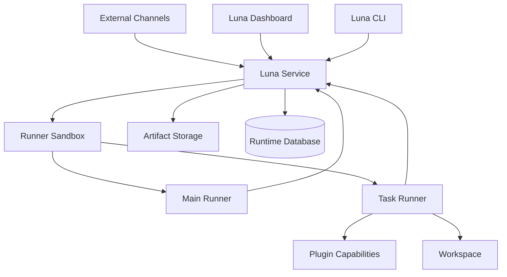
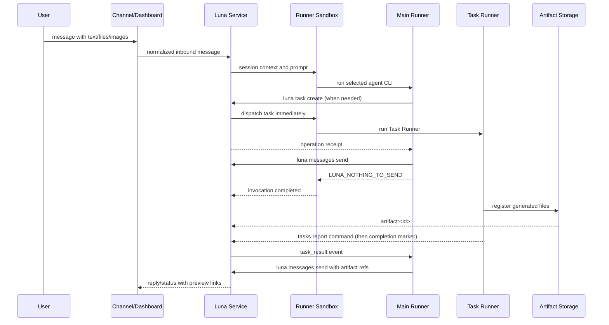

# Luna Documentation Overview

## What Luna Is

Luna is an Agentic Work OS for enterprise collaboration. This repository contains Luna Service, Luna Dashboard, Luna CLI, Main Runner, Task Runner, channel adapters, trusted plugin marketplace integration, and artifact storage.

The core model is simple: external channels or Dashboard create user interactions; Luna Service records provider-neutral messages, sessions, tasks, and resource facts; runners reason and deliver work inside controlled context; channels or Dashboard present the result in a surface-appropriate form.

## System Map

Main components:

- **Luna Service**: the control plane for HTTP APIs, authorization, scheduling, persistence, artifact management, plugin capability dispatch, and runtime state.
- **Dashboard**: the debugging and operations UI for sessions, tasks, timelines, runner decisions, and artifact previews.
- **CLI/MCP**: the local interface used by runners, developers, and tools to access Service capabilities.
- **Plugins**: trusted marketplace extensions that contribute capabilities, CLI commands, runner tools, and skills without adding domain-specific routes to Luna Core.
- **Main Runner**: the session-level reasoning runner that executes task, session-state and message commands, then returns a completion marker.
- **Task Runner**: the runner for long-running, deliverable, or evidence-heavy work.
- **Runner Sandbox**: the Docker-backed execution boundary for Main Runner and Task Runner. Service keeps scheduling, authorization, persistence, and delivery authority.
- **Channel Adapter**: the boundary that normalizes external channel payloads into Luna message abstractions and renders outbound channel responses.
- **Artifacts**: durable resources produced or received by Luna. Internal references use `artifact:<id>`; user access uses signed content or preview links.

## Core Runtime Paths

Core rules:

- Main Runner makes session-level decisions; Runtime performs deterministic database writes, channel sends, and task dispatch.
- Main Runner and Task Runner always execute inside the configured container runner sandbox.
- Task Runner performs deliverable work; user-visible generated files must be registered as artifacts.
- External channels and Dashboard are presentation surfaces over the same Service/runtime facts.
- `artifact:<id>` is the stable internal reference; `/artifacts/:id/preview` and `/api/artifacts/:id/content` are signed access or presentation forms.

## Architecture Documents

- [Architecture Principles](designs/architecture-principles.md)
- [Identity And Users](designs/identity-and-users.md)
- [Messages And Channels](designs/messages-and-channels.md)
- [Sessions And Main Runner](designs/sessions-main-runner.md)
- [Tasks And Task Runner](designs/tasks-task-runner.md)
- [Runner Sandbox](designs/runner-sandbox.md)
- [Artifacts](designs/artifacts.md)
- [Auth And Permissions](designs/auth-and-permissions.md)
- [Plugins And Marketplace](designs/plugins-and-marketplace.md)
- [Dashboard](designs/dashboard.md)
- [CLI, MCP, And Workspace](designs/cli-mcp-workspace.md)
- [End-To-End Flows](designs/end-to-end-flows.md)
- [Operations And Debugging](designs/operations-and-debugging.md)
- [Execution Runtime](designs/execution-runtime-foundation.md)
- [Agent And Shadow Ownership](designs/platform-agents-and-shadows.md)
- [Agent Configuration](designs/agent-configuration.md)
- [Worker Storage](designs/worker-storage-layout.md)
- [Runner Images](designs/runner-image-variants.md)
- [Database Schema](designs/database-schema.md)

## Deployment And Release

- [Deployment Guide](runbooks/deploy-luna.md)
- [Release Checklist](releasing.md)

## Where To Start

- New contributors: start with [Architecture Principles](designs/architecture-principles.md), [Messages And Channels](designs/messages-and-channels.md), and [Sessions And Main Runner](designs/sessions-main-runner.md).
- Debugging a user message: start with [Messages And Channels](designs/messages-and-channels.md), then read [Sessions And Main Runner](designs/sessions-main-runner.md), [End-To-End Flows](designs/end-to-end-flows.md), and the message injection runbook in [Operations And Debugging](designs/operations-and-debugging.md#message-flow-debugging).
- Debugging images, files, or report links: read [Artifacts](designs/artifacts.md), [Dashboard](designs/dashboard.md), and [Operations And Debugging](designs/operations-and-debugging.md).
- Changing runner behavior: read [Sessions And Main Runner](designs/sessions-main-runner.md), [Tasks And Task Runner](designs/tasks-task-runner.md), [Runner Sandbox](designs/runner-sandbox.md), and [CLI, MCP, And Workspace](designs/cli-mcp-workspace.md).
- Adding a channel or plugin capability: read [Messages And Channels](designs/messages-and-channels.md), [Plugins And Marketplace](designs/plugins-and-marketplace.md), [CLI, MCP, And Workspace](designs/cli-mcp-workspace.md), and [Auth And Permissions](designs/auth-and-permissions.md).
- Provisioning a new server: follow the [Deployment Guide](runbooks/deploy-luna.md).

## Maintenance Rules

- `docs/designs/` contains the current long-term architecture documentation.
- `docs/runbooks/` contains reusable operational instructions.
- `docs/local/` is ignored by Git and contains private deployment details, historical proposals and implementation records. Public documentation must not depend on it.
- Architecture docs describe the current long-term design and do not preserve old-data compatibility notes.
- Docs should explain boundaries, dependencies, data flow, authorization rules, failure modes, and primary code paths.
- Code paths are navigational anchors, not a source index.
