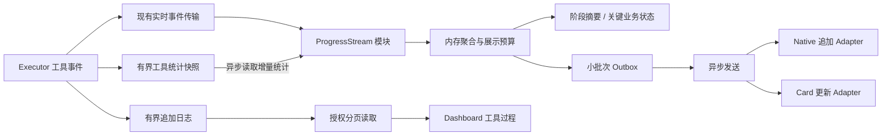

# Task / Work 进度增量处理与展示预算方案

状态：待评审，尚未实现。日期：2026-11-21。

## 1. 建议与范围

采用一条 Task / Work 共用的进度处理链路：工具事件写独立追加日志，展示进度在内存中聚合，业务库只保存关键状态、阶段摘要及有界发送检查点。Runner 的工具执行不等待飞书网络请求。Native 向同一消息追加新批次，普通 Card 使用有界的当前摘要更新。

本次不改任务执行账本、执行凭据、任务成功/失败判定、Worker 放置和 Runner 会话恢复。不删除工具日志来换取性能；业务库也不承担逐条工具日志存储。

本方案包含工具事件查看入口，因为移除业务时间线里的逐条工具事件后，Dashboard 必须仍能追查工具过程。现有运行中的执行轮次保持旧模式，新的执行轮次使用新模式。

## 2. 已确认的问题

| 当前代码 | 行为与影响 |
| --- | --- |
| `src/kernel/task-run-handler.ts` | 每个工具开始、结果分别调用 `timeline.append`，随后 `await onProgress`。工具执行流会等待通知处理。 |
| `src/tasks/task-run-notification-service.ts` | 每次进度更新按 task_id 读取所有时间线，解析数据后过滤当前 taskRunId，再重建完整步骤和 Native 条目。任务多次运行的历史也参与扫描。 |
| `src/work/work-runner.ts` | Work 的每次更新重新遍历累积的 progressEvents，生成完整步骤与 nativeProgress，再保存和发送状态卡。 |
| `extensions/channels/feishu/messaging/native-task-progress.ts` | 飞书侧已是增量，但内部每次加载全部 sentEntries，建立 Set，并遍历完整输入。每条新增记录的 append 前后都保存整个 JSON 状态。 |
| `apps/executor/src/executor/store.ts`、`event-reporter.ts` | Job 状态快照持久化，实时 provider 事件每个 Job 最多缓冲 16 条，取出后发送失败不补发。它不是完整、可重放的工具历史。 |

若每新增一个工具事件都触发更新，历史扫描和不断增长的 JSON 重写累计接近 O(N²)。这是代码复杂度判断，尚未用真实负载测量 CPU、延迟或磁盘占比。

Native 当前没有累计条数或长度预算。单条文本截取 800 个 JavaScript 字符单位，不能保证整条 Native 消息无限增长后仍能完整显示。未确认飞书 message_cot 的官方累计容量上限；下面的数值是 Luna 自身的拟议保护预算，不是飞书限制。

## 3. 数据流与职责



### 3.1 Executor 工具日志

在 provider 输出被实时环形缓冲丢弃之前，提取工具开始、结束、失败事件，写入按 Job 分隔的 JSONL 日志。利用现有 Job 序号建立 `(jobId, attempt, eventSeq, blockIndex)` 来源标识。生产者传输丢帧不影响日志中已记录的过程，但不能把未观测到的结果判定为成功。

字段为：所属 Agent / Shadow、invocationId、jobId、attempt、来源序号、时间、toolCallId、工具名、公开标题、阶段、可确认的结果状态。默认不复制工具参数、完整输出、环境变量或执行凭据。原始 Claude/Codex 转录文件继续使用原有读取权限；这份日志负责可定位的工具调用过程，而非第二份完整转录。

日志放在 Executor 的 `/data/job-traces/<jobId>/` 下，由 Executor 管理。写入使用有界缓冲，每 1 秒或 64 KiB 刷入文件；生命周期收尾尝试刷新缓冲。它是诊断数据，进程硬崩溃可能丢失最后一个缓冲窗口，不能作为任务结算依据。

拟议预算：每 Job 64 MiB，终态保留 7 天，Worker 总预算 5 GiB。先清理超过保留期的终态日志，再回收最旧终态日志；活跃 Job 达到单 Job 上限后停止写明细，持久标记截断位置和原因。缓冲最多 256 KiB；写入失败或空间不足时丢弃诊断明细并记录 gap，不阻塞工具执行、不改变任务结果。Dashboard 明确显示缺口，不能宣称无限或无损保存。

不使用新的 SQLite 表逐条保存工具开始和结果，不改变现有 Executor / Runtime 的可靠状态协议。

同时生成每 Job 的有界工具统计快照（累计调用数、已观测结果数、明确失败数、最多 64 个分类、来源序号及 gap 标记），和日志批量刷新一起保存为小文件。Service 每个聚合窗口读取统计快照，以前后快照的差值形成计数摘要；普通工具的实时事件只作为“统计可能更新”的提示，不重复计数。这样即使现有 16 条实时缓冲丢帧，也不会把实时收到的几次调用冒充全部调用。Worker 不可用或快照缺失时明确标记统计不完整。

快照序号、工具日志游标与飞书确认批次是不同概念，分别管理。统计文件的短窗口丢失不影响任务状态；不得根据统计快照推断任务成功。启动恢复只扫描快照之后的日志尾部，不能每次刷新都重新读取完整工具日志。

### 3.2 业务数据库

保留：任务创建、运行、完成、失败、取消、等待输入、最终结果、产物引用，以及有用的阶段摘要。任务关键状态沿用现有存储事务。

移除新模式下仅为进度展示而产生的每工具开始/结果 `timeline_events`。例如 100 次 Read 不再产生 200 条业务时间线，聚合为一条“读取文件 100 次，其中 2 次失败”的摘要。普通工具失败先计入摘要，不将“工具失败”自动提升为“任务失败”；真正阻塞任务、需要人处理的事件使用明确的关键事件。

新增 `timeline_events.task_run_id` 和索引 `(task_id, task_run_id, created_at, id)`；只对历史可确认的 JSON taskRunId 回填，其余保持空。查询阶段摘要时按当前轮次和游标分页，不再先读全任务历史再过滤。Work 的摘要按 turnId / invocationId 隔离。

### 3.3 ProgressStream Module

调用者只提交新增事实，不传完整历史：

```ts
record(scope, event): void
finish(scope, outcome): Promise<void>
```

scope 区分 Task Run / Work Turn 与 invocationId；event 有稳定来源标识，区分工具观察、公开阶段摘要和关键事件。`record` 只做有界入队、计数和去重，不等待网络、不重新查询历史。`finish` 保存最终投影和待发送终态，等待的只是本地持久化；不会等待飞书响应。

聚合、节流、预算、接收方投影、批次检查点和发送重试都由 Module 内部管理。Native / Card 是实际不同的 Adapter，Task / Work 不各自实现一套恢复机制。

Executor 的工具名分组最多 64 项，活跃 toolCallId 映射最多 128 项，超出归入“其他/未匹配”。Service 保留有界的上一份统计快照和近期公开摘要来源 ID；普通工具累计数以 Worker 快照为准。若日志/快照有缺口或重启后计数无法复原，摘要标记“统计可能不完整”。持久工具日志是查看详情的依据，统计不影响业务状态。

## 4. 展示、发送与背压

### 4.1 拟议默认参数

| 参数 | 默认建议 |
| --- | --- |
| 普通进度刷新 | 每 5 秒，或累计 32 条待展示摘要后提前排队；同一消息仍至少间隔 2 秒 |
| 单批请求体预算 | 8 KiB UTF-8 序列化数据，连事件包装一起计量；超过时拆批 |
| 单条 Native 消息累计预算 | 100 个展示节点、32 KiB 已发送序列化事件数据 |
| 关键通知预留 | 上述预算内预留 6 个节点和 4 KiB，普通进度不能占用 |
| 单执行轮次内存缓冲 | 16 KiB；工具计数、分类与来源去重额外使用固定上限 |
| 并发发送 | 每消息 1 个请求；全局有界并发，初始 4 个 |

这些是初始可调整参数，真实飞书验收后再校准。关键事件可以立即触发排队，但同一消息仍有串行发送，不能越过正在发送的请求。排队耗时有监控，不宣称立即送达。

### 4.2 Native

发送层收到已经形成的新批次，不再自行遍历累计工具历史。批次内保留原事件顺序，多个 Native events 放进一次 PUT。默认展示阶段摘要和工具调用计数，不逐个发送普通工具调用的开始/结果节点；关键阻塞事件单独展示。

达到累计预算时，只追加一次“详细进度请到 Dashboard 查看”的说明，随后普通工具明细仅写日志、聚合计数，不再往该气泡追加。业务暂停、等待输入、失败和完成使用预留预算。最终文本也有上限：保留状态、简短结论及结果链接，长报告通过现有产物交付。

默认不自动连续创建新气泡，避免长任务刷屏。若关键预留被消耗完，后续关键信息只更新数据库与 Dashboard；Task 最终结果继续走现有独立结果通知链路，不能因为进度预算耗尽而被吞掉。Work 目前依赖最终状态卡汇报，必须补齐独立最终答复兜底：已知进度预算耗尽时发送一条有界最终答复，复用既有逻辑消息回执防止重复；若投递结果不确定则保持不确定状态，不能盲重发。Native 条目为追加语义，已经发送的旧条目不承诺覆盖。

### 4.3 Card 与 Dashboard

Card 每次仍是替换投影，但投影只有最近 20 条阶段摘要、聚合统计和当前状态，大小有界。Dashboard 当前进度面板采用同一有界投影，状态消息中不塞入完整工具数组；工具过程另行分页查看。

发送背压下优先合并普通摘要和计数。每消息最多 1 个待发送批次、1 个正在发送批次；后续普通变化合并进内存投影。最终状态有独立终态槽，可从已持久化任务状态恢复。不得让飞书变慢造成无限内存队列，也不得让网络阻塞 Runner 的事件消费。

## 5. 批次持久化与恢复

### 5.1 检查点

V2 每个接收消息保存常量大小状态：逻辑投递键、channelId / providerMessageId / cotId、协议版本、nextBatchSeq、ackedBatchSeq、已消耗节点/字节、budgetExhausted、started/terminal、最近推理节点、pending 标记及最近发送错误。

不保存无限增长的 sentEntries。发送前在短事务中写入本批 payload、batchSeq 和 pending 状态；网络操作在事务外进行；确认响应后以比较 batchSeq 的方式推进检查点并释放 payload。Outbox 保存的是有界待发送批次，不是每次工具调用一行，也不是永久发送历史。

Outbox 明确区分 `queued / inflight / ambiguous / retryable`。发送线程先通过事务领取 queued 批次并持久化 inflight，再发起 HTTP；重启时 queued 可继续发送，遗留 inflight 一律视为 ambiguous。即使崩溃恰好发生在标记 inflight 后、实际请求前，也采取保守的不确定处理，不能推断请求一定未发出。同一消息不能越过未确认批次发送后续批次。

任务/会话阶段摘要与创建对应 Outbox 的动作在同一事务内形成。对于最终状态，沿用既有通知恢复入口：若最终业务状态已经持久化但终态 Outbox 写入失败，恢复扫描补建终态通知，不能仅依赖内存计时器。

每个投递接收方有自己的检查点。某个机器人或群发送失败，不能推进其他接收方的游标。发送沿用现有 SessionReplyDispatcher 的身份、机器人绑定和目标消息回执校验。

### 5.2 失败语义

| 场景 | 行为 |
| --- | --- |
| 进度仍在内存，Service 被硬杀 | 允许丢失最多一个聚合窗口的非关键展示进度。详细工具日志与任务关键状态独立保留；恢复后显示最近已持久化摘要，不重放全部工具。 |
| Outbox 已提交但尚未开始请求 | 重启后发送该批次。 |
| 请求开始后超时，无法确定飞书是否应用 | 保持 ambiguous 状态，停止该气泡继续追加；不盲重试、不声称 exactly-once。用户显式 resend 创建新气泡。 |
| 飞书明确拒绝 | 仅限流和可重试服务错误采用有界退避，最多 3 次；参数/权限错误停止重试并可诊断。 |
| 飞书成功响应后，确认写库前崩溃 | 仍是 ambiguous，不能假定该批未送达。 |
| append 已 ambiguous，但任务结束 | 有已知 messageId/cotId 时使用现有 complete 路径尝试关闭气泡，不能追发未确认明细；终态响应不明时继续保留不确定状态。 |
| 飞书故障、预算耗尽或进度日志不可用 | 任务继续执行并按真实结果结算，Dashboard 展示通知错误/日志缺口。 |

优雅停机只在限定时间内把内存摘要转为 Outbox，不等待所有飞书请求。停止新发送、保留正在请求的不确定标记，任务执行生命周期保持原有语义。

## 6. 工具过程查询

Worker 提供按 Job 读取小型统计快照、按来源序号读取日志页的受控入口；Service 根据已有任务运行或 Work Turn 的 invocation / Job 关联定位 Worker。Task / Work 页面使用详情入口展示工具调用列表，默认每页 200 条，响应再受字节预算限制。游标包含日志分段与序号，不能通过扫描整个文件实现每页查询。进度刷新读取统计快照，不分页拉取全部工具记录。

Service 必须验证调用者对任务或会话的读取权限，并核对 Agent、Shadow、invocation、Job 归属；Worker 再验证控制身份和请求作用域。原始转录、参数与完整输出不由这个公共摘要入口返回。

Worker 不在线时显示“详情暂不可用”，日志过期、截断或实时事件缺失时显示相应缺口。最终任务结果仍能从 Service 读取。Task 的业务时间线只保存阶段摘要，工具过程页面不承诺永远保留每次调用。

## 7. 实施顺序

1. 增加 Executor 工具 JSONL 日志、有界统计快照及 Worker/Service 授权读取，先与旧链路并行，确认详情足以排查问题、实时传输丢帧不误导计数、预算有效。
2. 引入 ProgressStream 聚合与小批次 Outbox，增加当前轮次字段和查询索引；Task / Work 新模式只调用 record / finish。
3. 实现 Native V2 批次追加和有界检查点，Card/状态消息改为有界投影；关键事件预留与预算耗尽提示同时上线。
4. 验证后才停止新模式的逐工具业务时间线写入、删除生产路径上的全量重建和网络等待。
5. 先在测试 Agent 启用，再逐步开放新 Task Run / Work Turn；旧消息和旧执行轮次保留 V1 至终态。V1 sentEntries 不做在线压缩迁移，不让 V2 更改已有投递的去重语义。V2 resend 仅恢复最近阶段摘要，不重放整个工具日志。

版本锁定在执行轮次/Turn 和其消息回执中，不通过 Service 重启热切换运行中的轮次。开发期可用小型内部特性开关进行灰度，不新增一整套面向用户的复杂配置页。

当前状态架构文档在实现各步时同步更新：`tasks-task-runner.md`、`sessions-main-runner.md`、`execution-runtime-foundation.md`、`dashboard.md` 和必要的数据库说明。本文件是方案，不能替代这些当前状态文档。

## 8. 验收与性能指标

使用同一输入流比较 1 千、1 万、10 万条工具事件；分别测试低频到达和短时间突发，Task / Work、Native / Card 均覆盖。报告真实测量值，不预先承诺固定吞吐或倍数提升。

- 工具事件流的 p95 record 延迟、Runner 完成耗时：飞书每次请求人为延迟 15 秒或失败时，工具事件消费仍前进。
- 业务时间线行数和 SQL 写次数随聚合窗口/关键摘要增长，不能仍按每工具开始/结束增长。Outbox 写入与实际批次数相关。
- 累计历史读取量应接近处理的新增事件量；热路径不存在全量 timeline 查询、累积 sentEntries JSON 重写。
- 每个消息最多一个请求在途；普通更新符合刷新间隔；请求体和累计展示始终在预算内。
- 10 万条连续工具事件下内存缓冲、分类映射、近期去重窗口和 Outbox 大小有界；同时验证 Worker 日志预算和缺口提示。
- 批内/批间来源重复、Service/Adapter 重启、多接收方扇出不会错误推进游标；网络不确定结果不会盲重发。
- 故障注入覆盖 Outbox 提交前后、请求前后、确认写库前后、日志满、磁盘写失败、终态并发到达、通知积压。
- 取消、等待输入、失败、完成和结果/产物交付保留现有真实语义，不把工具调用成功当任务完成。
- 真实飞书客户端验证累计预算边缘、预算耗尽提示与终态关闭；普通组件/接口测试不能代替此项。
- 本地 relevant tests / typecheck / build 后重启真实 8090 服务，确认监听并登录 Dashboard 验证阶段摘要和授权分页详情。

## 9. 回退

首先关闭新执行轮次的 V2 开关。正在执行的 V2 轮次继续由 V2 完成，不能在 Outbox 请求不确定时切回 V1。代码回退须等待 V2 轮次和发送队列收尾，或将已知气泡明确关闭；保留数据库新增字段/表及日志，不执行破坏性 down migration。旧 V1 继续可用。

## 10. 需要接受的产品取舍

飞书从逐工具调用显示改为阶段摘要与计数；Dashboard 工具过程来自 Worker，有保留期和容量上限；Service 硬崩溃可能丢失一个窗口的非关键展示摘要。作为交换，长任务不再被进度通知拖慢，业务数据库和飞书消息大小不随工具调用次数无限增长。
