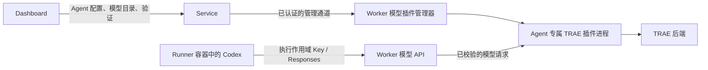

# Worker TRAE 模型插件基础版实施方案

日期：2026-11-25（Asia/Singapore）。

状态：基础版已在独立 Core / 外部插件 worktree 实施，完成自动化、本地 fixture 链路、真实 SSO、模型连接和缓存验证。
当前架构见 `docs/designs/worker-model-providers.md`；验收摘要见
`docs/plans/2026-11-26-worker-trae-model-plugin-verification.md`。
本文保留原始范围与实施任务，最终验证结果与边界见验收摘要。

## 1. 目标与基础版范围

把 TRAE 模型接成 Luna 的模型源插件。插件在 Worker 宿主上运行，用户在 Luna
Dashboard 配置账号、读取模型目录、选择模型并保存为 Agent Profile。
Runner 容器通过 Worker 的模型 API 调用 TRAE。

首版固定以下边界：

- 外部插件 ID：`trae-provider`；provider ID：`trae-code-cn`。
- 复用 `@byted-qzb/magpie-plugins` 的 `TraeCodeCnPlugin`，初始依赖锁定到
  已检查的 `0.3.7`，打包进入插件发布物，不在 Worker 启动时动态安装最新版。
- 只支持字节内部账号、AI 区域为 CN 的 TRAE App 模型。
- 每个 Agent 一个账号；Profile 明确绑定一个已授权 Worker。
- 原生 OpenAI Responses API，先支持 **Codex 类型的 Agent/分身**。
- 支持文本、流式与非流式回答、工具定义与工具结果、多轮推理内容。
- Dashboard 提供凭据导入、登录状态、刷新模型、选模型、连接验证、保存与激活。
- 基础版默认每个 Agent 同时处理一个模型请求；忙时返回明确的错误，不增加
  Luna 侧账号池或模型请求排队系统。TRAE 上游自身的排队仍由适配器处理。

不纳入首版：

- Claude 的 Anthropic `/v1/messages`、Chat Completions、Gemini API 转换。
- traex-cn、traex-sg、其他字节 provider。
- 多账号轮换、跨 Worker 凭据同步、自动 Worker 故障转移、模型路由组。
- Dashboard 自动 SSO 授权、用量/账单面板、对外开放的公共模型 API。
- 修改 Magpie 部署、读取 Magpie 现有账号作为默认凭据、安装 TRAE CLI。
- 为模型源新增第三种 Luna Agent 类型；Runner 仍然是现有 Codex。

## 2. 已确认的现状

### 2.1 TRAE 适配器

已检查安装包的导出，并在不提供真实凭据、不发送请求的情况下完成独立初始化：

- 包单独导出 `TraeCodeCnPlugin`。
- 返回 `config`、`provider`、`chat.headers`、`auth` hooks。
- provider 配置声明 `npm: "@ai-sdk/openai"`，接收 Responses 格式。
- `auth.loader(getAuth)` 返回 `baseURL`、`apiKey`、自定义 `fetch`。
- 模型列表、字节 SSO、TRAE raw-chat 转换、推理与工具处理已有实现。
- `baseURL` 是适配器的占位地址，不能把它当真实上游 URL；请求必须经过
  返回的自定义 `fetch`。

这证明适配器可以脱离 Magpie 加载。**尚未验证独立服务的真实模型调用**，
也不据此宣称支持完整的 OpenAI Responses 功能集。

### 2.2 Luna

- `packages/plugin-contracts/src/index.ts` 的插件贡献主要是 operations、
  commands、tools、skills，`PluginRuntime.invoke` 返回有限的操作结果。
- `src/plugins/installed-loader.ts` 在 Service 中加载启用的插件发布物。
  当前 Worker 没有模型插件加载器或模型 API 监听器。
- 插件安装由平台管理；Agent 启用及配置由 `AgentPluginStore` 管理，具有
  Agent 所有者校验、配置 CAS revision、write-only secret 边界。
- `apps/dashboard/src/app/settings/agent-config-dashboard.tsx` 当前通过输入框
  配置模型名、环境变量和 Key，没有插件模型目录选择器。
- `AgentProfileConnectionTester` 默认在 Service 所在机器启动 Docker 测试容器，
  不能直接作为远端 Worker 插件的完整连接验证。
- Agent Profile 修订、Shadow 固定模型选择、执行引用与配置指纹已经存在。
  新模型源必须接入这些边界，而不是只改运行时环境变量。
- Worker 的控制监听和 Executor callback 监听已有职责限制；callback 监听器
  只接收 Executor 事件，不能混入模型 API 或管理接口。

## 3. 架构与责任划分



| 组件 | 责任 |
| --- | --- |
| 外部 TRAE 插件 | 上游凭据格式、账号校验、模型目录、TRAE 协议转换、推理/工具/SSE、上游错误 |
| Worker | 校验和加载发布物、账号私有存储、插件进程生命周期、模型监听、执行作用域授权 |
| Service | 平台安装与 Agent 启用、Worker 授权、Profile 绑定、模型/凭据版本引用、调度和验证入口 |
| Dashboard | 展示可用 Worker/provider/账号/模型，提交配置与导入，显示状态和验证结果 |
| Codex Runner | 对话、执行客户端工具、把结果发回模型；TRAE 插件不代替 Runner 执行工具 |

Core 不包含 TRAE endpoint、SSO 参数、签名或 raw-chat 转换代码。
现有 operation 插件继续在 Service 执行，不整体迁移到 Worker。

## 4. 插件契约与发布

### 4.1 新增可选模型源贡献

拟在 `PluginManifest` 增加 `workerModelProviders`。以下是**新契约示意**，
不是当前 Luna 已支持的 manifest 字段：

```json
{
  "id": "trae-provider",
  "agentScopeVersion": 2,
  "workerModelProviders": [
    {
      "id": "trae-code-cn",
      "displayName": "TRAE CN-字节",
      "entrypoint": "worker.js",
      "protocols": ["responses"]
    }
  ]
}
```

契约需明确：

1. provider ID 唯一，entrypoint 是发布包内的相对文件路径。
2. Worker runtime 接收宿主提供的配置/账号访问器/日志/取消信号，而非 Core 私有模块。
3. 管理面支持账号校验、模型目录、状态；推理面接收 Request 并返回可流式的 Response。
4. 模型目录包含原生 ID、显示名及已声明的能力；未知能力不按模型名称猜测。
5. 区分认证过期、上游排队、限流、请求不支持、网络失败和插件进程失败。
6. 现有操作 runtime 契约不变，不把 SSE 装进 `OperationInvocationResult.output`。

### 4.2 发布物

插件源码位于独立 `luna-plugins/plugins/trae-provider/`：

```text
trae-provider/
  manifest.json
  package.json
  src/
    index.ts             # 轻量 Service 定义，不导入 TRAE 实现
    worker.ts            # Worker 子进程入口
    adapter.ts           # TraeCodeCnPlugin hooks 适配
    credential.ts        # 上游凭据校验/转换
    login.ts             # 本地凭据获取助手
  tests/
  scripts/pack-release.ts
  release/<version>/trae-provider-<version>.tgz
```

发布包保留既有的 `plugin.js`、manifest、checksums、package metadata，另包含
`worker.js` 及其依赖。Service 只加载轻量定义和贡献元数据，不初始化 TRAE adapter。
`worker.js` 及 runtime assets 全部进入发布物校验清单。

Worker 仅下载 Service 授权的固定发布物，验证 plugin ID、版本、摘要与目录边界。
普通 Runner resource snapshot 不暴露 Worker 插件运行目录或上游账号存储。
旧 Worker 不广告模型插件能力；Service 对不支持的 Worker 明确报错。
最低 Core/Worker 版本和 `lunaApiVersion` 在契约落地后确定，不假定旧版本兼容。

## 5. Worker 运行、网络与生命周期

新增通用 `WorkerModelProviderManager`，由 `runWorker` 创建和关闭。
每个 `(agentId, pluginId, releaseSha256)` 管理一个 Bun 子进程，基础版只初始化
该 Agent 的 TRAE adapter 与一个账号。

- Worker 提供一个稳定的模型 API 监听器；子进程使用私有 loopback endpoint。
- Runner 从容器访问 Worker 模型监听器。地址由 Worker 的 Docker 网络配置生成，
  不能向远端 Runner 下发 Service 的 `127.0.0.1`。
- 模型监听器与 Worker 控制监听、Executor callback 监听分开。
- 不需要 Caddy，不新增平台公共 `/v1` 网关，也不要求用户填写 Worker IP/端口。
- `/v1/models`、`/v1/responses` 是首版客户端接口；health 和账号管理是管理面接口。
- 流式数据直接转发，保留 backpressure 与取消信号，不缓存完整回答后再输出。
- 子进程重启不能重放已发出的模型请求。进程失败时结束该请求，后续请求可重建进程。
- 启动/停止/安装失败有界，Worker 停止时关闭模型监听、在途请求和子进程。
- 插件版本切换先停止新请求，再等待当前执行排空，保持既有 restart-based 发布策略；
  首版不做通用插件热卸载。

TRAE 已有的排队、保活与推理缓存逻辑由 adapter 保留。单账号没有下一个候选，
不能伪造 Magpie 的 fallback 标记。Worker 不叠加第二层自动重试或自动换账号。
多轮推理关联使用宿主生成的 Agent/上下文身份，并调用适配器的 session header
逻辑；不能让客户端自选一个跨 Agent 的缓存命名空间。

## 6. 账号、凭据导入与隔离

### 6.1 首版采用导入，不实现 Dashboard 自动 SSO

TRAE 当前登录流程临时监听本机 `127.0.0.1`，要求授权浏览器能回到该端口。
远端 Worker 的 localhost 不是 Dashboard 用户电脑的 localhost。

提供一个独立的本地登录助手：复用 adapter 的 SSO 方法，登录完成后写出 owner-only
凭据文件。用户在 Dashboard 对选定 Agent/Worker 导入该文件的内容。助手不修改
Magpie 或 TRAE App 的登录；不把凭据打印到普通日志。

如果已有正式获得的兼容凭据，也可直接导入。导入入口只接受白名单格式及合理
大小的 JSON；原始令牌不能作为文件路径、命令行参数或模型名称。
完整网页 SSO、远端端口转发自动化留到后续版本。

### 6.2 存储与导入事务

上游凭据只由绑定 Worker 持久化：

```text
<worker-data>/plugins/releases/<pluginId>/<releaseSha256>/   # 校验后的代码
<worker-data>/agents/<agentId>/model-providers/<pluginId>/   # 私有账号状态
```

- 账号目录权限 `0700`，凭据/本机加密 Key 文件 `0600`，不挂入 Shadow HOME。
- 使用 Worker 自己的密钥加密凭据；AAD 绑定 Worker、Agent、plugin、provider、
  account ID 和 credential revision。密钥不从 Service 环境或 Runner HOME 回退获取。
- Service 持久化账号引用、归属、状态、到期时间及 revision，不保存明文令牌。
- Dashboard 导入时 Service 会在内存中转发敏感载荷；管理通道使用已有的认证与
  传输边界。该载荷不得写入通用 RPC 日志、operation audit、错误诊断或 SQLite 请求正文。
- 导入有 request ID：Worker 记录有界的导入结果以支持丢失响应后的查询，不重复
  替换账号或回显令牌。认证与模型目录校验成功后才切换当前账号 revision。
- 导入失败保留旧账号。只有拥有该 Agent 且被授权使用该 Worker 的用户可导入或替换。
- 账号 revision 不可变。旧 revision 被 Profile 或未结束执行引用时不得删除。
- 账号过期、被拒、损坏分别形成固定错误状态；普通网络失败不直接标成凭据失效。
- 基础版不自动续期，不自动扫描 Mac/Worker 上其他工具的账号文件。

账号数据由 Core 宿主账号存储管理，插件通过限定的账号访问器取得本次绑定的凭据。
可信插件仍在 Worker 宿主上执行；子进程与文件权限是故障/资源隔离措施，不宣称为
完整的 OS 安全沙箱。

## 7. Profile、版本引用与 Worker 调度

### 7.1 结构化模型源

Agent Profile revision 增加可空的 `modelProvider` JSON。已有 default/custom gateway
Profile 继续沿用当前语义。插件 Profile 只允许 `agentType: "codex"`。

```json
{
  "kind": "worker-plugin",
  "pluginId": "trae-provider",
  "providerId": "trae-code-cn",
  "workerId": "<authorized-worker>",
  "accountId": "<agent-owned-account>",
  "credentialRevision": "<immutable-revision>",
  "releaseSha256": "<validated-release>"
}
```

`model` 继续保存该 provider 的原生模型 ID，例如 `gpt-6.1-sol`；UI 可以同时显示
provider 名。服务器从已验证的发布物与 Worker 账号元数据解析这些引用，不能信任
用户提交任意摘要、账号或 Worker ID。插件连接模式与手工 base URL/Key 模式互斥。

### 7.2 执行快照

将模型源引用纳入 Profile 修订、执行引用、配置指纹和恢复校验：

- provider 身份包括 Worker、provider、账号/凭据 revision 和插件发布摘要。
- 模型身份包括原生 model ID 及影响模型语义的配置。
- 每次执行固定这组引用，恢复时解析原引用；不能改用账号或插件的当前最新版。
- 短期模型 API Key 和子进程临时端口不进入稳定模型指纹，否则每次启动都破坏 resume。
- 保存新 Profile 不影响在途执行。替换账号需要创建并验证新修订，再激活；新执行使用
  新修订，旧引用按现有生命周期保留或明确撤销。
- Shadow 的“跟随激活配置 / 固定修订”继续复用已有行为，不增加另一套模型选择状态。

### 7.3 固定 Worker

基础版的模型插件与 Runner 位于同一 Worker。

- 自动路由的候选集限制到 Profile 绑定 Worker，且该 Worker 必须已授权、在线、
  支持模型插件能力、具有正确发布物和可用账号。
- Shadow 已显式绑定其他 Worker 时拒绝冲突，不能偷偷改 Shadow 的路由设置。
- 既有上下文已在其他 Worker 执行时，不迁移其活跃任务或会话文件；提示绑定冲突，
  通过正常的新上下文/既有准备重建规则处理。
- 绑定 Worker 离线、撤销授权或插件未就绪时明确失败/等待已有就绪流程；不改投
  一个没有该账号的 Worker，不转发到别人的凭据。
- 安装/禁用、Agent 停用、Worker 解绑与账号撤销必须接入执行授权和停止新请求边界。

## 8. Runner 的模型访问凭据

Worker 模型 API 不接受 Service/Worker 管理令牌或 TRAE 原始令牌。
使用随机的 execution-scoped Key，Worker 只持久化其摘要和绑定信息：

- 普通执行：Agent、Shadow、invocation、Job/assignment、Profile 修订、模型源与模型。
- Profile 测试：明确的 `profile-validation` 目的、Agent、Profile 修订和测试 ID；
  不伪造业务 Shadow 或长期会话。
- 请求验证当前执行状态、Worker 归属、账号 revision、允许模型及有界有效期。
- 长时间排队/工具等待不能因固定一分钟 TTL 被截断；有效期应跟随被 Worker 确认的
  活跃执行租约，结束或撤销时立即失效。续租不改变 Runner 已拿到的 Key 值。
- Worker 与 Service 失联时停止接收新的模型请求，按已有执行取消/失联规则处理在途请求。
- API `/v1/models` 只返回该 Key 允许的模型，不泄露其他 Agent 的目录或账号信息。

启动 Codex 时自动提供：

```text
CODEX_PROVIDER_MODE=gateway
OPENAI_BASE_URL=<Worker 可从 Runner 容器访问的模型入口>/v1
OPENAI_API_KEY=<execution-scoped key>
```

复用当前 Codex custom Responses provider 参数构建器及禁用 WebSocket 的行为。
凭据走显式私有执行凭据通道，不写入 Profile 明文字段、通用执行引用、审计或日志。
实现时确认 Job env 的唯一注入点并扩展明确的协议字段；不在请求哈希/assignment
校验之后偷偷改变业务载荷，保持重试幂等与恢复校验。

客户端 headers 必须按允许集合处理，实际 TRAE 上游认证由 adapter 决定。
Worker 不允许请求改写绑定模型/账号，也不开放任意 upstream URL 代理。

## 9. Dashboard 与连接验证

### 9.1 Agent 插件配置

在现有 Agent 插件页面增加通用模型源配置：

- 选择该 Agent 已授权、具备能力的 Worker。
- 导入/替换账号凭据，显示已配置状态、账号显示名、到期时间及固定错误。
- 刷新模型目录，展示 ID、名称与能力，不返回令牌。
- 请求携带 Agent 与 plugin scope；编辑以当前 CAS revision 保存。
- 切换 Agent/Worker 后清空旧目录和草稿；迟到的异步响应不能覆盖新作用域。
- Agent 与 Worker 引用互相独立，不能让平台管理员默认读取其他所有者的账号。

### 9.2 模型 Profile 编辑

Codex 的连接选项新增“Worker 插件”。选择后由服务端目录生成模型下拉框，
不用填写 IP、端口或上游 API Key。选中的模型必须属于当前账号；空目录、失效账号、
离线 Worker、旧 Worker、未启用插件都有明确的不可用状态。

保存、连接验证、激活和 Shadow 固定修订继续使用当前 Profile 工作流。
Claude 编辑器不提供本插件选项，并由后端同样拒绝不支持的组合。

### 9.3 验证执行位置

插件 Profile 的连接测试通过 Service 授权后派给绑定 Worker，由该 Worker 的镜像
和 Runner runtime 运行有界的一次性 Codex 验证容器。没有业务工作区、Service
凭据挂载或 TRAE 令牌挂载；测试使用专用模型访问 Key。

普通 Profile 仍用当前测试 executor，首版不借此重构所有连接测试。
结果记录 Profile/source fingerprint、Worker 和账号 revision；验证返回后重查
所有权与修订，失效的验证不能用于激活。worker 镜像缺少 Codex 时返回工具链错误，
不能把单纯 `/v1/models` 成功标成 Profile 的模型连接成功。

## 10. 实施任务与完成条件

以下新增文件名是落地建议；允许沿当前模块组织调整，职责和契约不得混入 TRAE 特例。

### P1 — 通用契约、发布验证与控制面

涉及：

- `packages/plugin-contracts/src/index.ts`。
- `src/plugins/manifest.ts`、`registry.ts`、`installed-loader.ts`。
- `src/plugins/marketplace/release-validator.ts`。
- `packages/runner-protocol/src/`：模型源管理消息与能力。
- `src/runtime/worker-gateway.ts`、`apps/worker/src/service-link.ts`。

完成条件：旧插件照常加载；带 workerModelProviders 的包校验完整；旧 Worker 被明确
拒绝；未授权 Agent/Worker 无法获取目录、安装实例或导入账号。纯模型包的 Service
入口不导入上游实现。平台管理安装与 Agent 启用仍是两个动作。

### P2 — Worker runtime、账号与模型入口

建议新增：

- `apps/worker/src/model-providers/manager.ts`、`process.ts`。
- `accounts.ts`、`credentials.ts`、`gateway.ts`、`access.ts`。
- 管理状态表/账号修订/模型访问授权，以及独立模型 listener 配置。

接入 `service.ts`、`server.ts` 和 Worker 停止/撤销生命周期。
完成条件：能够用 fixture 插件完成启动、目录、认证、SSE、取消、进程失败；账号
按 Agent 隔离；Worker 停止不遗留子进程；模型 listener 不接受控制接口请求。

### P3 — 外部 TRAE 插件

在 `luna-plugins/plugins/trae-provider/` 实现并打包：

- 仅初始化 `TraeCodeCnPlugin`，桥接 config/models/auth.loader/chat.headers。
- 凭据格式检查、到期状态、模型 ID 及能力映射。
- Responses 请求/回复直通适配、上游错误分类、排队保活与取消。
- 本地登录/导出助手和脱敏日志。
- 包校验、固定依赖、插件自身契约与转换测试。

完成条件：在没有 Magpie 进程或 TRAE CLI 的隔离测试环境中，fixture 上游走完整链路；
工具仍由 Runner 执行；请求和错误不输出真实凭据。

### P4 — Profile、调度与连接测试

涉及：

- `src/agent-config/types.ts`、`profile-validation.ts`、`agent-profile-store.ts`。
- `active-agent-config-service.ts`、`execution-reference.ts`。
- `src/data/schema/agent-profiles.ts` 及账号引用元数据。
- `src/runtime/` 的 Worker 选择/准备/提交；明确模型凭据注入点。
- `agent-profile-connection-tester.ts`、`src/server/routes/agent-config.ts`。

完成条件：同 Worker Codex 能使用插件模型；Worker 冲突明确拒绝；模型源引用被
完整 pin 到执行；账号/版本更新不改写旧执行；测试在正确 Worker 进行，失败不能激活。

### P5 — Dashboard

涉及：

- `apps/dashboard/src/app/plugins/agent-plugins.tsx`。
- `apps/dashboard/src/app/settings/agent-config-dashboard.tsx`。
- `apps/dashboard/src/hooks/` 与 Service 的 Agent-scoped 模型源管理 API。
- 复用 Shadow 的 `model-selection-field.tsx`，必要时补充模型源显示信息。

完成条件：真实 Dashboard 能导入 fixture 账号、刷新目录、选择模型、保存/验证/激活，
切换 Agent 不串数据；秘密只显示配置状态；Claude 类型不可选本插件。

### P6 — 文档、验证与发布

同步更新当前架构文档，不能只保留本文：

- `docs/designs/plugins-and-marketplace.md`。
- `docs/designs/agent-configuration.md`。
- `docs/designs/worker-storage-layout.md`。
- `docs/designs/execution-runtime-foundation.md`。
- `docs/designs/database-schema.md`。
- 新增 `docs/designs/worker-model-providers.md`。

原有 `model-gateway-deployment.md` 描述外部 Magpie 部署，不能误改为本功能已替换它。
在插件 README 写清依赖版本、凭据导入、Responses 支持范围和 Worker 绑定限制。
私有地址、真实验证记录与账号信息放 Git-ignored 本地记录，不写入公开 plan。

发布经验证的插件 `.tgz` 并更新 marketplace，Core/Worker 新能力先到位；
插件安装/启用按既有重启流程完成，不默默更新生产插件或上游依赖。

## 11. 验证计划

### 自动化与 fixture

新增有意义的覆盖，而不是只测字段赋值：

1. 包内路径逃逸/缺文件/错误 checksum/重复 provider/旧 Worker。
2. Agent 归属、Worker assignment、CAS 冲突、迟到导入响应与旧测试结果。
3. 凭据加密/AAD、非法或过期凭据、导入失败保留旧账号、不可删除被引用 revision。
4. 无 Key、跨 Agent/Shadow/Job Key、模型不匹配、执行结束后的 Key、解绑/失联。
5. fixture Responses 非流式、逐帧 SSE、推理、工具及工具结果、多轮取消、上游断开。
6. 插件崩溃不自动重发；忙时错误；Worker 关闭没有孤儿进程；流式有 backpressure。
7. Profile 固定模型源/凭据/发布摘要，恢复不使用最新账号，Worker 冲突不迁移执行。
8. 同一 Runner/Codex 参数生成器通过绑定 Worker 的 fixture API；连接失败不能激活。
9. Dashboard scope 切换、模型列表、write-only 秘密、保存/验证/激活与 Shadow 选择。

落地后执行相关新增测试与现有插件/Profile/Worker 回归，随后：

```bash
bun run typecheck
bun run build
bun test apps/dashboard/tests
git diff --check
```

插件仓库执行它自己的 test/typecheck/build/pack 命令，不在 Core 内引用插件源码。

### 真实 Luna runtime 验证

按仓库 AGENTS.md：相关测试/typecheck/build 通过后，停止旧的本地 Luna `8090`
服务，从当前工作树/build 在持久终端启动，再确认监听：

```bash
bun dist/luna-service.js start --foreground --port 8090
lsof -nP -iTCP:8090 -sTCP:LISTEN
```

同时运行当前 build 的测试 Worker。登录 `http://127.0.0.1:8090` 的真实 Dashboard，
检查插件配置、模型 Profile 和 Shadow 选择，并经 Worker fixture API 完成真实
Runner 链路；不能只凭组件测试宣称 Dashboard 行为正常。

真实 TRAE 凭据导入和模型推理验证单独安排，由用户明确选择账号并发起连接验证。
编写 plan 不发起它们。若只完成 fixture 验证，交付明确标注“真实 TRAE 上游未验证”，
不把目录读取或本地 mock 结果写成真实模型调用成功。

## 12. 实施前检查与交付

技术检查由实施者完成，不扩大基础版产品范围：

- 锁定的适配器实际 Responses 支持范围和 Codex 所需 endpoints；避免声称支持
  未实现的 response 存储、任意 previous_response_id、图片或服务端工具执行。
- Worker 到 Executor 的环境/秘密交付位置与请求哈希规则。
- 账号 revision、插件发布摘要和现有资源快照的一致性，避免配置更新导致自动卸载
  仍在执行的模型进程。
- 本地登录助手得到的凭据与 adapter getter 形状一致；不修改上游 localhost 回调假设。
- 开始编码前重新检查两个仓库的未提交修改，保留已有 Worker/镜像等工作；不得覆盖
  本方案之外的改动。本文不创建分支、提交、PR 或生产部署。

基础版完成的用户路径：

1. 平台安装已验证的 `trae-provider` 发布物，Agent 所有者启用它并选定 Worker。
2. 在 Dashboard 导入该 Agent 的 TRAE CN 账号，看到账号状态和模型目录。
3. 新建 Codex Profile，连接选择 Worker 插件，选定 TRAE 模型。
4. 经绑定 Worker 的连接验证后激活，Shadow 跟随或固定该 Profile 修订。
5. Codex 在该 Worker 的 Runner 中发起请求，经 Worker 模型 API 获取回答、执行工具
   并完成下一轮；无需完整 Magpie、手填网关地址或把 TRAE 令牌放进 Runner。
