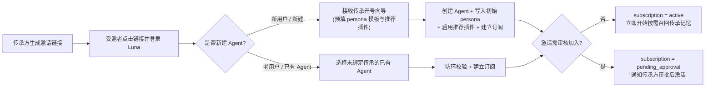
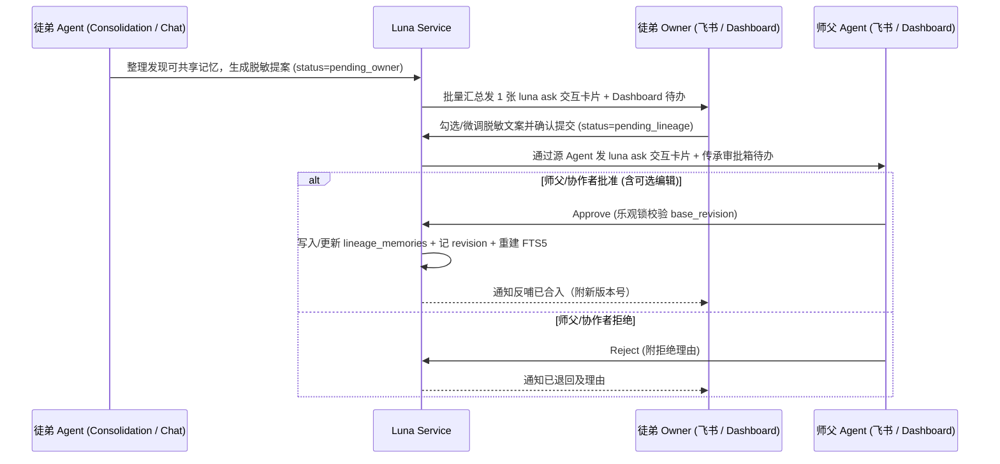

# 传承记忆（Inherited Memory / Lineage）设计方案

- **日期**：2026-11-28
- **状态**：Draft（需求与架构已对齐，待评审后分期实现）
- **关联现态文档**：
  - [Agent Memory](../designs/agent-memory.md)
  - [Agent Proactivity](../designs/agent-proactivity.md)
  - [Platform Accounts And Agent Users](../designs/accounts-and-agent-users.md)
  - [Database Schema](../designs/database-schema.md)

---

## 1. 背景与目标

Luna 当前各 Agent 之间在用户、记忆与配置上完全隔离。这保证了多租户与个人隐私边界，但在团队推广和协作中存在两个明显痛点：

1. **新成员冷启动成本高**：受邀接入 Luna 的新用户创建自己的 Agent 后，需要从零开始重新教一遍团队规范、发布流程、避坑经验与常用工具用法。
2. **实践经验难以反向沉淀**：每个成员的 Agent 在日常工作与「记忆整理（Consolidation）」中都会沉淀出高质量的通用经验，但这些经验被锁在个人 Agent 内，无法安全、可控地反哺给团队。

**传承记忆（Inherited Memory / Lineage）** 旨在建立一套「**师承归属 + 物理隔离 + 双向受控演进**」的跨 Agent 记忆共享机制：

- 邀请他人使用 Luna 时，对方可接收传承记忆与开号模板，一键创建即开即用的个人 Agent。
- 徒弟 Agent 的传承记忆与私有记忆清晰分层：默认按需召回、个人记忆优先级更高、可本地屏蔽或覆写，并支持在遇到难题时按需「追寻祖脉」向上查找更早一代的传承。
- 徒弟 Agent 在「记忆整理」中发现可共享经验（或 Owner 手动发起贡献）时，经过「**Owner 脱敏确认 → 传承方审批合入**」双审后写入传承记忆，所有同门及师父自身立即受益。

---

## 2. 核心设计决策

| 决策项 | 结论 | 核心理由 |
| --- | --- | --- |
| **归属模型** | **师承制（绑定源 Agent）**，底层用独立 `agent_lineages` 表轻解耦 | 复用源 Agent 的飞书通道与 `luna ask --to owner` 卡片能力，零冷启动成本；未来如需移交或解耦仅改外键 |
| **存储隔离** | **物理隔离**：传承记忆存入独立表 `lineage_memories`，不与 `agent_memories` 混存 | 杜绝日常 `reflection`/`consolidation` 意外改写或 `WHERE` 条件漏写导致师父私有记忆泄露；独立生命周期（不受 180 天自动遗忘影响） |
| **允许的记忆类型** | 仅限 `procedure`、`feedback`、`reference`、`project` | 彻底排除 `persona`、`person`、`chat`、`episode` 等身份、人际与会话隐私类记忆 |
| **订阅关系** | 每个 Agent 最多订阅 **1 个**直接传承；同时可独立开启自己的对外传承（不二传） | 避免多传承打架与权限失控；A 授权给 B 的记忆绝不会被 B 打包转授给 C |
| **血脉与「追寻祖脉」** | 日常自动召回**严格单跳**（自己 + 直接师父）；支持显式 `--ancestors` 按需向上追寻祖脉（默认上限 5 代） | 日常 O(1) 零膨胀；难题可深挖祖脉；受 `allow_ancestor_lookup` 开关与防环校验保护，断链即止 |
| **上下文注入策略** | 传承记忆**全部按需 FTS5 召回**，无传承 Core，不常驻首轮上下文 | 最大程度控制 token 消耗，不挤占个人 30 条 `core` 配额 |
| **冲突与本地化** | 注入时明确标明来源；**个人记忆优先级高于传承记忆**；支持单条「屏蔽（mute）」或「内化覆写（override）」 | 既享受自动同步更新，又不被不适合自己的团队经验绑死 |
| **邀请与开号模板** | 邀请链接（有效期/次数/是否需审批加入）承载「传承记忆 + 推荐 `persona` 模板 + 推荐插件/技能清单」 | 新人点链接登录即可一键开号；老用户也可给已有 Agent 追加挂载 |
| **反哺与审批** | 支持**新增**与**修改已有传承条目**；记忆整理自动批量脱敏推荐 + 手动随时贡献；双端（`luna ask` 飞书卡片 + Dashboard）双重审批；**反哺仅逐级单跳给直接师父** | 既不频繁打扰 Owner，又防止越级打扰祖师；审批时看 diff，支持编辑后合入 |
| **退出与移除** | 主动退出或被移除后**立即断开只读挂载**；本地已覆写私有记忆与已合入历史贡献保留 | 权限收回干净彻底，且不破坏接收方本地已内化的工作流 |

---

## 3. 领域模型与数据表设计

采用增量 Drizzle SQLite 迁移（衔接现有 `0013` 之后的迁移序列），严格遵守 `accounts`（平台账号）与 `users`（Agent 内用户）的分层命名规范（`_account_id` 指向 `accounts`，`_user_id` 指向 `users`）。

### 3.1 `agent_lineages`（传承定义）

每个源 Agent 最多开启 1 个对外传承（`source_agent_id` UNIQUE）。

| 字段 | 类型 | 说明 |
| --- | --- | --- |
| `id` | `TEXT PK` | 传承 ID（如 `lin_...`） |
| `source_agent_id` | `TEXT NOT NULL UNIQUE FK(luna_agents.id)` | 归属的源 Agent（师父 Agent） |
| `name` | `TEXT NOT NULL` | 传承名称（120 字符内） |
| `description` | `TEXT NOT NULL DEFAULT ''` | 传承简介（向受邀者展示） |
| `intake_guidelines` | `TEXT NOT NULL DEFAULT ''` | **收录范围说明**（供徒弟记忆整理筛选与脱敏参考） |
| `allow_ancestor_lookup` | `INTEGER NOT NULL DEFAULT 1` | 是否允许徒孙及更后代通过「追寻祖脉」查阅本传承 |
| `allow_member_invite` | `INTEGER NOT NULL DEFAULT 0` | 是否允许已订阅成员查看/复用本传承的邀请链接 |
| `template_json` | `TEXT NOT NULL DEFAULT '{}'` | 快速开号模板（见下方结构） |
| `status` | `TEXT NOT NULL DEFAULT 'active'` | `active` / `paused` / `archived` |
| `created_by_account_id` | `TEXT NOT NULL FK(accounts.id)` | 创建账号 |
| `created_at`, `updated_at` | `INTEGER NOT NULL` | Unix ms |

`template_json` 结构：
```json
{
  "defaultAgentNamePrefix": "研发助手",
  "personaTemplates": [
    { "title": "工作原则", "description": "研发协作基本规范", "body": "..." }
  ],
  "recommendedPlugins": ["plugin-a", "plugin-b"],
  "recommendedSkills": ["skill-x"]
}
```
> 注：模板仅包含非敏感的推荐配置，绝不包含源 Agent 的密钥、Bot App Secret、Model API Key 或渠道绑定。

### 3.2 `lineage_maintainers`（共同审批协作者）

允许源 Agent 的 Owner 指定额外的平台账号共同管理传承、审核反哺提案与管理成员（源 Agent Owner 天然拥有全部权限，无需额外写入此表）。

| 字段 | 类型 | 说明 |
| --- | --- | --- |
| `lineage_id` | `TEXT NOT NULL FK(agent_lineages.id)` | |
| `account_id` | `TEXT NOT NULL FK(accounts.id)` | 协作者账号 |
| `role` | `TEXT NOT NULL DEFAULT 'reviewer'` | `admin` / `reviewer` |
| `created_at` | `INTEGER NOT NULL` | |
| **PK** | `(lineage_id, account_id)` | |

### 3.3 `lineage_invites`（邀请链接）

| 字段 | 类型 | 说明 |
| --- | --- | --- |
| `id` | `TEXT PK` | |
| `lineage_id` | `TEXT NOT NULL FK(agent_lineages.id)` | |
| `token_hash` | `TEXT NOT NULL UNIQUE` | 邀请口令 SHA-256 哈希（原始 token 仅创建时返回一次） |
| `label` | `TEXT NOT NULL DEFAULT ''` | 备注（如「2026 Q4 新人入职」） |
| `require_approval` | `INTEGER NOT NULL DEFAULT 0` | 接收后是否需传承方批准才能激活订阅 |
| `max_uses` | `INTEGER NULL` | 最大使用次数，`NULL` 不限 |
| `used_count` | `INTEGER NOT NULL DEFAULT 0` | 已使用次数 |
| `expires_at` | `INTEGER NULL` | 过期时间，`NULL` 永不过期 |
| `status` | `TEXT NOT NULL DEFAULT 'active'` | `active` / `revoked` |
| `created_by_account_id` | `TEXT NOT NULL FK(accounts.id)` | |
| `created_at` | `INTEGER NOT NULL` | |

### 3.4 `lineage_subscriptions`（Agent 订阅关系）

| 字段 | 类型 | 说明 |
| --- | --- | --- |
| `id` | `TEXT PK` | |
| `agent_id` | `TEXT NOT NULL FK(luna_agents.id)` | 接收方 Agent（徒弟） |
| `lineage_id` | `TEXT NOT NULL FK(agent_lineages.id)` | 订阅的传承 |
| `status` | `TEXT NOT NULL` | `pending_approval` / `active` / `left` / `revoked` |
| `invite_id` | `TEXT NULL FK(lineage_invites.id)` | 来源邀请 |
| `approved_by_account_id` | `TEXT NULL FK(accounts.id)` | 审核加入的账号 |
| `created_at`, `updated_at` | `INTEGER NOT NULL` | |

- **部分唯一索引**：`UNIQUE(agent_id) WHERE status IN ('pending_approval', 'active')` —— 强制一个 Agent 同时最多绑定 1 个活跃/待审传承。
- **防环校验（Service 层事务内强制）**：将 `agent_id` 订阅到 `lineage_id`（其 `source_agent_id = S`）前，沿 `S` 向上遍历 `lineage_subscriptions (status='active') → agent_lineages.source_agent_id`，若路径中出现 `agent_id` 或超过最大深度（如 10），直接拒绝并返回 `409 lineage_cycle_detected`。

### 3.5 `lineage_memories`、`lineage_memory_revisions` 与 `lineage_memory_terms`

物理独立于 `agent_memories`，结构高度对齐以复用 `memoryTerms` 分词与 BM25 排序逻辑：

- **`lineage_memories`**：
  - `id` (`TEXT PK`, 如 `lmem_...`)
  - `lineage_id` (`TEXT NOT NULL FK(agent_lineages.id)`)
  - `type` (`TEXT NOT NULL CHECK (type IN ('procedure', 'feedback', 'reference', 'project'))`)
  - `title` (`TEXT NOT NULL`, ≤ 120 chars)
  - `description` (`TEXT NOT NULL`, ≤ 200 chars)
  - `body` (`TEXT NOT NULL`, ≤ 8 KB)
  - `status` (`TEXT NOT NULL DEFAULT 'active'`, `active` / `archived` / `deleted`)
  - `revision` (`INTEGER NOT NULL DEFAULT 1`)
  - `change_seq` (`INTEGER NOT NULL`) —— 传承内递增序列，供增量通知/缓存失效使用
  - `origin_kind` (`TEXT NOT NULL`, `owner_publish` / `contribution_approved` / `lineage_edit`)
  - `contributor_agent_id` (`TEXT NULL FK(luna_agents.id)`)
  - `contributor_account_id` (`TEXT NULL FK(accounts.id)`)
  - `approved_by_account_id` (`TEXT NOT NULL FK(accounts.id)`)
  - `created_at`, `updated_at` (`INTEGER NOT NULL`)
- **`lineage_memory_revisions`**：记录每次变更的完整快照、`reason`、`changed_by_account_id`、`contribution_id`（可溯源至反哺提案），支持 Dashboard 查看 diff 与一键回滚（revert）。
- **`lineage_memory_terms`（FTS5 虚拟表）**：复用现有 `memoryTerms`（支持中文二元切分 + 英文分词），仅索引 `status = 'active'` 的传承条目。

### 3.6 `lineage_memory_overrides`（接收方本地屏蔽与覆写）

| 字段 | 类型 | 说明 |
| --- | --- | --- |
| `agent_id` | `TEXT NOT NULL FK(luna_agents.id)` | 接收方 Agent |
| `lineage_memory_id` | `TEXT NOT NULL FK(lineage_memories.id)` | 被屏蔽/覆写的传承条目 |
| `mode` | `TEXT NOT NULL` | `muted`（仅屏蔽）/ `overridden`（已内化为本地私有记忆） |
| `local_memory_id` | `TEXT NULL FK(agent_memories.id)` | 当 `mode = 'overridden'` 时指向本地私有条目 |
| `created_at`, `updated_at` | `INTEGER NOT NULL` | |
| **PK** | `(agent_id, lineage_memory_id)` | |

### 3.7 `lineage_contributions`（反哺提案）

| 字段 | 类型 | 说明 |
| --- | --- | --- |
| `id` | `TEXT PK` | 如 `lcon_...` |
| `lineage_id` | `TEXT NOT NULL FK(agent_lineages.id)` | 目标传承（必须是提交 Agent 当前活跃订阅的直接传承） |
| `source_agent_id` | `TEXT NOT NULL FK(luna_agents.id)` | 提交方 Agent |
| `source_owner_account_id` | `TEXT NOT NULL FK(accounts.id)` | 提交方 Owner |
| `source_local_memory_id` | `TEXT NULL FK(agent_memories.id)` | 来源私有记忆（可追溯） |
| `origin_kind` | `TEXT NOT NULL` | `consolidation`（整理自动推荐）/ `manual_dashboard` / `manual_chat` |
| `batch_id` | `TEXT NULL` | 记忆整理批量推荐时的批次 ID（合并发一张确认卡片） |
| `kind` | `TEXT NOT NULL` | `add`（新增）/ `update`（修改已有传承条目） |
| `target_lineage_memory_id` | `TEXT NULL FK(lineage_memories.id)` | `kind = 'update'` 时必填 |
| `base_revision` | `INTEGER NULL` | `kind = 'update'` 时的基准版本号（审批合入时用于乐观锁/冲突提示） |
| `proposed_type` | `TEXT NOT NULL` | `procedure` / `feedback` / `reference` / `project` |
| `proposed_title` | `TEXT NOT NULL` | 脱敏后的建议标题 |
| `proposed_description` | `TEXT NOT NULL` | 脱敏后的建议一句话描述 |
| `proposed_body` | `TEXT NOT NULL` | 脱敏后的建议正文 |
| `rationale` | `TEXT NOT NULL DEFAULT ''` | 推荐/修改理由 |
| `status` | `TEXT NOT NULL` | `pending_owner` → `pending_lineage` → `approved` / `rejected_by_owner` / `rejected_by_lineage` / `cancelled` / `expired` |
| `owner_request_id` | `TEXT NULL` | 关联的 `correlated_requests.id`（Owner 侧交互卡片） |
| `lineage_request_id` | `TEXT NULL` | 关联的 `correlated_requests.id`（传承方源 Agent 交互卡片） |
| `reviewed_by_account_id` | `TEXT NULL FK(accounts.id)` | 最终审批人 |
| `review_comment` | `TEXT NULL` | 审批备注/拒绝理由 |
| `result_lineage_memory_id` | `TEXT NULL` | 合入后创建/更新的传承条目 ID |
| `result_revision` | `INTEGER NULL` | 合入后生成的传承条目版本号 |
| `created_at`, `updated_at` | `INTEGER NOT NULL` | |

---

## 4. 核心业务流程

### 4.1 开启传承与发布初始记忆

1. 源 Agent Owner 在 Dashboard「传承记忆」页开启传承，填写名称、简介、**收录范围说明**（`intake_guidelines`）及可选的开号模板（`persona` 模板、推荐插件/技能）。
2. 发布传承记忆有三种方式（均写入独立 `lineage_memories` 表，不改动原 `agent_memories`）：
   - **直接新建**：在传承记忆页直接编写并发布。
   - **从私有记忆提炼发布**：在私有记忆列表勾选若干条 `procedure`/`feedback`/`reference`/`project`，打开脱敏编辑弹窗（可选调用模型一键脱敏改写为通用表述），确认后写入 `lineage_memories`。
   - **师父自己的记忆整理推荐**：源 Agent 开启传承后，师父自己的 `consolidation` 也会检查近期新增/更新的私有 trusted 记忆，若符合本传承的 `intake_guidelines`，同样可生成脱敏候选请师父一键发布（直接单审进入 `lineage_memories`）。

### 4.2 邀请链接与快速创建 Agent



- **权限校验**：展示邀请预览页（`GET /api/lineages/invites/:token`）仅返回传承名称、简介、收录指南、条目总数和开号模板摘要，**不暴露任何具体传承记忆内容**，直到用户登录并完成激活订阅。
- **开号向导**：创建 Agent 时原子化完成 `AgentStore.create` → 写入模板 `persona` 条目到新 Agent 的默认 Shadow → 写入推荐插件配置（仅启用无需私密凭据的插件，需配置凭据的标记为“待配置”）→ 创建 `lineage_subscriptions`。

### 4.3 运行时召回、本地覆写与「追寻祖脉」

#### 1) 日常自动召回（严格单跳，无 Core 常驻）

每次 Main / Work / Task Runner 携带用户消息进入 turn 时，Service 执行联合按需召回：
1. **私有记忆检索**：按现有规则查询本 Agent 的 `agent_memories`（FTS5 BM25）。
2. **直系传承检索**（最多 1 个活跃订阅 + 若自身开启了传承，也包含自身 `lineage_memories`）：
   - 查询 `lineage_memories WHERE lineage_id = ? AND status = 'active'`；
   - 自动排除本 Agent 在 `lineage_memory_overrides` 中标记为 `muted` 或 `overridden` 的条目。
3. **合并与优先级排序**：
   - 受同一个 `memory.recallLimit`（默认 8 条）总预算控制，避免上下文膨胀；
   - **私有记忆优先**：当私有记忆与传承记忆分数接近或主题重叠时，私有记忆优先入选；若已存在本地 `overridden` 私有条目，原传承条目已被过滤。
4. **Prompt 注入格式**：
   - 保持仅注入 `id`、`type`、`title`、`description` 和来源标注（正文仍通过 `luna memory get` 按需读取），明确区分私有与传承来源，例如：
     - 私有：`[mem_xxx] (procedure) 发布回滚流程: ...`
     - 传承：`[lmem_yyy] (procedure · 传承: 研发团队传承) 发布回滚流程: ...`
   - Prompt 规则补充：当传承记忆与个人记忆矛盾时，以个人记忆为准；传承记忆只读，不可直接 `luna memory update/delete`。

#### 2) 本地屏蔽与内化覆写

- 接收方 Owner（或 Runner 经 Owner 授权）对某条传承记忆 `lmem_yyy` 可执行：
  - **屏蔽（Mute）**：写入 `lineage_memory_overrides (mode='muted')`，此后该 Agent 不再召回该条目。
  - **内化覆写（Override / Fork）**：复制 `lmem_yyy` 的内容创建一条新的私有 `agent_memories` 条目 `mem_zzz` 供自由编辑，同时写入 `lineage_memory_overrides (mode='overridden', local_memory_id='mem_zzz')`，自动隐藏原传承条目。

#### 3) 显式「追寻祖脉」（Ancestor Lookup）

当 Runner 在私有记忆和直接师父的传承记忆中均未找到答案时，可显式触发祖脉检索：

```text
luna memory search <keywords> --ancestors [--max-depth 5]
luna memory lineage
```

- Service 沿当前 Agent 的活跃订阅链向上逐代遍历：
  - 第 1 代：直接师父 `L1`（`lineage_subscriptions.lineage_id`）
  - 第 2 代：`L1.source_agent_id` 的活跃订阅 `L2`
  - 第 k 代：依此类推，最多 `maxDepth`（默认 5，硬上限 5）
- **每一跳检查两个闸门**：
  1. 订阅状态必须为 `active`（若中间某代已退出或被移除，血脉链在此中断，不再继续向上）；
  2. 对于第 2 代及以上，目标传承必须满足 `allow_ancestor_lookup = 1`（若某代祖师关闭该开关，则跳过该代或按策略止步——**推荐策略：该代不可查，且若配置为封闭传承则不再越过该代继续上溯**）。
- 返回结果按代数标注：`[lmem_zzz] (procedure · 祖脉 第2代 · 来自 宗门通用传承) ...`。
- 读取正文：`luna memory get lmem_zzz` 时，Service 实时校验 `lmem_zzz` 仍属于当前 Agent 有效可读的自身/直系/祖脉传承且 `status = 'active'`，通过即返回正文并记录只读访问。

### 4.4 双向反哺闭环（双端双重审批）



#### 细节设计

1. **记忆整理（Consolidation）自动发现与防打扰**：
   - 仅当 Agent 存在 `status = 'active'` 的传承订阅时，每日 `consolidation` 的 Prompt 才会附带该传承的 `name` 与 `intake_guidelines`。
   - Consolidation 只考察本轮新增/变更的 **trusted 私有记忆**（且类型为 `procedure`/`feedback`/`reference`/`project`），对比现有传承记忆（通过 FTS5 召回相似传承条目判断是「新增 `add`」还是「补充/更新 `update`」）。
   - 每轮最多产出 **3~5 条**脱敏候选（自动去除具体人名、私密项目代号、个人偏好等），通过 Runner 命令提交为同一 `batch_id` 下的 `pending_owner` 提案。
   - **合并通知**：Service 将同一 `batch_id` 合并为**单张** `luna ask --to owner` 摘要卡片发给 Owner（展示条目标题与改动类型，提供 `[全部提交]`、`[去 Dashboard 逐条审核/微调]`、`[本次忽略]`），绝不逐条轰炸。
   - 未处理的 `pending_owner` 提案默认 7 天后自动 `expired`，不会堆积。
2. **手动随时贡献**：
   - **Dashboard**：在私有记忆详情页点击「贡献到传承」，弹窗预填内容（可选一键脱敏），选择「作为新条目」或「更新某条已有传承条目」，提交直接跳过一审进入 `pending_lineage`。
   - **对话中**：Owner 在对话里说「把这条经验贡献到传承」，Runner 调用 `luna memory contribute` 创建 `pending_owner`（若触发者即 Owner 且已明确口头确认，可带确认卡片直接提交）。
3. **传承方审批（二审）**：
   - 提案进入 `pending_lineage` 后，Service 通过**源 Agent 的默认 Shadow**向源 Agent Owner 发送 `luna ask --to owner` 交互卡片（附提案类型、贡献者、标题与摘要，提供 `[批准合入]`、`[去 Dashboard 查看 Diff/编辑]`、`[拒绝]`），同时写入传承 Dashboard 审批箱（所有 `lineage_maintainers` 协作者均可见并可审批）。
   - 若为 `update` 提案且合入时目标传承条目的 `revision !== base_revision`，Dashboard 提示版本冲突并展示最新 diff，审批人手动合并后提交。
   - 合入成功后写入 `lineage_memories` 与 `lineage_memory_revisions`（保留贡献者署名与审批人），立即对师父及所有直系徒弟生效。

### 4.5 退出传承与移除成员

- **主动退出**（徒弟 Owner 在 Dashboard 操作）或 **管理员移除**（师父/协作者操作）：
  - 将 `lineage_subscriptions.status` 置为 `left` / `revoked`。
  - 该 Agent 立即失去对该传承及更上代祖脉的召回和 `get` 权限；已存在的 `pending_owner` / `pending_lineage` 反哺提案自动置为 `cancelled`。
  - 该 Agent 此前通过「内化覆写」生成的私有 `agent_memories` 保持不变；此前已合入 `lineage_memories` 的历史贡献继续保留在传承库中（保留贡献者记录）。

---

## 5. CLI、API 与 Dashboard 接口规划

### 5.1 Runner CLI (`luna memory`) 扩展

```text
# 查看当前订阅的传承与血脉链概况（自身传承 + 直接师父 + 可追寻祖脉层级）
luna memory lineage

# 日常搜索默认包含私有 + 直接传承；加 --ancestors 显式向上追寻祖脉
luna memory search <keywords> [--type T] [--ancestors] [--max-depth N]

# 读取条目详情（根据 ID 前缀 mem_ / lmem_ 自动路由并校验权限）
luna memory get <id>

# 提交反哺提案（Consolidation 或对话中调用）
luna memory contribute --kind add|update [--target <lmem_id>] --type T --title TITLE --description DESC [--source-memory <mem_id>] [--rationale WHY] (--body TEXT | --stdin)
```

### 5.2 Service HTTP API

- **传承管理（源 Agent Owner / Maintainers）**：
  - `GET / PUT /api/agents/:agentId/lineage` —— 查看/开启/更新传承配置（名称、收录指南、`allowAncestorLookup`、`template_json`）
  - `GET / POST / DELETE /api/agents/:agentId/lineage/maintainers` —— 管理共同审批协作者
  - `GET / POST / DELETE /api/agents/:agentId/lineage/invites` —— 生成与吊销邀请链接
  - `GET / POST / DELETE /api/agents/:agentId/lineage/members` —— 查看订阅徒弟列表、审批待加入成员、移除成员
  - `GET / POST / PATCH / DELETE /api/agents/:agentId/lineage/memories` —— 传承记忆列表、新建/从私有提炼发布、编辑、归档、查看修订历史与回滚
  - `GET /api/agents/:agentId/lineage/contributions` & `POST .../approve|reject` —— 传承方审批箱
- **邀请接收与订阅管理（接收方 Account / Agent Owner）**：
  - `GET /api/lineages/invites/:token` —— 邀请预览（不含记忆正文）
  - `POST /api/lineages/invites/:token/accept` —— 接收传承（支持 `mode: "create_agent"` 一键建号或 `mode: "attach_agent"` 挂载到已有 Agent）
  - `GET / DELETE /api/agents/:agentId/subscription` —— 查看当前订阅的传承概况或主动退出
  - `GET /api/agents/:agentId/subscription/memories` —— 浏览已订阅传承的记忆列表
  - `PUT / DELETE /api/agents/:agentId/subscription/overrides/:lineageMemoryId` —— 屏蔽或内化覆写单条传承记忆
  - `GET / POST / PATCH /api/agents/:agentId/contributions` —— 徒弟 Owner 查看/微调/确认/取消待提交的反哺提案
- **Runner 内部路由（`/api/runner/memory/*`）**：
  - 扩展 `search`（支持 `includeAncestors`、`maxDepth`）、`get`（支持 `lmem_` 鉴权）、新增 `lineage` 与 `contribute`。

### 5.3 Dashboard 页面布局

1. **Agent 侧边栏 → 「记忆」页内新增 Tab 分栏**：
   - **私有记忆**：现有列表不变；每条符合类型的条目增加「发布到我的传承」（若已开启传承）或「贡献到师父传承」（若已订阅传承）快捷按钮。
   - **已接收传承**（仅已订阅时显示）：展示师父传承简介、血脉关系、可浏览传承条目（只读）、单条「屏蔽 / 内化覆写」、以及「待我确认的反哺建议」列表。
   - **我的传承**（开启对外传承后显示）：
     - 传承记忆库（增改查、版本历史与回滚）
     - 待审批反哺箱（带红点计数，支持 Side-by-Side Diff、编辑后合入、拒绝填理由）
     - 成员与邀请链接管理
     - 传承设置（收录指南、祖脉追寻开关、开号模板、协作者）
2. **独立邀请落地页 `/invite/:token`**：
   - 未登录自动跳转 OAuth/SSO 登录后回到该页；
   - 展示传承名称、来源与开号模板预览，提供「一键接收并创建我的 Agent」与「挂载到我已有的 Agent」两个清晰入口。

---

## 6. 安全与隐私边界检查清单

- **物理表隔离**：所有跨 Agent 读取路径（直系召回、祖脉追寻、Dashboard 浏览）仅允许访问 `lineage_memories`，严禁触碰 `agent_memories`。
- **类型白名单强制**：Schema CHECK 约束 + Service 校验双重禁止 `persona`/`person`/`chat`/`episode` 进入 `lineage_memories`。
- **防环与深度上限**：订阅激活事务内强校验无环；追寻祖脉硬上限 5 代，防止递归查询放大。
- **不二传**：B 开启自己的传承时仅暴露 B 自己的 `lineage_memories`，不会把 A 的记忆复制或代理给 C；C 查 A 必须走显式祖脉追寻且受 A 的 `allow_ancestor_lookup` 开关控制。
- **反哺乐观锁与脱敏**：`consolidation` 产出的提案必须经 Owner 人工确认后才会流出本 Agent，避免私有细节未经审核发给外部传承方。
- **模板无凭据**：`template_json` 严禁携带任何 secret、token、bot 凭据或外部账号信息。

---

## 7. 分期实施建议

### Phase 1：MVP 闭环（核心传承 + 邀请开号 + 手动反哺）
- 数据库迁移：新增上述 7 张表与 `lineage_memory_terms` FTS5。
- 传承管理基础 API 与 Dashboard「我的传承」页（开启传承、手动发布/从私有记忆提炼发布、生成邀请链接、管理成员）。
- 邀请落地页 `/invite/:token`（支持一键接收传承创建 Agent + 挂载已有 Agent）。
- 运行时单跳按需召回（私有 + 直系传承，个人优先）与单条本地屏蔽/覆写。
- 手动贡献反哺 + 传承方 Dashboard 审批箱（支持新增与修改 Diff 合入）。

### Phase 2：自动化与双端卡片闭环
- 接入 `consolidation`（记忆整理）自动筛选脱敏候选，按 `batch_id` 合并生成 `luna ask --to owner` 飞书/Dashboard 确认卡片。
- 接入源 Agent 侧 `luna ask --to owner` 飞书交互卡片审批反哺提案。
- 师父自身 `consolidation` 发现适合公开的私有记忆时，自动向师父推荐发布。

### Phase 3：追寻祖脉与协作增强
- 实现 `luna memory search --ancestors`、`luna memory lineage` 与 `allow_ancestor_lookup` 跨代闸门。
- 完善 `lineage_maintainers` 多人协作者审批、邀请审核加入（`require_approval`）与传承移交工具。
- 同步更新现态架构文档：[agent-memory.md](../designs/agent-memory.md)、[database-schema.md](../designs/database-schema.md)、[dashboard.md](../designs/dashboard.md)。
